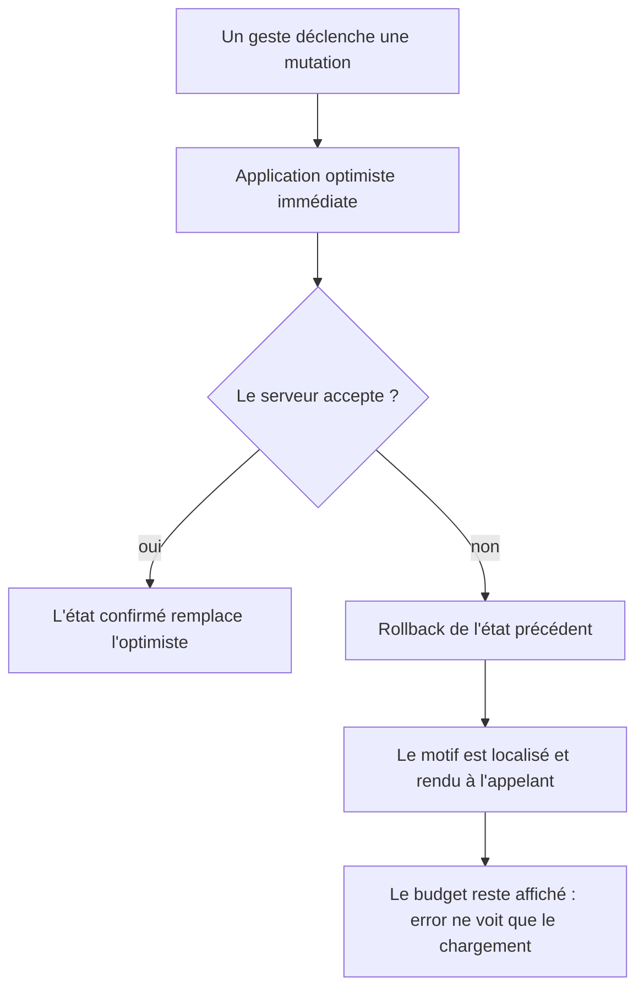

# Instruction: La carte d'erreur redevient celle du chargement

## Architecture projection

```txt
.
└── frontend/projects/webapp/src/app/feature/budget/budget-details/
    ├── store/
    │   ├── ✏️ budget-details-store.ts                       # error ← ressource seule ; chaque mutation rend son motif
    │   ├── ✏️ budget-details-state.ts                       # errorMessage retiré, plus aucun écrivain
    │   ├── ✏️ budget-details-store-integration.spec.ts      # les attentes sur error() après échec de mutation
    │   ├── ✏️ budget-details-store-spread.spec.ts           # idem, chemin lissage
    │   └── ✏️ budget-details-store-savings-withdrawal.spec.ts # idem, chemin pioche
    └── components/
        └── ✏️ budget-items-container.ts                     # le report lit la valeur de retour, plus store.error()
```

## User Journey



## Wireframe

```txt
APRÈS — une suppression refusée
┌────────────────────────────────────────────┐
│ (1) Barre de mois  ◀  Août 2026  ▶         │
├────────────────────────────────────────────┤
│ (2) Hero · Disponible à dépenser           │
├────────────────────────────────────────────┤
│ (3) Prévisions                             │
│     ├ Loyer                                │
│     ├ Courses                              │
│     └ Essence          ← revenue en place  │
└────────────────────────────────────────────┘
```

1. Barre de mois : inchangée.
2. Hero : le budget n'a jamais quitté l'écran.
3. Liste : la ligne annulée est remise par le rollback optimiste, à sa place.

## Tasks to do

### `1)` Réserver le signal de page au chargement

> Le budget est indisponible, ou il ne l'est pas. Un refus ponctuel n'est pas une indisponibilité.

1. Ne faire remonter à `error` que l'erreur de la ressource de détail.
2. Supprimer `#setError`, `#clearError` et le champ `errorMessage` de l'état : plus aucun écrivain ne subsiste.
3. Retirer les deux appels à `#clearError` devenus sans objet, au rechargement et après une mutation réussie.
4. Vérifier que la carte plein écran de la page ne se déclenche plus que sur un échec de chargement, sans toucher son gabarit.

### `2)` Faire rendre son motif à chaque mutation

> Quatorze mutations écrivaient dans le signal de page ; trois rendent déjà leur motif. Toutes suivent désormais le même contrat.

1. Remplacer les trois champs de motif existants par un seul, remis à `null` au début de chaque méthode publique et relu à la fin.
2. Commenter ce champ unique : seuls les trois pointages peuvent échouer en parallèle, sous le verrou par identifiant, et ils portent un message constant — deux échecs simultanés produisent la même chaîne, il n'y a rien à écraser. Tout le reste est mono-vol, piloté par un dialogue.
3. Faire écrire ce champ par chaque `onError`, à la place du signal de page, en conservant la localisation et le repli par clé qui existent déjà.
4. Ne jamais déduire le succès de `response !== undefined` : deux mutations sont typées `void` et résolvent `undefined` en cas de succès. Le succès, c'est un motif resté `null`.
5. Faire rendre `Promise<string | null>` aux dix mutations qui ne rapportent aucune donnée, `null` valant succès — les sept qui rendaient `void` et les trois qui rendaient un booléen.
6. Faire rendre aux quatre mutations qui rapportent une donnée — les trois lissages et la création de pioche — une valeur portant à la fois la donnée et le motif éventuel, via un type nommé déclaré une fois dans le store.

### `3)` Faire lire le report sur la valeur de retour

> Seul appelant en production à lire `store.error()`. Il doit changer dans le même pas, sinon son message précis retombe sur la clé générique.

1. Faire consommer au report le motif rendu par la mutation, et supprimer la lecture de `store.error()`.
2. Conserver son repli sur la clé générique quand aucun motif n'est rendu.

### `4)` Aligner les tests sur le nouveau contrat

1. Reprendre les assertions qui attendent un message sur `error()` après un échec de mutation, dans les trois fichiers de spec concernés.
2. Les réécrire sur le modèle déjà en place pour la pioche : le motif est rendu par l'appel, et `error()` reste nul.

## Test acceptance criteria

| Task | Acceptance criteria                                                                                                         |
| ---- | ----------------------------------------------------------------------------------------------------------------------------- |
| 1    | Aucune mutation en échec ne fait apparaître la carte « Impossible de charger ton budget ».                                   |
| 1    | Un échec de chargement du budget affiche toujours cette carte.                                                               |
| 2    | Chaque mutation en échec rend le motif localisé par le serveur, ou la clé générique de l'opération quand le motif est absent. |
| 2    | Une mutation qui réussit rend un motif nul, y compris les deux suppressions dont la réponse est vide.                        |
| 2    | Après une mutation en échec, le budget affiché est celui d'avant le geste.                                                   |
| 3    | Un report refusé affiche toujours le motif du serveur, pas la clé générique.                                                 |
| 4    | Les tests échouent si une mutation en échec repose une valeur sur `error()`.                                                 |
