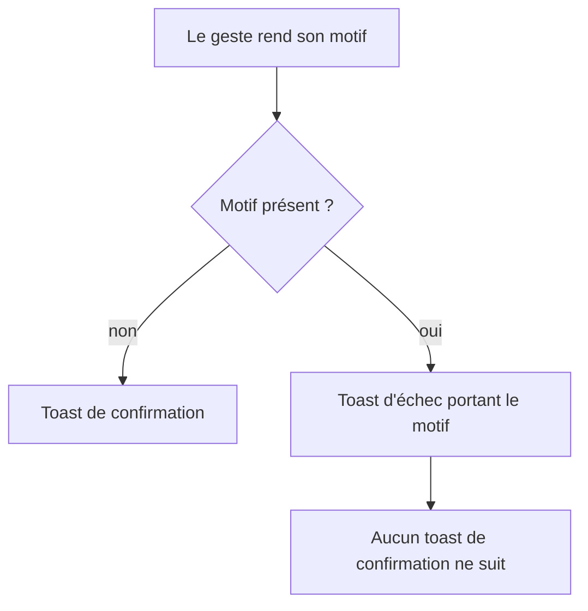

# Instruction: Chaque geste refusé se dit sur place

## Architecture projection

```txt
.
└── frontend/projects/webapp/src/app/feature/budget/budget-details/
    ├── ✏️ components/budget-items-container.ts   # les gestes cessent d'annoncer un succès qu'ils n'ont pas
    ├── ✏️ budget-details-page.ts                 # même règle pour le lissage et la pioche ouverts depuis la page
    └── ✏️ utils/budget-details-snackbar.utils.ts # les deux relances portent le motif du serveur, plus la clé générique
```

## User Journey



## Wireframe

```txt
┌────────────────────────────────────────────┐
│ (1) Contenu du budget, intact              │
│                                            │
├────────────────────────────────────────────┤
│ (2) ┌────────────────────────────────────┐ │
│     │ ⚠ <motif du serveur>       Fermer  │ │
│     └────────────────────────────────────┘ │
└────────────────────────────────────────────┘
```

1. Le budget reste à l'écran, acquis en phase 1.
2. Toast d'échec, au registre d'erreur, ancré au geste — jamais suivi d'un toast de confirmation.

## Tasks to do

### `1)` Cesser d'annoncer les succès qui n'ont pas eu lieu

> Six gestes ouvrent aujourd'hui un toast de confirmation sans regarder l'issue. La suppression d'une prévision, elle, n'ouvre rien.

1. Reprendre les appelants qui enchaînent une confirmation après la mutation : modification et suppression d'un réel, ajout d'un réel lié, réinitialisation depuis le mois type, pointage d'un réel, pointage en cascade des réels liés, suppression depuis la table.
2. Faire porter à chacun la même forme que la création de prévision déjà en place dans ce fichier : si un motif est rendu, ouvrir le toast d'échec partagé et s'arrêter là ; sinon, le toast de confirmation existant.
3. Supprimer le `try/catch` de la réinitialisation : la mutation ne rejette jamais, ce bloc est mort.
4. Laisser inchangé le pointage d'une prévision, seul appelant qui teste déjà l'issue avant de confirmer.

### `2)` Faire porter le motif aux deux relances

> Le lissage et la pioche affichent déjà un échec, mais toujours la même clé générique. Le refus d'horizon passe par ce chemin et mérite sa phrase.

1. Faire consommer aux deux fonctions de relance le motif rendu par la mutation depuis la phase 1.
2. Afficher ce motif quand il existe, en conservant la clé générique en repli et l'action « Réessayer » avec sa clé d'idempotence.
3. Faire annoncer son refus au lissage d'un élément existant, aujourd'hui muet quand la mutation échoue.

## Test acceptance criteria

| Task | Acceptance criteria                                                                                        |
| ---- | ------------------------------------------------------------------------------------------------------------ |
| 1    | Un geste refusé n'affiche jamais de toast de confirmation.                                                 |
| 1    | Un geste refusé affiche un toast portant le motif du serveur, au registre d'erreur.                        |
| 1    | Un geste accepté affiche toujours sa confirmation, avec la même formulation qu'avant.                      |
| 2    | Un lissage refusé pour cause d'horizon affiche le motif de l'objectif, pas la clé générique du lissage.    |
| 2    | La relance d'un lissage refusé rejoue le même groupe, sans créer de doublon.                               |
| 2    | Le lissage d'un élément existant annonce son refus au lieu de ne rien afficher.                            |
