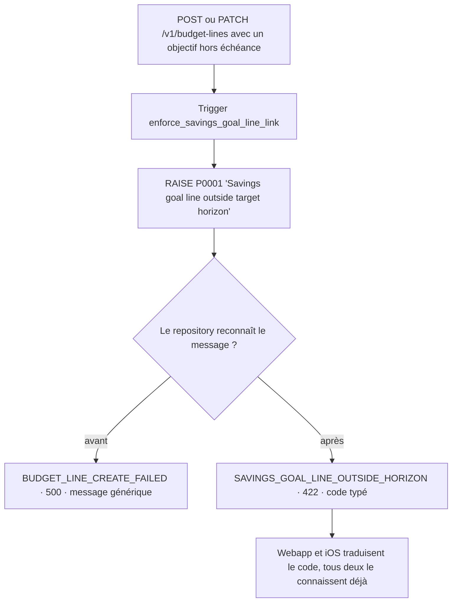

# Instruction: Le refus horizon devient un 422

## Architecture projection

```txt
.
└── backend-nest/src/
    ├── common/utils/
    │   └── ✏️ tag-links.util.ts                        # garde horizon sur le chemin RPC taggé
    └── modules/budget-line/infrastructure/persistence/
        ├── ✏️ supabase-budget-line.repository.ts       # garde horizon dans insert() et update()
        └── ✏️ supabase-budget-line.repository.spec.ts  # repro du bug sur les trois chemins
```

> Le contrat de modification se scinde selon `tagIds` : renseigné, il passe par la
> RPC atomique de `tag-links.util.ts`, et c'est ce chemin que prend réellement le
> dialogue d'édition du web. Trois sites, pas deux.

## User Journey



## Tasks to do

### `1)` Reproduire le bug par un test

> Deux tests rouges qui prouvent le 500 avant toute correction.

1. Dans le `describe` de `insert`, ajouter un test qui fait renvoyer au mock Supabase `{ code: 'P0001', message: 'Savings goal line outside target horizon' }`.
2. Attendre `code: 'ERR_SAVINGS_GOAL_LINE_OUTSIDE_HORIZON'` et `getStatus() === 422`.
3. Dupliquer pour `update`.
4. Calquer la forme sur le test existant « maps a spread past the goal deadline to a dedicated 422 » — même mock, mêmes assertions.
5. Lancer les tests et vérifier qu'ils échouent sur un 500.

### `2)` Mapper le refus dans les deux chemins

> Le garde manquant, copié depuis le chemin lissage qui l'a déjà.

1. Dans `insert()`, avant le `throw` générique `BUDGET_LINE_CREATE_FAILED`, ajouter le branchement `isSavingsGoalLinkOutsideHorizon(error)` qui lève `ERROR_DEFINITIONS.SAVINGS_GOAL_LINE_OUTSIDE_HORIZON`.
2. Faire de même dans `update()`, avant `BUDGET_LINE_UPDATE_FAILED`.
3. Conserver le `loggingContext` et le `{ cause }` déjà en place sur chaque chemin.
4. L'import de `isSavingsGoalLinkOutsideHorizon` existe déjà en tête de fichier — ne pas le dupliquer.
5. Relancer les tests : les deux passent, aucun autre ne casse.

## Test acceptance criteria

| Task | Acceptance criteria                                                                                                                     |
| ---- | ----------------------------------------------------------------------------------------------------------------------------------------- |
| 1    | Avant correction, les deux nouveaux tests échouent en signalant un 500 et le code `ERR_BUDGET_LINE_CREATE_FAILED` / `..._UPDATE_FAILED`. |
| 2    | Créer une prévision d'épargne rattachée à un objectif dont l'échéance précède le mois du budget renvoie 422 et le code `ERR_SAVINGS_GOAL_LINE_OUTSIDE_HORIZON`. |
| 2    | Modifier une prévision existante pour la rattacher à un tel objectif renvoie le même 422.                                               |
| 2    | Un objectif supprimé ou appartenant à un autre utilisateur renvoie toujours `ERR_SAVINGS_GOAL_NOT_FOUND` — le comportement existant est intact. |
| 2    | Le chemin lissage renvoie toujours son 422 — aucune régression sur la suite existante.                                                  |
