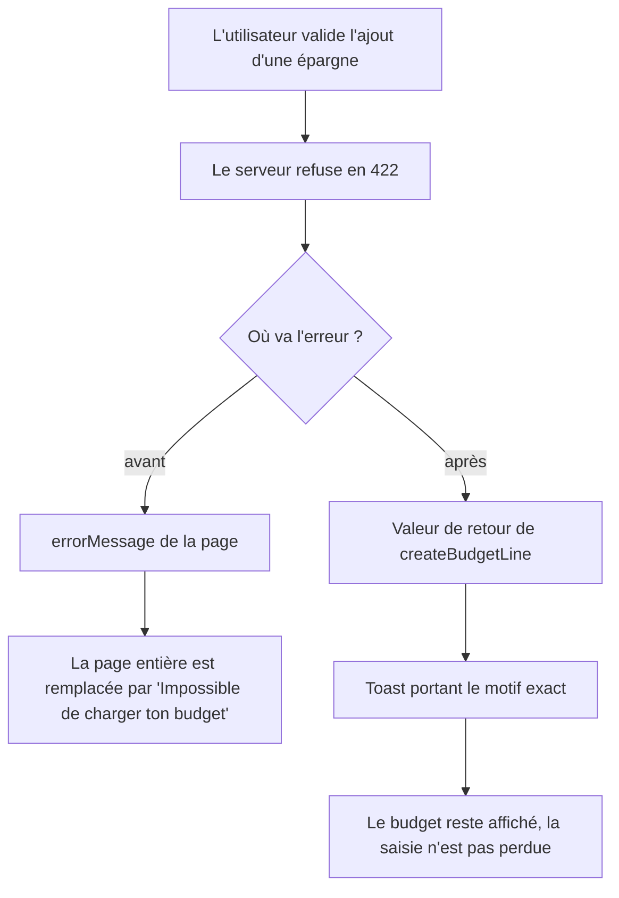

# Instruction: Le message atteint l'utilisateur

## Architecture projection

```txt
.
├── frontend/projects/webapp/
│   ├── src/app/feature/budget/budget-details/
│   │   ├── ✏️ store/budget-details-store.ts        # create et update rendent leur erreur au lieu de la poser sur la page
│   │   ├── ✏️ store/budget-details-store.spec.ts   # l'échec ne touche plus error()
│   │   └── ✏️ budget-details-page.ts               # affiche le message rendu en toast
│   └── public/i18n/
│       └── ✏️ fr.json                              # copy valable hors lissage
└── ios/Pulpe/Core/Network/
    └── ✏️ APIError.swift                           # même copy, même défaut
```

## User Journey



## Wireframe

```txt
┌──────────────────────────────────────────────────┐
│ (1) Budget · octobre 2027          [Ajouter]     │
├──────────────────────────────────────────────────┤
│ (2) Hero + prévisions (restent visibles)         │
│     ┌────────────────────────────────────────┐   │
│     │ Loyer                                  │   │
│     │ Épargne Maison                         │   │
│     └────────────────────────────────────────┘   │
│                                                  │
│              ┌─────────────────────────────┐     │
│              │ (3) Toast                    │     │
│              └─────────────────────────────┘     │
└──────────────────────────────────────────────────┘
```

1. En-tête, inchangé.
2. Contenu : aujourd'hui remplacé par la carte d'erreur dès qu'une mutation échoue. Doit rester en place.
3. Toast : porte le motif renvoyé par le serveur, transitoire, non destructif.

## Tasks to do

### `1)` Corriger une copy écrite pour le seul lissage

> « raccourcis le lissage » n'a aucun sens sur une ligne unique, or le même code d'erreur sert désormais les deux.

1. Dans `fr.json`, réécrire `apiError.savingsGoalLineOutsideHorizon` pour couvrir la ligne unique comme le lissage, et nommer les deux issues réelles : choisir un autre objectif, ou repousser l'échéance.
2. Reporter la même formulation dans `APIError.swift`, cas `.savingsGoalLineOutsideHorizon`.
3. Vérifier qu'aucune autre clé ne mentionne le lissage pour cette erreur.

### `2)` Sortir les échecs de mutation du signal d'erreur de la page

> Reprendre le motif déjà écrit et justifié pour la suppression, sans en inventer un autre.

1. Dans le store, faire porter l'erreur de la mutation de création par un champ dédié renseigné dans `onError`, sur le modèle de `#lastSavingsWithdrawalDeleteError`.
2. Localiser cette erreur via `#localizeError` avec `budget.forecastCreateError` en repli — c'est ce qui laisse passer le message du 422.
3. `createBudgetLine` retourne le message en cas d'échec, `null` en cas de succès. Ne plus appeler `#setError`.
4. Appliquer la même transformation à la mutation de modification, avec `budget.forecastUpdateError` en repli.
5. Conserver la restauration optimiste `#budgetDetailsResource.set(previous)` : elle est correcte et indépendante.

### `3)` Afficher le message côté page

> Le toast est déjà outillé sur cette page, il n'y a rien à créer.

1. Dans `budget-details-page.ts`, récupérer la valeur rendue par `createBudgetLine` et l'ouvrir dans le `MatSnackBar` déjà injecté quand elle n'est pas nulle.
2. Faire de même pour la modification.
3. Aligner durée et style sur les toasts d'erreur existants de la page.

### `4)` Couvrir le comportement par des tests

> Le point vérifiable est que la page ne bascule plus en erreur.

1. Ajouter un test store : une création qui échoue laisse `error()` nul et retourne le message localisé.
2. Ajouter le test symétrique pour la modification.
3. Ajouter un test : une erreur typée portant le code horizon ressort avec le message traduit, pas avec le repli générique.

## Test acceptance criteria

| Task | Acceptance criteria                                                                                                                          |
| ---- | ---------------------------------------------------------------------------------------------------------------------------------------------- |
| 1    | La formulation lue par l'utilisateur reste juste qu'il ait créé une ligne unique ou un lissage, et cite une action possible.                 |
| 1    | Web et iOS affichent une formulation identique pour le même code d'erreur.                                                                   |
| 2    | Un ajout de prévision refusé laisse le budget affiché : hero, prévisions et navigation restent en place.                                     |
| 2    | La carte « Impossible de charger ton budget » n'apparaît plus que lorsque le chargement du budget échoue réellement.                         |
| 3    | Le refus s'affiche en toast et cite l'échéance de l'objectif comme cause, pas « Erreur lors de l'ajout de la prévision ».                    |
| 4    | Les tests échouent si une mutation en échec repose une valeur sur `error()`.                                                                 |
