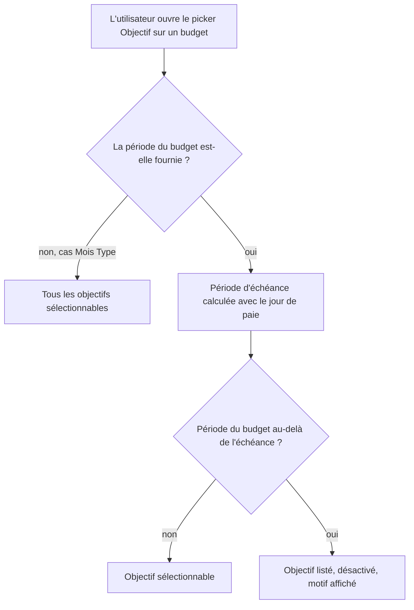

# Instruction: Le picker cesse de proposer l'impossible

## Architecture projection

```txt
.
└── frontend/projects/webapp/src/app/
    ├── pattern/savings-goal-picker/
    │   ├── ✏️ savings-goal-picker-field.ts       # période du budget en entrée facultative, options hors horizon désactivées
    │   └── ✏️ savings-goal-picker-field.spec.ts  # option désactivée, motif affiché, Mois Type intact
    └── feature/budget/budget-details/budget-line/
        ├── ✏️ create/dialog.ts                   # transmet la période, déjà disponible
        └── ✏️ edit/dialog.ts                     # transmet la période, à ajouter à son contrat de données
```

## User Journey



## Wireframe

```txt
┌──────────────────────────────────────────────────┐
│ (1) Objectif                              ▾      │
│  ┌────────────────────────────────────────────┐  │
│  │ (2) Aucun objectif                         │  │
│  │ (3) Voiture                                │  │
│  │ ─────────────────────────────────────────  │  │
│  │ (4) Maison                      [disabled] │  │
│  │     (5) Échéance dépassée · juin 2027      │  │
│  └────────────────────────────────────────────┘  │
└──────────────────────────────────────────────────┘
```

1. Champ de sélection, inchangé.
2. Option neutre existante, toujours en tête.
3. Objectif dans l'horizon : sélectionnable.
4. Objectif hors horizon : listé et visible, non sélectionnable.
5. Motif porté par l'option elle-même, pas par un message séparé.

## Tasks to do

### `1)` Rendre le picker conscient de la période

> Les données nécessaires sont déjà chargées ; il ne manque que la période du budget.

1. Ajouter au composant une entrée facultative portant l'année et le mois du budget. Absente, le comportement reste celui d'aujourd'hui.
2. Lire le jour de paie depuis le store de réglages utilisateur, comme le fait déjà le formulaire d'objectif.
3. Calculer la période d'échéance de chaque objectif avec l'utilitaire de période partagé — c'est la formule que le trigger SQL reproduit ; ne pas la réécrire.
4. Marquer hors horizon tout objectif dont l'échéance est strictement antérieure à la période du budget. Un objectif sans échéance n'est jamais hors horizon.

### `2)` Traduire l'état dans l'option

> L'objectif reste visible : une absence inexpliquée coûte plus cher qu'une option grisée.

1. Désactiver l'option hors horizon plutôt que la retirer de la liste.
2. Afficher sous son nom le motif et le mois d'échéance, formaté avec le formateur de date existant.
3. Ajouter les clés de traduction correspondantes dans `fr.json`.
4. Ne pas toucher la logique existante qui remet la sélection à nul lorsque l'objectif sélectionné n'est plus dans la liste.

### `3)` Alimenter le picker depuis les deux dialogues de prévision

> Un seul des deux dispose déjà de la période.

1. Dans le dialogue de création, transmettre l'année et le mois déjà présents dans ses données.
2. Dans le dialogue de modification, ajouter la période à son contrat de données et la fournir depuis l'appelant.
3. Laisser le dialogue de ligne de Mois Type sans période : la borne ne s'applique pas à cette table.

### `4)` Couvrir le comportement par des tests

1. Un objectif dont l'échéance précède la période du budget est listé et désactivé.
2. Un objectif sans échéance, et un objectif dont l'échéance est postérieure, restent sélectionnables.
3. Sans période fournie, aucun objectif n'est désactivé.
4. La bascule d'horizon suit le jour de paie : un même objectif change d'état selon le jour de paie configuré.

## Test acceptance criteria

| Task | Acceptance criteria                                                                                                             |
| ---- | --------------------------------------------------------------------------------------------------------------------------------- |
| 1    | L'état hors horizon se calcule sans appel réseau supplémentaire : la liste d'objectifs déjà chargée suffit.                     |
| 1    | Le composant se comporte comme avant quand aucune période n'est fournie.                                                        |
| 2    | Un objectif hors horizon reste lisible dans la liste et ne peut pas être sélectionné.                                           |
| 2    | Le motif affiché nomme l'échéance, de sorte que l'utilisateur comprenne sans quitter le dialogue.                               |
| 3    | Créer ou modifier une prévision d'épargne sur un mois postérieur à l'échéance ne permet plus d'atteindre le refus serveur.       |
| 3    | Le picker du Mois Type propose toujours tous les objectifs.                                                                     |
| 4    | Les tests échouent si le calcul d'horizon ignore le jour de paie.                                                               |
