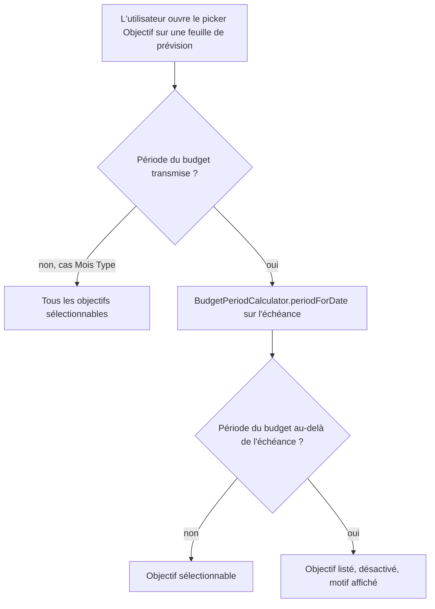

# Instruction: Le picker iOS atteint la même parité

## Architecture projection

```txt
.
└── ios/Pulpe/
    ├── Shared/Components/
    │   ├── ✏️ SavingsGoalPickerField.swift   # période du budget facultative, objectifs hors horizon désactivés
    │   └── ✏️ EditBudgetLineSheet.swift      # transmet la période, à ajouter à son contrat
    ├── Features/Budgets/BudgetDetails/
    │   └── ✏️ AddBudgetLineSheet.swift       # transmet anchorMonth / anchorYear, déjà présents
    └── PulpeTests/
        └── ✅ SavingsGoalPickerHorizonTests.swift  # bascule d'horizon et respect du jour de paie
```

## User Journey



## Wireframe

```txt
┌──────────────────────────────────────────────────┐
│ (1) Objectif                                     │
│  ┌────────────────────────────────────────────┐  │
│  │ Aucun objectif                          ⌄  │  │
│  └────────────────────────────────────────────┘  │
│        ┌──────────────────────────────────┐      │
│        │ (2) Aucun objectif               │      │
│        │ ────────────────────────────────  │      │
│        │ (3) Voiture                      │      │
│        │ (4) Maison            [disabled] │      │
│        │     (5) Échéance dépassée · juin │      │
│        └──────────────────────────────────┘      │
└──────────────────────────────────────────────────┘
```

1. Champ, inchangé.
2. Entrée neutre existante, toujours en tête.
3. Objectif dans l'horizon : sélectionnable.
4. Objectif hors horizon : présent dans le menu, non sélectionnable.
5. Motif porté par l'entrée elle-même.

## Tasks to do

### `1)` Rendre le picker iOS conscient de la période

> Le port Swift du calcul de période existe déjà ; ne rien recalculer à la main.

1. Ajouter au composant une propriété facultative portant le mois et l'année du budget, `nil` par défaut pour préserver l'appel du Mois Type.
2. Lire le jour de paie depuis `UserSettingsStore`, comme le font déjà les autres écrans d'objectifs.
3. Déterminer la période d'échéance de chaque objectif avec `BudgetPeriodCalculator.periodForDate`, et comparer avec `comparePeriods`.
4. Considérer hors horizon tout objectif dont l'échéance précède strictement la période du budget. Un objectif sans échéance ne l'est jamais.
5. Extraire ce verdict en une fonction statique pure, testable sans vue.

### `2)` Traduire l'état dans le menu

> Même règle que le web : l'objectif reste visible, désactivé, motivé.

1. Désactiver l'entrée hors horizon au lieu de la retirer du menu.
2. Afficher le motif et le mois d'échéance sous le nom, avec les formateurs de date existants.
3. Conserver la réconciliation existante qui remet la sélection à nil quand l'objectif a disparu.
4. Utiliser les jetons de design existants ; aucune valeur visuelle en dur.

### `3)` Alimenter le picker depuis les deux feuilles de prévision

1. Dans `AddBudgetLineSheet`, transmettre `anchorMonth` et `anchorYear`, déjà disponibles.
2. Dans `EditBudgetLineSheet`, ajouter la période à l'initialiseur et la fournir depuis ses appelants.
3. Laisser `EditTemplateLineSheet` sans période : la borne ne concerne pas cette table.

### `4)` Couvrir la règle par des tests

1. Un objectif dont l'échéance précède la période du budget est hors horizon.
2. Un objectif sans échéance, et un objectif dont l'échéance est postérieure ou égale, ne le sont pas.
3. Sans période fournie, aucun objectif n'est hors horizon.
4. Le verdict suit le jour de paie : un jour de paie au-delà du 15 décale la période d'échéance d'un mois.

## Test acceptance criteria

| Task | Acceptance criteria                                                                                                     |
| ---- | ------------------------------------------------------------------------------------------------------------------------- |
| 1    | Le verdict d'horizon se calcule depuis les objectifs déjà chargés, sans appel réseau supplémentaire.                     |
| 1    | Le composant se comporte comme avant lorsqu'aucune période n'est transmise.                                             |
| 2    | Un objectif hors horizon reste lisible dans le menu et ne peut pas être choisi.                                          |
| 2    | Le motif nomme l'échéance, de sorte que l'utilisateur comprenne sans quitter la feuille.                                 |
| 3    | Ajouter ou modifier une épargne sur un mois postérieur à l'échéance ne permet plus d'atteindre le refus serveur sur iOS. |
| 3    | Le picker du Mois Type propose toujours tous les objectifs.                                                             |
| 4    | Les tests échouent si le verdict ignore le jour de paie.                                                                |
