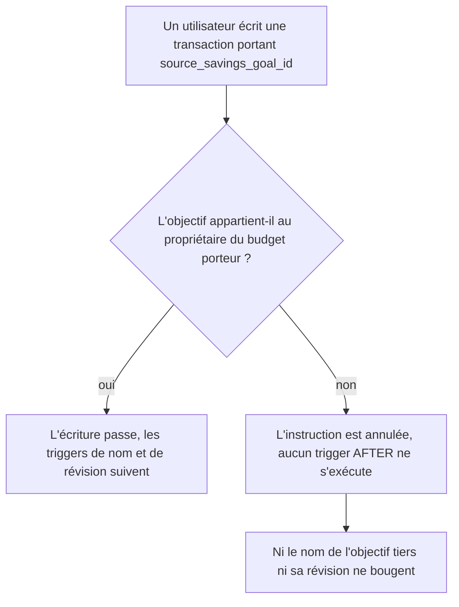

# Instruction: refuser un objectif d'épargne qui n'appartient pas au porteur du revenu

## Architecture projection

> Tree of the final files. ✅ create · ✏️ modify · ❌ delete

```txt
.
└── backend-nest/
    └── supabase/
        ├── migrations/
        │   └── 20260802120000_add_savings_goal_withdrawals.sql   ✏️ garde de tenancy + retrait de deux instructions mortes
        └── tests/
            └── savings_goal_withdrawal_atomicity.sql             ✏️ assertions cross-tenant
```

## User Journey



## Tasks to do

### `1)` Poser le garde de tenancy sur le lien objectif → revenu

> Le lien ne doit exister qu'entre deux lignes du même propriétaire, quel que soit le chemin d'écriture.

1. Ajouter une fonction trigger `SECURITY DEFINER` à `search_path` vide qui, lorsque `source_savings_goal_id` est renseigné, lit le `user_id` du `monthly_budget` porteur et exige un `savings_goal` de même propriétaire ; sinon lever `P0001`.
2. Sortir immédiatement quand `source_savings_goal_id` est nul, pour que la mise à nul déclenchée par `ON DELETE SET NULL` reste gratuite.
3. Brancher le trigger en `BEFORE INSERT OR UPDATE OF source_savings_goal_id, budget_id ON public.transaction`, de sorte qu'il précède les triggers de synchronisation de nom et d'avancement de révision.
4. Le placer dans la migration avant ces deux triggers, et lui appliquer le même `OWNER` et le même `REVOKE` que la fonction sœur `enforce_savings_goal_line_link`.
5. Ne pas y rejouer le contrôle « revenu libre uniquement » : les contraintes de forme déjà posées dans cette migration le portent, et le trigger reste mono-responsabilité.

### `2)` Retirer les deux instructions mortes du RPC de suppression

> Ce que le moteur fait déjà n'a pas à être réécrit dans la procédure.

1. Supprimer le `PERFORM 1 … FOR UPDATE` sur la transaction : son `FOUND` n'est jamais lu et le `DELETE` qui suit prend le même verrou au même moment.
2. Supprimer le `DELETE FROM transaction_tag` explicite, couvert par `ON DELETE CASCADE` sur `transaction_tag_transaction_id_fkey`.
3. Vérifier que le RPC de suppression verrouille désormais la transaction avant ses tags, comme le RPC d'édition.

### `3)` Prouver la fermeture sur base migrée

> Une assertion qui échouerait aujourd'hui est la seule preuve qui vaille.

1. Étendre le harnais SQL existant avec un second utilisateur porteur de son propre objectif.
2. Asserter qu'une insertion de transaction liée à l'objectif de l'autre utilisateur est rejetée.
3. Asserter qu'un `UPDATE` d'une transaction propre vers l'objectif de l'autre utilisateur est rejeté.
4. Asserter que le lien vers son propre objectif reste accepté, pour que le garde ne soit pas un refus global.
5. Garder le tout dans le `BEGIN … ROLLBACK` du fichier, sans aucune commande destructive.

## Test acceptance criteria

| Task | Acceptance criteria |
| ---- | ------------------- |
| 1, 3 | Un utilisateur ne peut ni créer ni modifier une transaction portant l'objectif d'épargne d'un autre utilisateur. |
| 1, 3 | Le lien vers son propre objectif d'épargne reste accepté sur les deux chemins d'écriture. |
| 1 | Après une tentative de lien cross-tenant, le nom et la révision de l'objectif visé sont inchangés. |
| 1 | La mise à nul du lien lors de la suppression d'un objectif continue de passer. |
| 2 | Supprimer un retrait supprime aussi ses liens de tags. |
| 3 | Le harnais SQL passe intégralement sur une base locale migrée et ne laisse aucun état derrière lui. |
