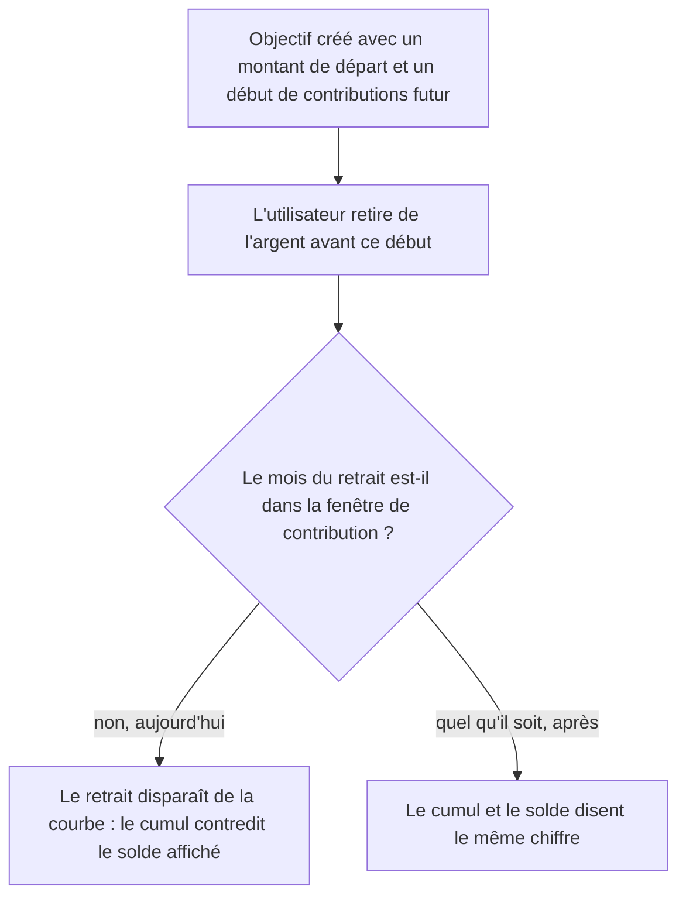

# Instruction: faire compter le retrait dans tous les mois du plan

## Architecture projection

> Tree of the final files. ✅ create · ✏️ modify · ❌ delete

```txt
.
├── shared/src/calculators/
│   ├── savings-goal-plan.ts                        ✏️ retrait décompté sans condition aux trois sites
│   └── savings-goal-plan.spec.ts                   ✏️ mois hors fenêtre de contribution
└── ios/
    ├── Pulpe/Domain/Formulas/SavingsPlanCalculator.swift        ✏️ miroir des trois sites
    └── PulpeTests/Domain/Formulas/SavingsPlanCalculatorTests.swift  ✏️ miroir des tests
```

## User Journey



## Tasks to do

### `1)` Décompter le retrait quel que soit le mois

> Un mouvement de stock ne se juge pas à une fenêtre de contribution.

1. Dans la construction de la timeline, sortir la soustraction du retrait du bloc conditionné par l'intervalle historique : le cumul confirmé la subit dans tous les mois, le cumul prévu reste inchangé.
2. Dans la simulation, sortir la soustraction du retrait du garde d'éligibilité : seule la contribution du mois reste conditionnée.
3. Dans la redistribution de l'effort restant, retirer le filtre d'éligibilité sur la somme des retraits.
4. Laisser `confirmedAmount` intact : la ligne « contributions du mois » reste une somme d'entrées, jamais une contribution négative.
5. Corriger le commentaire de la timeline qui promettait déjà ce comportement.

### `2)` Refléter les trois décisions côté iOS

> Les deux implémentations sont miroir par construction ; une divergence ici se paierait en écart de chiffre entre les deux clients.

1. Appliquer les trois mêmes retraits de garde dans le calculateur Swift.
2. Vérifier qu'aucune des deux implémentations ne conserve un filtre d'éligibilité sur un retrait.

### `3)` Pinner le comportement des deux côtés

> Le test doit échouer si l'un des trois gardes revient.

1. Ajouter un cas avec un objectif dont les contributions démarrent après le mois du retrait, et asserter que le cumul confirmé final égale le confirmé rendu par le calcul de progression.
2. Ajouter un cas où le retrait tombe après l'échéance, et asserter que la timeline et la simulation en tirent le même final.
3. Asserter que redistribuer puis simuler retombe exactement sur la cible malgré un retrait hors fenêtre.
4. Miroir des trois cas dans la suite Swift.

## Test acceptance criteria

| Task | Acceptance criteria |
| ---- | ------------------- |
| 1, 3 | Un retrait antérieur au début des contributions creuse le cumul confirmé autant qu'il creuse le solde. |
| 1, 3 | Un retrait postérieur à l'échéance produit le même final dans la timeline et dans la simulation. |
| 1, 3 | Redistribuer l'effort restant puis simuler retombe exactement sur la cible, retrait hors fenêtre compris. |
| 1 | La contribution mensuelle confirmée d'un mois portant un retrait reste inchangée. |
| 2, 3 | Les suites TypeScript et Swift donnent les mêmes chiffres sur les mêmes scénarios. |
