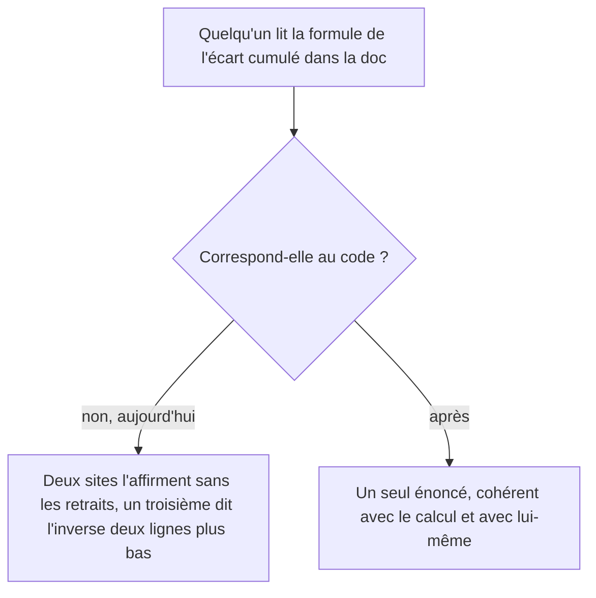

# Instruction: réaligner la documentation sur les formules réellement calculées

## Architecture projection

> Tree of the final files. ✅ create · ✏️ modify · ❌ delete

```txt
.
├── docs/
│   └── SAVINGS.md                                              ✏️ formule de l'écart cumulé, deux sites
└── aidd_docs/tasks/2026_08/2026_08_02_savings-goal-withdrawals/
    └── phase-2.md                                              ✏️ contrat d'exécution des RPC
```

## User Journey



## Tasks to do

### `1)` Corriger la formule de l'écart cumulé aux deux sites

> La doc affirme aujourd'hui le contraire de ce qu'elle dit deux lignes plus bas.

1. Dans le tableau des cas limites, réécrire la formule de l'écart cumulé pour retrancher les retraits déjà survenus, et vérifier qu'elle ne contredit plus la ligne « Retrait (stock vs flux) » qui la suit.
2. Dans le contrat de lecture de l'endpoint de progression, appliquer la même correction — c'est le site canonique.
3. Vérifier qu'aucun autre endroit du document ne porte encore l'ancienne formule.

### `2)` Décrire le contrat d'exécution réel des RPC

> Une tâche inapplicable telle qu'écrite fera échouer toute revue fonctionnelle ultérieure.

1. Réécrire la tâche du plan parent qui demande de retirer l'exécution au rôle `authenticated` : le backend appelle les RPC avec le jeton de l'utilisateur, et toutes les RPC d'objectif déjà livrées accordent de la même façon.
2. Y énoncer ce que la base garantit réellement — propriété, révision, forme — et ce qui reste porté par le backend, à savoir le plafond « ne jamais retirer plus que le solde confirmé ».
3. Ne toucher ni aux `GRANT` de la migration ni au client Supabase : basculer ces RPC sur le rôle service serait une décision produit, hors périmètre de cette correction.

## Test acceptance criteria

| Task | Acceptance criteria |
| ---- | ------------------- |
| 1 | La formule de l'écart cumulé documentée donne le même résultat que le calcul, retraits déjà survenus compris. |
| 1 | Le tableau des cas limites ne se contredit plus d'une ligne à l'autre. |
| 2 | La tâche du plan parent décrit un contrat qui tient face à la migration livrée. |
| 2 | Aucun `GRANT` ni aucun appelant Supabase n'est modifié par cette phase. |
