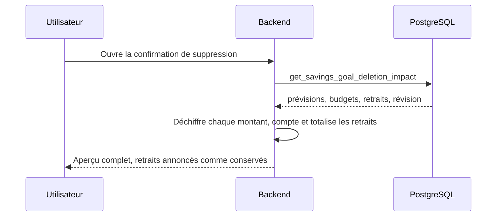

# Instruction: réparer l'aperçu de suppression et son contrat

## Architecture projection

> Tree of the final files. ✅ create · ✏️ modify · ❌ delete

```txt
shared/
└── schemas.ts                                                          ✏️ montant du retrait tolérant au déchiffrement dégradé
backend-nest/src/modules/savings-goal/
├── infrastructure/persistence/
│   ├── schemas/
│   │   ├── rpc-payload.schemas.ts                                      ✏️ déclarer la clé `withdrawals` que la RPC émet déjà
│   │   └── rpc-payload.schemas.spec.ts                                 ✏️ fixture porteuse d'un retrait
│   ├── supabase-savings-goal.repository.ts                             ✏️ déchiffrer les retraits et alimenter le résumé
│   └── supabase-savings-goal.repository.spec.ts                        ✏️ totaux calculés au lieu des valeurs par défaut
└── savings-goal.integration.spec.ts                                    ✏️ valider la vraie réponse RPC au lieu de la caster
```

## User Journey



## Tasks to do

### `1)` Accepter la clé que la base émet déjà

> Le contrat de frontière doit décrire la réponse réelle, pas celle d'avant la migration.

1. Déclarer `withdrawals` sur `savingsGoalDeletionImpactRpcSchema`, en miroir exact des cinq clés émises par la RPC : `transactionId`, `budgetId`, `name`, `transactionDate`, `amount`.
2. Typer les champs comme leurs frères de ce fichier : identifiants en `z.uuid()`, date en `z.iso.datetime({ offset: true })`, montant en `z.string().nullable()` car il arrive encore chiffré.
3. Fermer l'objet interne par `.strict()`, comme chaque autre entrée du payload.
4. Ne pas toucher `revision` : les retraits en sont exclus par construction, ils survivent à tous les modes de suppression.

### `2)` Déchiffrer les retraits et dire la vérité dans le résumé

> Accepter la clé sans la lire rendrait un aperçu qui annonce zéro retrait à un objectif qui en porte.

1. Mapper les retraits dans `toDeletionImpact` avec la clé de chiffrement déjà obtenue pour les autres montants, sans second appel.
2. Déchiffrer chaque montant par la même méthode que les prévisions et les transactions, avec le repli maison à zéro.
3. Alimenter `withdrawalCount` et `withdrawalTotal` du résumé à partir des retraits déchiffrés, comme les autres compteurs.
4. Assouplir le montant du retrait dans le contrat partagé pour qu'un ciphertext illisible dégrade la ligne au lieu de faire échouer l'aperçu entier, et documenter cette tolérance à côté du champ.
5. Ne rien ajouter au mapper de sortie : le type de domaine est un alias du contrat partagé, il n'a rien à élargir.

### `3)` Rendre la dérive producteur/consommateur détectable par la CI

> La régression a passé la revue parce qu'aucun test ne confronte la fonction SQL à son schéma TypeScript.

1. Remplacer le cast d'échappement du spec d'intégration par une validation avec le schéma de frontière réel, pour que la vraie réponse de la base rencontre son vrai consommateur.
2. Supprimer l'interface locale à deux champs devenue inutile, et laisser le type inféré porter la suite du test.
3. Ajouter un retrait aux payloads fabriqués à la main des deux specs unitaires, et remplacer l'attente des valeurs par défaut par les totaux réellement calculés.

## Test acceptance criteria

| Task | Acceptance criteria |
| ---- | ------------------- |
| 1 | `GET /savings-goals/:id/deletion-impact` répond 200 sur un objectif sans aucun retrait, là où il répondait 500 sur chaque appel. |
| 2 | Un objectif portant deux retraits les restitue tous les deux, montants déchiffrés, avec un compte et un total non nuls dans le résumé. |
| 2 | Un retrait dont le montant est illisible laisse l'aperçu répondre : il n'annule ni les autres retraits ni le reste du payload. |
| 3 | Retirer la clé `withdrawals` du schéma de frontière fait échouer le spec d'intégration, qui interroge la vraie base. |
| 3 | Les deux specs unitaires échouent si le dépôt cesse d'alimenter les retraits ou leur résumé. |
