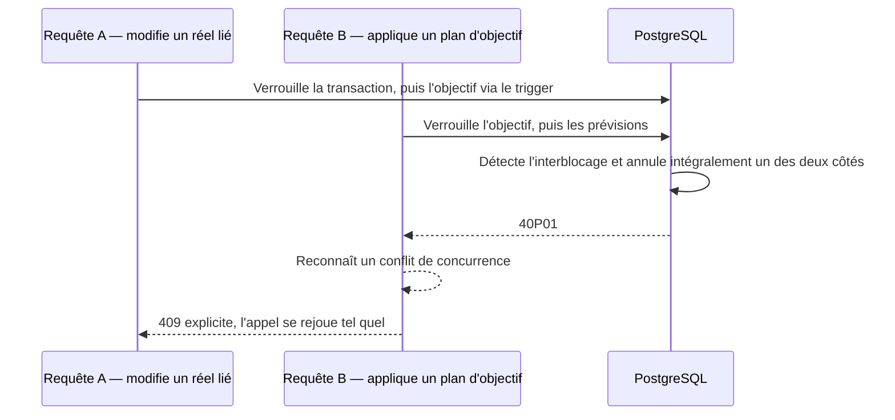

# Instruction: traduire le conflit de verrous en 409 rejouable

## Architecture projection

> Tree of the final files. ✅ create · ✏️ modify · ❌ delete

```txt
backend-nest/src/
├── common/utils/
│   ├── postgres-conflict.ts                                            ✅ prédicat partagé de conflit de verrous
│   ├── postgres-conflict.spec.ts                                       ✅ couverture du prédicat
│   ├── tag-links.util.ts                                               ✏️ écriture taguée concurrente reconnue comme conflit
│   └── tag-links.util.spec.ts                                          ✏️ preuve du 409 sur l'écriture taguée
└── modules/savings-goal/infrastructure/persistence/
    ├── supabase-savings-goal.repository.ts                             ✏️ les quatre chemins RPC de l'objectif reconnaissent le conflit
    └── supabase-savings-goal.repository.spec.ts                        ✏️ preuve du 409 sur chacun des chemins
```

## User Journey



## Tasks to do

### `1)` Nommer la condition une seule fois

> Le projet n'a aucun mapping central des codes PostgreSQL ; il partage ses gardes par prédicat, à côté de celui du lien d'objectif.

1. Ajouter au module de gardes partagé un prédicat qui reconnaît l'arbitrage d'interblocage et l'échec de sérialisation, les deux formes d'annulation que le moteur inflige à une transaction victime.
2. Le faire porter sur le code d'erreur remonté, jamais sur un fragment de message : ces conditions viennent du moteur, pas d'un `RAISE` que le projet aurait écrit.
3. Tolérer une erreur de forme inattendue sans lever, comme le prédicat voisin.
4. Couvrir le prédicat par des cas positifs et négatifs, dont un conflit de révision applicatif qui ne doit surtout pas être confondu avec un conflit de verrous.

### `2)` Le faire reconnaître par tous les chemins exposés

> L'inversion existe entre quatre RPC d'objectif déjà livrées et toute écriture ordinaire de prévision ou de transaction : la victime peut être n'importe lequel des deux côtés.

1. Interroger le prédicat en tête de chaque assistant d'erreur RPC de l'objectif — suppression, réconciliation d'échéance, application de plan, arrêt de génération — avant les comparaisons de message existantes.
2. Faire de même dans l'assistant d'erreur des écritures taguées, qui couvre la mise à jour d'une transaction et d'une prévision.
3. Renvoyer le conflit de concurrence déjà défini, en nommant la ressource concernée, plutôt que de laisser l'erreur tomber dans le générique.
4. Conserver la chaîne de cause d'origine et le contexte de journalisation de chaque assistant.
5. Ne pas introduire de rejeu côté serveur : le projet confie le rejeu au client, un verrou arbitré est un échec propre à réémettre tel quel.

### `3)` Prouver la traduction

> Un interblocage réel est trop coûteux à provoquer dans un test unitaire ; c'est la traduction qui doit être prouvée, pas le moteur.

1. Simuler une erreur portant le code d'arbitrage sur chacun des chemins repris, et vérifier qu'il en sort un conflit et non une panne générique.
2. Vérifier qu'une erreur voisine sans ce code continue de produire l'erreur métier qu'elle produisait avant.

## Test acceptance criteria

| Task | Acceptance criteria |
| ---- | ------------------- |
| 1 | Le prédicat distingue un arbitrage de verrous d'un conflit de révision applicatif, et ne lève sur aucune forme d'entrée. |
| 2 | Les quatre chemins RPC de l'objectif et le chemin d'écriture taguée sortent en 409 quand la base annule leur transaction, au lieu du 500 générique d'aujourd'hui. |
| 2 | La réponse porte un code que le client peut reconnaître pour rejouer, et le corps ne divulgue rien du détail moteur. |
| 3 | Les erreurs déjà traduites gardent exactement leur code et leur statut d'avant. |
