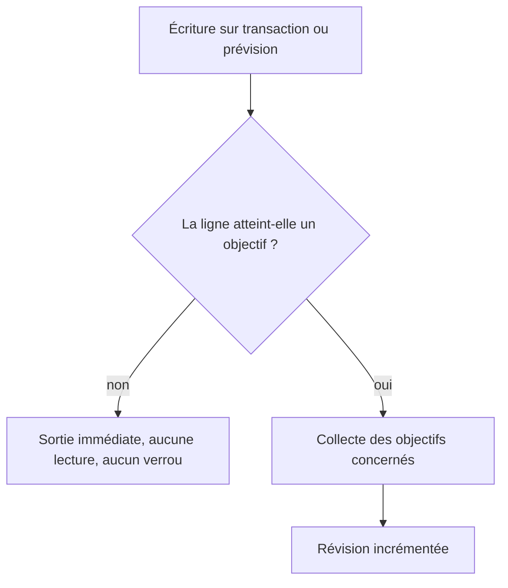

# Instruction: alléger les triggers de révision et pinner le contrat SQL

## Architecture projection

> Tree of the final files. ✅ create · ✏️ modify · ❌ delete

```txt
backend-nest/supabase/
├── migrations/
│   └── 20260802120000_add_savings_goal_withdrawals.sql                 ✏️ sortie anticipée des deux fonctions de révision
└── tests/
    ├── savings_goal_withdrawal_atomicity.sql                           ✏️ contrat de clés de l'aperçu et non-régression du garde
    └── README.md                                                       ✏️ couverture du harnais mise à jour
```

## User Journey



## Tasks to do

### `1)` Ne rien faire quand il n'y a rien à invalider

> Les deux triggers sont attachés aux tables les plus écrites de l'application ; la quasi-totalité des lignes n'atteint aucun objectif.

1. Sortir en tête de la fonction de révision issue des transactions quand ni la source d'objectif ni la prévision d'imputation ne sont renseignées, ni avant ni après l'écriture.
2. Écrire ce test comme une seule expression booléenne : dans un trigger ligne à ligne, l'enregistrement absent se lit NULL, donc la même condition couvre insertion, modification et suppression.
3. Lire les deux enregistrements et non le seul entrant, pour qu'une ligne qui quitte un objectif continue de l'invalider.
4. Poser le même garde sur la fonction de révision issue des prévisions, dont la lecture est moins chère mais la fréquence identique.
5. Conserver les gardes d'opération existants et le contrat de retour de chaque branche.
6. Ne pas déplacer la condition dans une clause de déclenchement : elle est refusée à la création dès que le trigger couvre l'insertion.

### `2)` Épingler le contrat de l'aperçu au niveau SQL

> Le harnais SQL est le seul endroit où la fonction de suppression est observée telle qu'elle est réellement déployée.

1. Ajouter une assertion qui compare l'ensemble des clés de premier niveau retournées par la fonction d'impact à la liste attendue, retrait compris.
2. Ajouter une assertion prouvant qu'une transaction ordinaire, sans objectif ni prévision, laisse la révision inchangée — la contrepartie du garde de la tâche 1.
3. Les placer en fin de bloc, avant l'annonce finale, pour ne renuméroter aucune assertion existante.
4. Respecter la forme du fichier : bannière numérotée, comparaison stricte, exception explicite en cas d'écart, notice de passage.
5. Refléter les deux nouvelles assertions dans la description de couverture du harnais.

### `3)` Rejouer sans commande destructive

> La base locale est partagée entre plusieurs arbres de travail ; la réinitialiser détruirait le travail des voisins.

1. Réappliquer les seules définitions de fonctions modifiées sur la base locale, qui les remplace en place sans toucher aux données.
2. Rejouer le harnais SQL en entier et vérifier qu'il annonce toujours son passage complet.
3. Vérifier si la régénération des types de base produit un écart : seuls des corps de fonction changent, aucune signature.

## Test acceptance criteria

| Task | Acceptance criteria |
| ---- | ------------------- |
| 1 | Une transaction ordinaire ne déclenche plus aucune lecture de prévision ni aucune écriture sur les objectifs. |
| 1 | Créer, modifier ou supprimer un retrait, et confirmer une contribution allouée, font toujours avancer la révision. |
| 1 | Une ligne qui quitte un objectif invalide encore l'objectif qu'elle quitte. |
| 2 | Retirer la clé des retraits de la fonction d'impact fait échouer le harnais SQL. |
| 2 | Le harnais échoue si une écriture sans lien fait bouger la révision. |
| 3 | Le harnais annonce son passage complet après réapplication, sans qu'aucune commande destructive ait été employée. |
