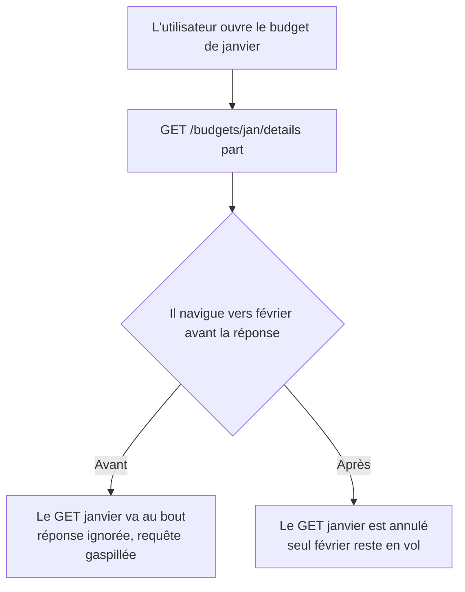

# Instruction: Annuler les chargements de détail abandonnés

## Architecture projection

> Tree of the final files. ✅ create · ✏️ modify · ❌ delete

```txt
frontend/projects/webapp/src/app/feature/budget/budget-details/store/
├── ✏️ budget-details-store.ts                    # loader de #budgetDetailsResource rendu en Observable
└── ✏️ budget-details-store-integration.spec.ts   # + 1 test d'annulation au changement de budget
```

## User Journey



## Tasks to do

### `1)` Rendre l'Observable au lieu de l'await

> `cachedResource` accepte `Observable<T> | Promise<T>` ; la forme Observable est la seule à honorer `abortSignal`.

1. Dans `#budgetDetailsResource`, remplacer le `loader: async ({ params }) => { await firstValueFrom(...) }` par le retour direct de `this.#budgetApi.getBudgetWithDetails$(params.budgetId).pipe(map(...))`.
2. Déplacer tel quel le garde `if (!response.success || !response.data)` — `logger.error` puis `throw` — à l'intérieur du `map` : une erreur levée dans un `map` devient une erreur d'Observable, que le loader traite comme un échec, exactement comme le `throw` actuel.
3. Ne toucher ni aux imports (`map` et `firstValueFrom` sont déjà importés ligne 50, `firstValueFrom` reste utilisé par le prefetch ligne 1459) ni aux trois autres resources, qui rendent déjà leur Observable.

### `2)` Couvrir l'annulation

> Le seul comportement qui change mérite le seul test ajouté.

1. Dans `budget-details-store-integration.spec.ts`, stubber `getBudgetWithDetails$` avec un `Subject` par budget au lieu d'un `of(...)`, pour garder la première réponse en vol.
2. Charger un premier budget, changer `budgetId` avant d'émettre, puis vérifier que la souscription au premier `Subject` est fermée.
3. Ne pas retoucher les stubs `of(...)` existants : ils restent valides, la forme Observable les consomme à l'identique.

## Test acceptance criteria

| Task | Acceptance criteria                                                                                                                      |
| ---- | ---------------------------------------------------------------------------------------------------------------------------------------- |
| 1    | Un chargement réussi produit le même view-model qu'avant : la suite d'intégration existante passe sans qu'aucun de ses stubs soit modifié |
| 1    | Une réponse `success: false` laisse la resource en erreur et journalise une seule fois, comme avant                                       |
| 2    | Changer de budget pendant un chargement en vol ferme la souscription au premier GET au lieu de l'attendre                                 |
