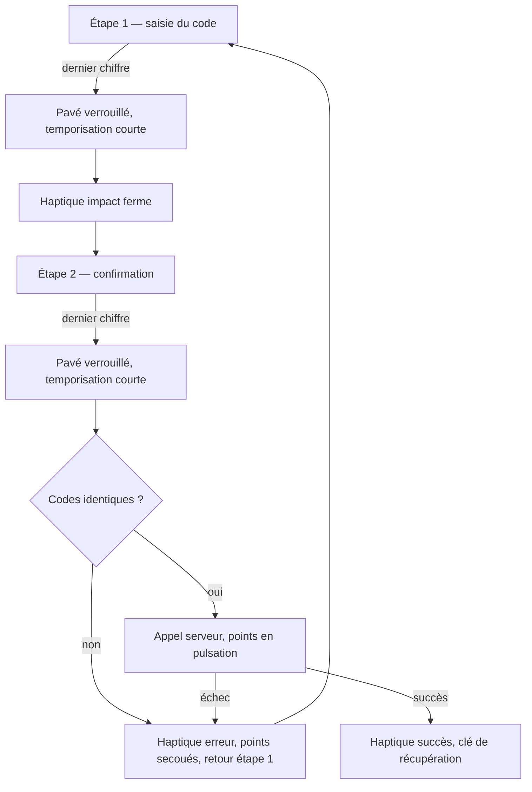

# Instruction: Auto-validation et haptique

## Architecture projection

```txt
.
└── ios/
    ├── Pulpe/
    │   ├── Shared/Design/
    │   │   └── DesignTokens.swift                    ✏️ jeton de temporisation de fin de saisie
    │   └── Features/Auth/Pin/
    │       ├── Components/
    │       │   └── NumpadView.swift                  ✏️ retrait du paramètre et de la touche de validation
    │       ├── PinSetupView.swift                    ✏️ auto-validation + haptique de passage d'étape
    │       ├── ChangePinView.swift                   ✏️ auto-validation
    │       ├── PinRecoveryView.swift                 ✏️ auto-validation + haptique de passage d'étape
    │       └── PinEntryView.swift                    (inchangé — auto-valide déjà)
    └── PulpeTests/Features/Auth/
        ├── PinSetupViewModelTests.swift              ✏️
        ├── ChangePinViewModelTests.swift             ✏️
        └── PinRecoveryViewModelTests.swift           ✏️
```

## User Journey



## Wireframe

```txt
┌───────────────────────────────┐
│                               │
│       ┌─────────────────┐     │
│       │  titre étape    │ (1) │
│       │  sous-titre     │     │
│       └─────────────────┘     │
│                               │
│         ●   ●   ●   ○     (2) │
│                               │
│       ┌───┐ ┌───┐ ┌───┐       │
│       │ 1 │ │ 2 │ │ 3 │       │
│       └───┘ └───┘ └───┘       │
│       ┌───┐ ┌───┐ ┌───┐       │
│       │ 4 │ │ 5 │ │ 6 │       │
│       └───┘ └───┘ └───┘       │
│       ┌───┐ ┌───┐ ┌───┐       │
│       │ 7 │ │ 8 │ │ 9 │       │
│       └───┘ └───┘ └───┘       │
│       ┌ ─ ┐ ┌───┐ ┌───┐       │
│         3   │ 0 │ │ ⌫ │       │
│       └ ─ ┘ └───┘ └───┘       │
│                               │
└───────────────────────────────┘
```

1. Titre et sous-titre pilotés par l'étape courante (saisie puis confirmation).
2. Points de saisie, un par chiffre attendu.
3. Emplacement en bas à gauche laissé vide — l'ancienne touche de validation disparaît.

## Tasks to do

### `1)` Jeton de temporisation

> Nommer le battement visuel entre le dernier chiffre et la suite.

1. Dans `DesignTokens.Animation`, ajouter une durée nommée (~180 ms) documentée comme le temps laissé à l'utilisateur pour voir sa saisie complète avant transition.

### `2)` Auto-validation dans `PinSetupViewModel`

> Le dernier chiffre déclenche la suite, sans bouton.

1. Dans `appendDigit`, quand la saisie atteint `pinLength` : passer `isValidating` à `true` et lancer une tâche de soumission.
2. La tâche attend le jeton de la tâche 1, puis appelle `handlePinComplete()`, et remet `isValidating` à `false` en sortie.
3. Retirer de `completeSetup()` sa propre gestion de `isValidating` (désormais portée par la tâche de soumission) — vérifier qu'aucun chemin ne laisse l'écran verrouillé.
4. Supprimer `confirm()` et `canConfirm`, devenus sans appelant.

### `3)` Haptique de passage d'étape

> Trois sensations distinctes selon l'issue.

1. Ajouter un déclencheur `hapticStepAdvance` dans `PinSetupViewModel`, basculé à la sortie de la branche `enterPin` de `handlePinComplete()`.
2. Câbler `.sensoryFeedback(.impact(flexibility: .rigid), trigger:)` dans le corps de `PinSetupView`, à côté des deux modificateurs haptiques existants.
3. Faire de même dans `PinRecoveryViewModel` / `PinRecoveryView` pour le passage `createPin` → `confirmPin`, aujourd'hui muet.
4. Ne pas toucher aux haptiques existants : erreur sur code divergent et succès en fin de parcours restent tels quels.

### `4)` Auto-validation dans `ChangePinViewModel` et `PinRecoveryViewModel`

> Aligner les deux autres écrans sur le même comportement.

1. Reproduire le déclenchement de la tâche 2 dans `appendDigit` des deux modèles, en respectant leur propre drapeau (`isProcessing`).
2. Supprimer `confirm()` / `confirmPin()` et `canConfirm` une fois sans appelant.
3. Laisser inchangé l'enchaînement `.success` déjà émis par `ChangePinViewModel` quand l'ancien code est validé par le serveur : c'est une réussite de vérification, pas un simple passage d'étape.

### `5)` Retrait de la touche de validation du pavé

> Supprimer le code devenu mort.

1. Dans `NumpadView`, retirer le paramètre `onConfirm`, le cas `.confirm` de `NumpadItem` et sa branche de rendu.
2. Vérifier que `bottomLeftItem` retombe correctement sur `.biometric` ou `.empty` pour les quatre écrans.
3. Retirer les arguments `onConfirm:` des quatre appelants.

### `6)` Tests

> Inverser les assertions qui gardaient l'ancien comportement.

1. `PinSetupViewModelTests` : `appendDigit_noAutoSubmitAtMaxDigits` affirme aujourd'hui l'inverse de la cible — le remplacer par un test d'auto-passage à l'étape de confirmation.
2. Remplacer les appels directs à `confirm()` / `confirmPin()` des trois suites par la saisie des chiffres, en attendant la fin de la tâche de soumission.
3. Ajouter un test de non-correspondance : deux codes différents ramènent à la première étape et basculent le déclencheur d'erreur.

## Test acceptance criteria

| Task | Acceptance criteria                                                                                                             |
| ---- | --------------------------------------------------------------------------------------------------------------------------------- |
| 1    | Aucune durée littérale n'apparaît dans les modèles PIN ; le jeton porte un nom lisible.                                            |
| 2    | Saisir quatre chiffres à l'étape de création fait passer à l'étape de confirmation sans aucune action supplémentaire.              |
| 3    | Le passage d'étape produit un impact perceptiblement plus ferme que la tape d'une touche, et différent du buzz d'erreur.           |
| 4    | Changement de code et récupération par clé s'enchaînent aussi sans bouton de validation.                                           |
| 5    | Le pavé n'affiche plus de coche ; l'emplacement en bas à gauche est vide, ou porte la biométrie sur l'écran de déverrouillage.     |
| 6    | La suite `PulpeTests` passe, et un code de confirmation divergent est couvert par un test qui échoue si l'auto-validation régresse. |
