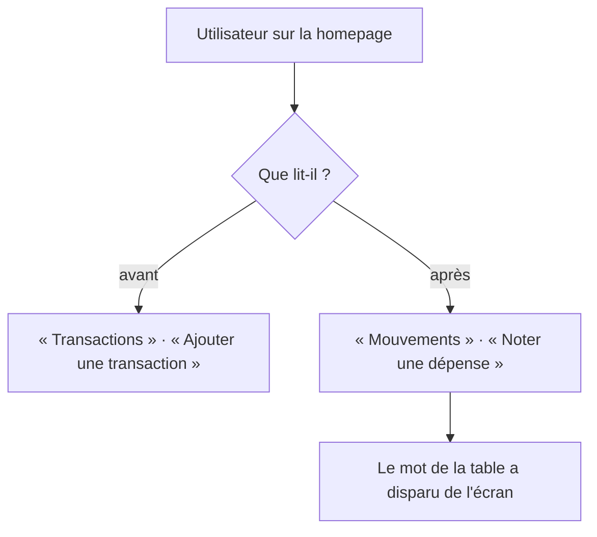

<!-- Fill or omit these sections; never add, rename, or reorder one. -->

# Instruction: Web — sweep lexical

## Architecture projection

> Tree of the final files. ✅ create · ✏️ modify · ❌ delete

```txt
frontend/
└── projects/webapp/
    ├── public/i18n/
    │   └── fr.json                                      ✏️ les 49 valeurs portant « transaction », plus la ligne du tour qui appelle « mouvement » une prévision
    └── src/app/feature/budget/budget-details/allocated-transactions/details-dialog/
        └── bottom-sheet.spec.ts                         ✏️ seule spec unitaire assertant sur un libellé réécrit
frontend/e2e/tests/features/
└── (le fichier portant getByText('Pointer les transactions ?'))  ✏️ unique assertion e2e sur du texte visible
.github/scripts/
└── lexicon.test.mjs                                    ✅ garde de lexique, même forme que public-surface.test.mjs
package.json                                            ✏️ script test:lexicon, ajouté à la ligne quality
```

## User Journey



## Tasks to do

### `1)` Inventorier les 49 clés par famille

> Décider une fois par famille, pas 49 fois à la main.

1. Extraire les clés dont la valeur porte « transaction » depuis `fr.json`.
2. Les ranger en sept familles : actions et titres · erreurs · confirmations · états vides · libellés de champs · relations · en-têtes de section.
3. Poser la règle par famille : les cinq premières passent au verbe ou perdent le sujet (« L'ajout a échoué — réessaie ») ; seules **relations** et **en-têtes de section** gardent un nom.
4. Pour ces deux familles, préférer le mot de nature quand la collection est homogène — `budgetLineHasTransactions` dit déjà « Cette prévision a des **dépenses** associées », et c'est le bon réflexe. « Mouvement » ne sert que là où la liste est réellement mixte. Moins il apparaît, moins il peut redevenir un terme générique.

### `2)` Réécrire les valeurs

> Les clés ne bougent pas : elles ne sont pas visibles, et les renommer serait de l'agitation pure.

1. Appliquer la règle de chaque famille aux 49 valeurs.
2. Corriger la ligne du tour qui dit « **À pointer** signifie que le mouvement est encore prévu » — une prévision n'est pas un mouvement.
3. Vérifier qu'aucune valeur ne dit à la fois « mouvement » et « prévision » pour désigner la même chose.

### `3)` Rattraper les deux assertions sur du texte visible

> Tout le reste passe par `data-testid` et ne bouge pas.

1. Mettre à jour la spec unitaire du bottom-sheet des transactions allouées.
2. Mettre à jour l'unique `getByText` e2e.

### `4)` Passer la copie au crible

> `/impeccable clarify` possède les libellés, les messages d'erreur et les états vides.

1. Lancer `/impeccable clarify` sur le lot réécrit.
2. Contrôler que chaque erreur nomme le problème **et** la sortie, et qu'aucun état vide ne restate son titre.

### `5)` Empêcher le mot de revenir

> Un sweep sans garde régresse au premier ajout de fonctionnalité. Le dépôt porte déjà deux gardes de cette forme, lancés par `pnpm quality`.

1. Écrire `.github/scripts/lexicon.test.mjs` sur le modèle de `public-surface.test.mjs` : un `node --test` qui lit les fichiers et asserte.
2. Faire échouer le test si une **valeur** de `fr.json` affiche « transaction ». Les clés ne sont pas concernées : elles portent le nom du domaine, qui ne bouge pas.
3. Déclarer `test:lexicon` dans le `package.json` racine et l'ajouter à la ligne `quality`, à côté de `test:ci-security` et `test:public-surface`.
4. Le limiter au web à ce stade : iOS dit encore « transaction », et la phase 3 étendra ce même fichier aux sources Swift. Chaque phase doit laisser le dépôt vert.

### `6)` Mettre à jour les docs de vocabulaire

> `CLAUDE.md § Vocabulary` et `PRODUCT.md § Vocabulaire utilisateur durable` disent aujourd'hui `transaction` → « Réel ». Un lexique qu'on change sans changer sa source repart en arrière au prochain écran écrit.

1. Écrire les deux portées au lieu d'une seule correspondance : « Réel » est le mot d'agrégat, celui qui fait face à « Prévu » dans une colonne ou un total ; « mouvement » est le mot de collection dénombrable ; au singulier sur un écran, on nomme la nature (dépense, revenu, épargne) ou on emploie un verbe.
2. Reporter la même formulation dans `CLAUDE.md` et `PRODUCT.md` — `aidd_docs/memory/project-brief.md` pointe déjà vers `CLAUDE.md` et n'a pas à répéter la règle.

## Test acceptance criteria

<!-- Each criterion is an observable behavior, not a command. -->

| Task | Acceptance criteria                                                                                                            |
| ---- | ------------------------------------------------------------------------------------------------------------------------------ |
| 1    | Chaque clé touchée porte une famille, et la règle de sa famille est écrite une seule fois.                                       |
| 2    | Aucun écran de la webapp n'affiche le mot « transaction ». Le tour ne qualifie plus une prévision de mouvement.                  |
| 3    | La suite unitaire et la suite e2e passent sans qu'un sélecteur ait été affaibli pour les faire passer.                           |
| 4    | Un lecteur qui n'a jamais utilisé Pulpe comprend chaque message d'erreur sans connaître le modèle de données.                    |
| 5    | Réintroduire « transaction » dans une valeur de `fr.json` fait échouer `pnpm quality`, et le message dit quoi écrire à la place.  |
| 6    | Quelqu'un qui lit `CLAUDE.md` ou `PRODUCT.md` sait quand écrire « Réel », quand écrire « mouvement », et quand nommer la nature.  |
