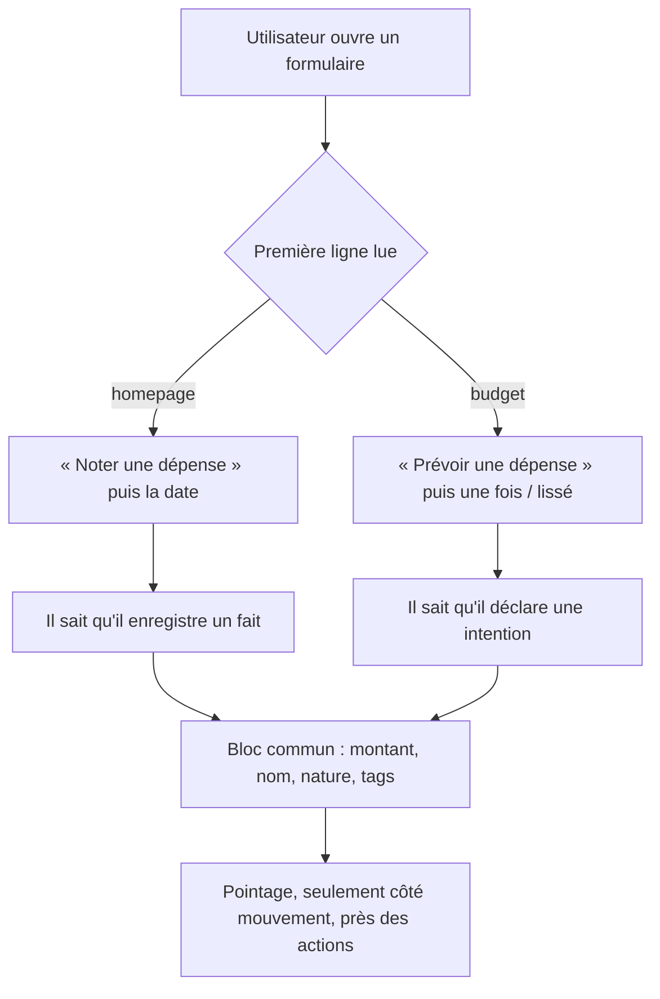

<!-- Porte avant la phase 3, tranchée : le titre mutant est conservé, le repli
     n'est pas appliqué. Mesuré au navigateur sur les trois natures — la boîte
     du titre reste à left=617, top=39, height=66 ; seul le dernier mot change,
     et le select de nature reste visible en même temps que le titre (39 vs 230
     sur 621px). iOS hérite donc du titre mutant en phases 3 et 4.

     Écart assumé sur la tâche 2, reporté à l'appelant : le bandeau
     « une fois / lissé » n'a PAS été remonté au-dessus du bloc commun. Il
     dépend de la nature (`isSpreadAvailable() = kind !== 'income'`) et
     disparaît sur « Revenu » — vérifié au navigateur. Le placer au-dessus du
     select qui le gouverne produirait exactement le tremblement que la tâche
     1.4 interdit. Côté mouvement, il n'existe aucun contrôle de date : la date
     est une phrase (« Aujourd'hui »), par décision antérieure ; c'est elle qui
     a été remontée sous le titre. -->


<!-- Fill or omit these sections; never add, rename, or reorder one. -->

# Instruction: Web — les deux formulaires

## Architecture projection

> Tree of the final files. ✅ create · ✏️ modify · ❌ delete

```txt
frontend/projects/webapp/src/app/feature/
├── current-month/
│   └── current-month.ts                     ✏️ le FAB porte le verbe
├── current-month/components/
│   ├── add-transaction-dialog.ts            ✏️ titre au verbe suivant la nature, retrait de la définition négative
│   ├── add-transaction-bottom-sheet.ts      ✏️ variante mobile du même écran, mêmes changements
│   ├── add-transaction-form.ts              ✏️ ordre des blocs, libellé de nature, pointage descendu près des actions
│   ├── add-transaction-form.spec.ts         ✏️ assertions d'ordre et de libellés
│   └── add-transaction-bottom-sheet.spec.ts ✏️ idem pour la variante mobile
└── budget/budget-details/budget-line/create/
    ├── dialog.ts                            ✏️ titre au verbe suivant la nature, lissage remonté en tête
    └── dialog.spec.ts                       ✏️ assertions d'ordre et de libellés
```

## User Journey



## Wireframe

```txt
ÉCRAN 1 — noter (homepage)          ÉCRAN 2 — prévoir (budget)
┌──────────────────────────────┐    ┌──────────────────────────────┐
│ (1) titre : verbe + nature   │    │ (1) titre : verbe + nature   │
├──────────────────────────────┤    ├──────────────────────────────┤
│ (2) DIFFÉRENCIE : la date    │    │ (2) DIFFÉRENCIE : une fois / │
│     [ date ]                 │    │     lissé  [ mois ][ total ] │
├──────────────────────────────┤    ├──────────────────────────────┤
│ (3) bloc commun              │    │ (3) bloc commun — identique  │
│     [ montant ] [ nom ]      │    │     [ montant ] [ nom ]      │
│     [ raccourcis ]           │    │     [ nature ▾ ]             │
│     [ nature ▾ ] [ tags ]    │    │                              │
├──────────────────────────────┤    ├──────────────────────────────┤
│ (4) [ Déjà pointé   ○——● ]   │    │ (4) [ Déjà pointé   ○——● ]   │
│                              │    │                              │
├──────────────────────────────┤    ├──────────────────────────────┤
│ (5)      annuler · valider   │    │ (5)      annuler · valider   │
└──────────────────────────────┘    └──────────────────────────────┘
```

1. Le titre : le verbe porte le temps, la nature suit le select de (3).
2. Le seul bandeau qui diffère entre les deux écrans. C'est lui qui dit ce qu'on crée, et il est aujourd'hui enterré sous (3).
3. Le bloc commun, strictement identique des deux côtés — descendu sous ce qui les sépare.
4. Le pointage : axe orthogonal que les deux entités portent — le contrôle est déjà en place des deux côtés, web comme iOS — donc il descend près des actions plutôt que dans le bandeau qui les distingue.
5. Actions.

## Tasks to do

### `1)` Faire suivre le titre à la nature

> Le titre cesse d'être une étiquette de catégorie et devient la phrase que l'utilisateur complète.

1. Côté mouvement : « Noter une dépense » / « Noter un revenu » / « Noter une épargne », lié au champ de nature.
2. Côté prévision : « Prévoir une dépense » / « Prévoir un revenu » / « Prévoir une épargne », même liaison.
3. Vérifier que le titre reste le nom accessible du dialogue, et que le lecteur d'écran l'annonce à l'ouverture — pas seulement au changement de nature.
4. Ne faire varier que le dernier mot. Le début de phrase ne bouge jamais, et le champ de nature doit rester visible en même temps que le titre quand on le manipule : une mutation dont on voit la cause se lit comme une réponse, la même mutation hors du regard se lit comme un tremblement.
5. Repli écrit d'avance, tranché à la fin de cette phase et avant iOS : titre fixe par écran, verbe déplacé sur le bouton de validation (« Noter la dépense »), lu au moment de l'engagement plutôt qu'en continu. La thèse survit entière ; seul le porteur du verbe change.

### `2)` Remonter ce qui différencie

> Le signal existe déjà dans les deux formulaires, enterré sous trois champs identiques.

1. Côté mouvement : la date passe au-dessus du bloc commun.
2. Côté prévision : « une fois / lissé » et ses champs dépendants passent au-dessus du bloc commun.
3. Descendre « Déjà pointé » près des actions : il ne définit pas la nature de l'objet, les deux entités le portent.

### `3)` Retirer les deux formulations qui décrivent le modèle

> Elles répondent à la mauvaise question.

1. « Type de transaction » demande en réalité la nature. Le libellé perd le mot ; le contrôle reste un select, décision prise.
2. « Pas liée à une prévision » est un statut de rattachement en position de définition. Dans le flux autonome, la question ne se pose pas : la ligne s'en va. La variante rattachée garde son titre, qui porte déjà le nom de la prévision.

### `4)` Faire parler le point d'entrée

> Décision révisée en session : le FAB peut porter le verbe, quitte à s'étendre et à masquer une part du montant.

1. Le FAB de `current-month.ts` passe du « + » muet au verbe — « Noter une dépense ».
2. Trancher la forme au regard : FAB étendu, ou FAB rond dont seul le nom accessible porte le verbe.
3. Vérifier à 375px que le FAB étendu ne recouvre pas une action, seulement du montant.

### `5)` Vérifier la composition et la finition

> Deux formulaires réordonnés, dont un en bottom-sheet sur mobile.

1. Lancer `/impeccable adapt` sur les deux écrans : le bloc remonté ne doit pas repousser le bloc commun sous la ligne de flottaison de la bottom-sheet.
2. Lancer `/impeccable polish` sur le résultat.
3. Vérifier au navigateur, à 375px et à 1280px, que les deux formulaires se lisent dans le même ordre.
4. **Porte avant la phase 3.** Ouvrir les deux formulaires et changer la nature plusieurs fois de suite. Si le titre mutant se lit instable, appliquer le repli maintenant, sur le web seul, et le figer pour iOS. iOS ne part qu'une fois cette décision prise : c'est ce qui empêche une structure fausse d'être fausse sur deux plateformes à la fois.

## Test acceptance criteria

<!-- Each criterion is an observable behavior, not a command. -->

| Task | Acceptance criteria                                                                                                                          |
| ---- | ---------------------------------------------------------------------------------------------------------------------------------------------- |
| 1    | Changer la nature change le titre, et le titre annoncé par le lecteur d'écran suit.                                                             |
| 2    | Sur chacun des deux écrans, la première chose lue sous le titre est ce qui distingue cet écran de l'autre.                                       |
| 3    | Aucun des deux formulaires n'affiche « transaction », et le flux autonome ne mentionne plus le rattachement.                                     |
| 4    | Depuis la homepage, le premier mot lu avant d'ouvrir le formulaire est un verbe, pas un « + ».                                                   |
| 5    | À 375px, le bloc commun de la bottom-sheet reste atteignable sans que le bandeau remonté occupe la hauteur visible à lui seul. Le porteur du verbe — titre ou bouton — est tranché au regard et noté avant que la phase 3 ne commence. |
