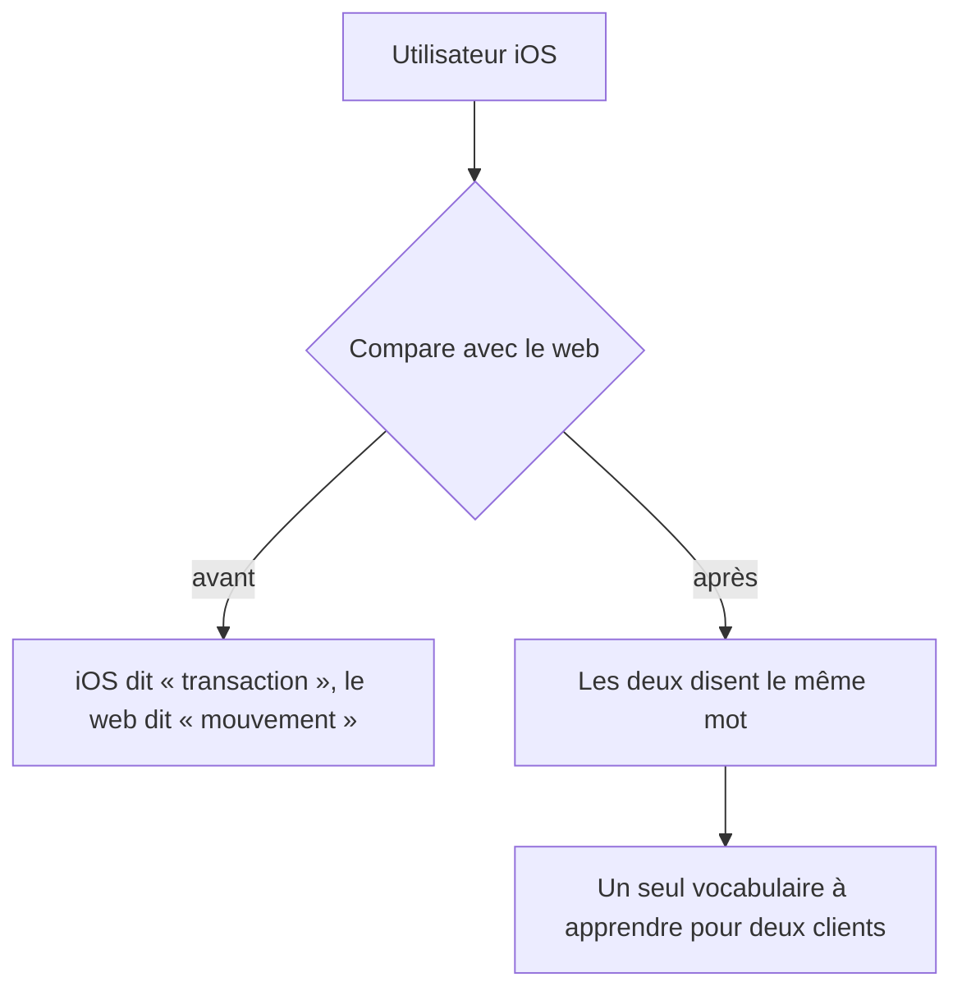

<!-- Fill or omit these sections; never add, rename, or reorder one. -->

# Instruction: iOS — parité lexicale

## Architecture projection

> Tree of the final files. ✅ create · ✏️ modify · ❌ delete

```txt
ios/Pulpe/
├── Features/Budgets/BudgetDetails/
│   ├── AddAllocatedTransactionPage.swift              ✏️
│   ├── BudgetDetailsFreeTransactionsList.swift        ✏️
│   ├── BudgetDetailsView.swift                        ✏️
│   ├── BudgetLineDetailPage.swift                     ✏️
│   ├── BudgetLineDetailTransactionsHeader.swift       ✏️
│   ├── EditTransactionPage.swift                      ✏️
│   ├── PreviousBudgetSheet.swift                      ✏️
│   ├── Coordinator/BudgetDetailsCoordinator.swift     ✏️
│   └── State/{MutationQueue,SyncStateStore}.swift     ✏️ messages de file d'attente et de synchro
├── Features/CurrentMonth/Components/
│   ├── ActivityCard.swift                             ✏️
│   ├── BudgetSection.swift                            ✏️
│   └── LinkedTransactionsSheet.swift                  ✏️
├── Features/Onboarding/OnboardingState+Suggestions.swift  ✏️
├── Features/SavingsGoals/
│   ├── Components/GoalDeletionSheet.swift             ✏️
│   └── GoalContributionsSection.swift                 ✏️
└── Shared/Components/
    ├── TagPickerField.swift                           ✏️
    ├── ToastView.swift                                ✏️
    └── WhatsNewSheet.swift                            ✏️
.github/scripts/
└── lexicon.test.mjs                                    ✏️ le garde de la phase 1, étendu aux sources Swift
```

> `AddTransactionSheet.swift` et `AddBudgetLineSheet.swift` sont exclus de cette phase : ils sont restructurés en phase 4, et les toucher deux fois ferait deux diffs sur les mêmes lignes.

## User Journey



## Tasks to do

### `1)` Reporter les décisions de la phase 1

> Les familles et leur règle sont déjà tranchées côté web. Cette phase les applique, elle ne les rejoue pas.

1. Reprendre le tableau de familles produit en phase 1.
2. Appliquer la même règle aux littéraux des 18 fichiers listés.
3. Là où iOS a une chaîne sans équivalent web, la ranger dans une famille existante avant de la réécrire — ne pas inventer une huitième famille.

### `2)` Traiter les chaînes qui ne sont pas de l'interface

> Trois fichiers portent des messages techniques, pas de la copie produit.

1. `MutationQueue` et `SyncStateStore` : ne réécrire que ce qui atteint l'écran ; laisser les messages de journalisation.
2. `WhatsNewSheet` : c'est un texte historique daté. Ne pas réécrire une note de version déjà publiée.
3. `OnboardingState+Suggestions` : vérifier que les suggestions parlent bien de prévisions, et pas de mouvements.

### `3)` Contrôler la parité

> Deux clients qui nomment différemment le même concept, c'est le défaut que ce plan corrige.

1. Comparer le lexique final iOS et web, terme par terme.
2. Vérifier qu'aucun des deux ne garde « transaction » sur une surface visible.
3. Vérifier que « mouvement » n'apparaît que pour les collections, des deux côtés.

### `4)` Étendre le garde aux sources Swift

> iOS n'a pas de catalogue de chaînes, donc aucun compilateur ne signalera un oubli. Un garde de dépôt n'en a pas besoin : il lit les fichiers, quel que soit le langage.

1. Étendre `.github/scripts/lexicon.test.mjs` aux littéraux d'interface Swift, une fois les 18 fichiers réécrits — pas avant, sous peine de laisser le dépôt rouge entre deux phases.
2. Le faire échouer sur « transaction » dans une chaîne affichée, et l'ignorer dans les commentaires et les messages de journalisation.
3. Sortir `WhatsNewSheet` du périmètre du garde : elle porte une note de version publiée, qu'on ne réécrit pas.

## Test acceptance criteria

<!-- Each criterion is an observable behavior, not a command. -->

| Task | Acceptance criteria                                                                                                              |
| ---- | ---------------------------------------------------------------------------------------------------------------------------------- |
| 1    | Aucun écran iOS n'affiche « transaction ».                                                                                         |
| 2    | Les messages de journalisation sont intacts, et la note de version publiée n'a pas été réécrite.                                    |
| 3    | Pour chaque terme du lexique, iOS et le web affichent le même mot ; l'écart, s'il en reste un, est nommé et justifié.               |
| 4    | Réintroduire « transaction » dans un littéral d'interface Swift fait échouer `pnpm quality` ; ni les commentaires ni la note de version publiée ne déclenchent le garde. |

<!--
VERDICT

Task 1 — 34 littéraux réécrits sur 17 fichiers. Les trois portées de la phase 1
tiennent sans huitième famille : « Mouvements » ne sort qu'au pluriel (en-tête de
liste, résumé d'impact, toast de suppression multiple), « Réel » reste l'agrégat
qui fait face à « Prévu », et un objet seul prend un verbe (« Modifier »,
« Noter un montant », « Enregistré ») ou son nom propre (« Supprimer « Loyer » ? »).

Task 2 — les commentaires de `MutationQueue` et `SyncStateStore` décrivent le code
et ne s'affichent pas : seul celui de `SyncStateStore` a suivi, parce qu'il cite
mot pour mot le titre d'alerte qui vient de changer. `WhatsNewSheet` n'est pas
touchée. Les suggestions d'onboarding nomment déjà des prévisions (« Courses /
alimentation », « 3ème pilier ») : rien à corriger, vérification faite.

Task 3 — parité vérifiée terme à terme contre `fr.json`, qui a fourni le mot
exact pour les cinq chaînes de la feuille de suppression d'objectif
(`transactionSummary`, `withTransactions`, `noLinkedData`), pour le titre de
confirmation (`deleteTransaction` = « Supprimer « {{ name }} » ? ») et pour les
étiquettes partagées (`typeLabel` = « Nature », `dateLabel` = « Date »).

Task 4 — le garde distingue l'affiché du machinal par la FORME de la chaîne, pas
par son emplacement : un chemin d'API, une clé d'analytics ou un identifiant de
test portent un `_` ou un `/`, ou tiennent en un mot ; une phrase française a une
espace et aucun des deux. Les interpolations tombent d'abord, sinon
`\(transaction.name)` ferait échouer un écran irréprochable. Prouvé dans les deux
sens : rendre « Type de transaction » à `KindToggle` fait échouer le garde sur la
bonne ligne, et les deux commentaires qui citent le mot entre guillemets
(`ActivityCard:3`, `OnboardingState+Suggestions:8`) ne le déclenchent pas.

ÉCARTS AVEC LE PLAN — signalés, non corrigés dans le plan

1. `AddTransactionSheet.swift` était exclu par la note sous la projection
   (« restructuré en phase 4 »), mais ses deux littéraux devaient partir ici :
   le critère 1 dit qu'aucun écran iOS n'affiche le mot, et le garde du critère 4
   lit tout le dépôt. Les deux critères ne peuvent pas tenir en gardant le
   fichier hors périmètre. Seules les deux chaînes changent ; la restructuration
   reste en phase 4.

2. Trois fichiers portaient le mot sans figurer dans la projection :
   `Shared/Components/KindToggle.swift` (« Type de transaction »),
   `Shared/Components/TransactionDateSelector.swift` (« Date de la transaction »),
   et la donnée de test `App/BudgetLongPressUITestHarness.swift`
   (« Prévision avec transactions ») avec l'assertion qui la lit dans
   `PulpeUITests/BudgetLineLongPressTests.swift`.

3. Trois fichiers marqués ✏️ n'avaient rien à réécrire : `ActivityCard.swift`
   (dit déjà « Tes opérations s'afficheront ici »),
   `OnboardingState+Suggestions.swift` (vérification de la task 2.3), et
   `TagPickerField.swift` (seul `AppConfiguration.maxTagsPerTransaction`, un
   identifiant Swift dans une interpolation).
-->

