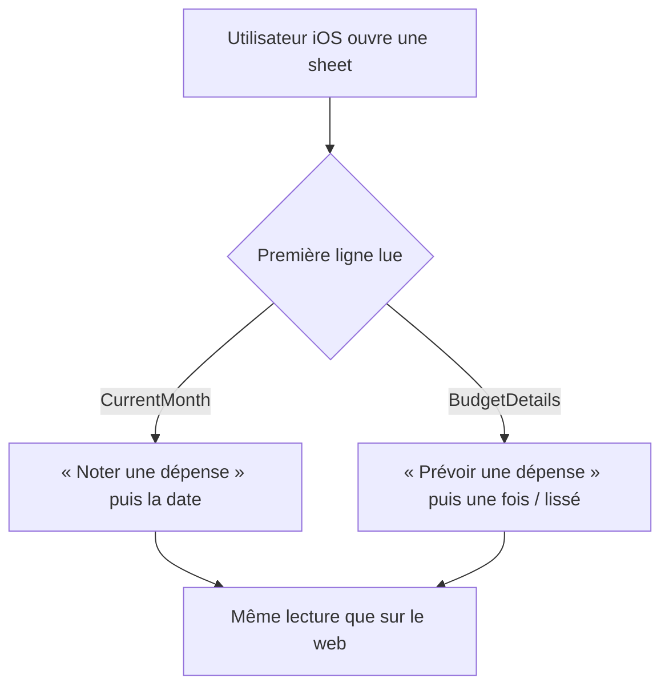

<!-- Fill or omit these sections; never add, rename, or reorder one. -->

# Instruction: iOS — les deux sheets

## Architecture projection

> Tree of the final files. ✅ create · ✏️ modify · ❌ delete

```txt
ios/Pulpe/Features/Budgets/BudgetDetails/
├── AddBudgetLineSheet.swift            ✏️ titre au verbe suivant la nature, lissage remonté en tête
└── AddBudgetLineSheet+Submit.swift     ✏️ seulement si le titre ou l'ordre y sont construits
ios/Pulpe/Features/CurrentMonth/Components/
└── AddTransactionSheet.swift           ✏️ titre au verbe suivant la nature, date remontée, pointage descendu
ios/PulpeTests/
└── (les tests couvrant ces deux sheets) ✏️ assertions de titre et d'ordre
```

## User Journey



## Wireframe

```txt
SHEET 1 — noter (CurrentMonth)      SHEET 2 — prévoir (BudgetDetails)
┌──────────────────────────────┐    ┌──────────────────────────────┐
│ (1) titre : verbe + nature   │    │ (1) titre : verbe + nature   │
├──────────────────────────────┤    ├──────────────────────────────┤
│ (2) DIFFÉRENCIE : la date    │    │ (2) DIFFÉRENCIE : une fois / │
│     [ date ]                 │    │     lissé  [ mois ][ total ] │
├──────────────────────────────┤    ├──────────────────────────────┤
│ (3) bloc commun              │    │ (3) bloc commun — identique  │
│     [ montant ] [ nom ]      │    │     [ montant ] [ nom ]      │
│     [ nature ] [ tags ]      │    │     [ nature ]               │
├──────────────────────────────┤    ├──────────────────────────────┤
│ (4) [ Déjà pointé   ○——● ]   │    │ (4) [ Déjà pointé   ○——● ]   │
├──────────────────────────────┤    ├──────────────────────────────┤
│ (5)      annuler · valider   │    │ (5)      annuler · valider   │
└──────────────────────────────┘    └──────────────────────────────┘
```

1. Le titre : le verbe porte le temps, la nature suit le contrôle de (3).
2. Le seul bandeau qui diffère entre les deux sheets.
3. Le bloc commun, identique des deux côtés.
4. Le pointage : axe orthogonal que les deux entités portent — `CheckedToggle` sur les deux sheets, comme les deux formulaires web — donc près des actions et hors du bandeau qui distingue.
5. Actions.

## Tasks to do

### `1)` Aligner les deux sheets sur les deux formulaires web

> Même structure, mêmes mots, mêmes règles — décidées en phase 2, appliquées ici.

1. Reprendre le porteur du verbe tranché au regard en phase 2 — titre lié à la nature, ou titre fixe avec le verbe sur le bouton de validation. iOS ne rejoue pas cet arbitrage, il l'applique.
2. Remonter la date dans `AddTransactionSheet`, le lissage dans `AddBudgetLineSheet`.
3. Descendre « Déjà pointé » près des actions dans `AddTransactionSheet`.

### `2)` Respecter les contraintes de la plateforme

> Une sheet n'est pas un dialogue : la hauteur est contrainte et le clavier mange l'écran.

1. Vérifier que le bandeau remonté ne repousse pas le montant hors du premier detent.
2. Vérifier le comportement au clavier ouvert : l'inset s'applique en dernier, sinon il laisse une marge fantôme.
3. Réutiliser `standardSheetPresentation()` plutôt que de reposer detents, indicateur et rayon à la main.

### `3)` Vérifier sur simulateur

> Le CLI ne produit pas de capture fidèle ; c'est le simulateur qui tranche.

1. Construire en configuration `Local`, ouvrir les deux sheets.
2. Comparer côte à côte avec les deux écrans web du même lot.
3. Lancer la suite iOS sur le simulateur de test dédié, jamais sur le simulateur interactif.

## Test acceptance criteria

<!-- Each criterion is an observable behavior, not a command. -->

| Task | Acceptance criteria                                                                                                                    |
| ---- | ------------------------------------------------------------------------------------------------------------------------------------------ |
| 1    | Les deux sheets portent le verbe au même endroit que le web, et l'ordre des blocs est celui du web.                                        |
| 2    | Au premier detent, le montant est visible sans défiler ; clavier ouvert, aucune marge fantôme sous le formulaire.                          |
| 3    | La suite iOS passe, et les deux sheets se lisent dans le même ordre que leurs équivalents web.                                             |

<!--
VERDICT

Task 1 — le verbe est porté par le titre, comme en phase 2, et la nature ne fait
que le terminer : « Noter une dépense », « Prévoir une épargne ». Les deux moitiés
vivent dans une seule propriété (`indefiniteLabel`), donc l'article ne peut pas se
détacher de son mot. Le bandeau qui distingue est remonté en deuxième position des
deux côtés : la date sur la sheet « Noter », « Une seule fois / Lisser » sur la
sheet « Prévoir ». « Déjà pointé » est descendu près des actions.

`SpreadAmountModeToggle` (« Total / Par mois ») a suivi le bandeau au lieu de rester
en bas : il décide de ce que le montant VEUT DIRE — une part mensuelle ou un total à
répartir — et le libellé du champ le confirme à l'écran (« Montant total »). Le lire
après le montant, c'est le lire trop tard.

Le bandeau reste SOUS la nature qui le gouverne. Un revenu ne se lisse pas ; posé
plus haut, il apparaîtrait et disparaîtrait en réponse à un contrôle situé plus bas.
C'est l'arbitrage rendu en phase 2 côté web, appliqué ici sans être rejoué.

Task 2 — `SheetFormContainer` appelle déjà `standardSheetPresentation()`, dont le
detent unique est `.large` : il n'y a pas de premier palier plus court à faire
déborder. Le montant reste visible sans défiler, clavier ouvert (captures). Le
piège de la marge fantôme n'existe pas ici : aucun `.ignoresSafeArea(.keyboard)`
dans le conteneur ni dans les deux sheets, donc aucun ordre à respecter.

Task 3 — vérifié sur le simulateur dédié via le harnais `contextual-creation`, qui
ouvre les deux écrans sans authentification. C'est cette vérification qui a rattrapé
un vrai défaut : le bandeau de lissage s'affichait DEUX fois, la copie remontée
ayant été ajoutée sans que l'originale soit retirée. Le build seul ne l'aurait
jamais dit. Suite complète : 2031 tests, 212 suites, vertes.

ÉCARTS AVEC LE PLAN — signalés, non corrigés dans le plan

1. Le titre est construit dans `Domain/Models/TransactionEnums.swift`, absent de la
   projection. `newTransactionTitle` et `newBudgetLineTitle` n'existent que pour ces
   deux sheets ; les réécrire ailleurs aurait dupliqué la règle.

2. `Features/Onboarding/Steps/AddCustomExpenseSheet.swift` portait le même
   « Nouvelle prévision » en dur. Laissé de côté, il aurait été le seul écran de
   création à garder l'ancien titre. Il lit maintenant `kind.newBudgetLineTitle`,
   ce qui le rend en prime sensible à la nature de l'étape qui l'ouvre.

3. Le wireframe dessine un « bloc commun identique » des deux côtés. Le web n'en a
   pas : son formulaire « Noter » ordonne montant → nom → nature, son formulaire
   « Prévoir » ordonne nom → nature → lissage → montant. Chaque sheet iOS suit donc
   l'INTENTION du wireframe — le bandeau qui distingue en deuxième, le montant haut
   — plutôt que l'ordre des champs de son homologue web : descendre le montant en
   quatrième position contredirait le critère 2 et enterrerait le `HeroAmountField`,
   qui est l'ancre visuelle de la sheet sur iOS.

4. Le web dit « Déjà pointé », iOS dit « Pointer » sur le même contrôle. Hors
   périmètre de cette phase, qui porte sur le verbe et l'ordre. Écart refermé
   depuis : `CheckedToggle` porte le libellé du web.

5. Le croquis donnait « pas de (4) » à la sheet « prévoir », un écran qui n'a
   jamais existé : `AddBudgetLineSheet` porte `CheckedToggle` comme son homologue
   web porte `forecastCheckedToggle`. L'écart a été tranché en gardant le
   contrôle — le pointage est un fait sur l'argent, et une prévision passée sur
   le compte en est un aussi. Le croquis a été corrigé, pas l'écran.
-->

