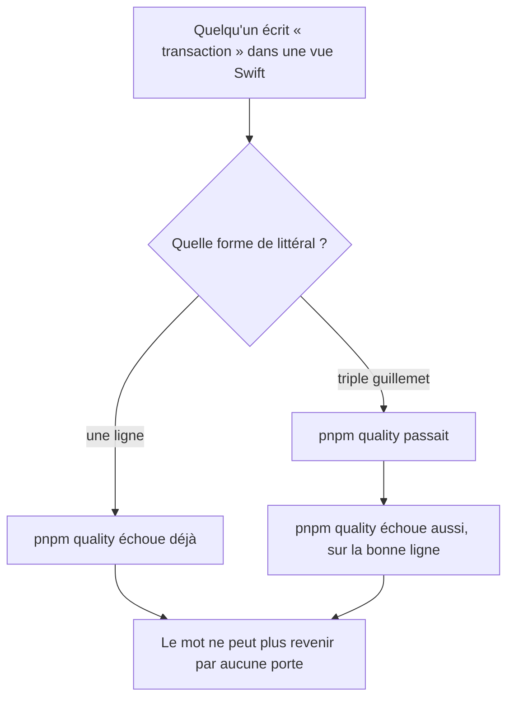
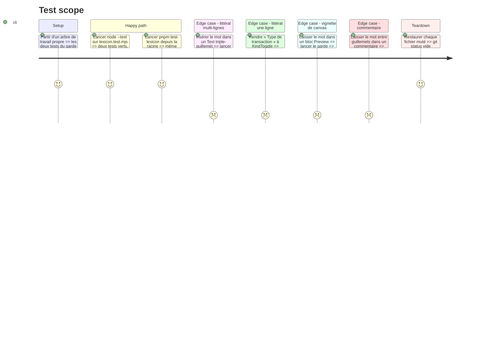

<!-- Fill or omit these sections; never add, rename, or reorder one. -->

# Instruction: le garde voit toute la copie affichée

Le garde lit les sources Swift ligne à ligne et n'apparie que des `"…"`. Les lignes intérieures
d'un littéral `"""` ne portent aucun guillemet : elles ne sont jamais inspectées. Cinq fichiers de
`ios/Pulpe` en emploient, dont la prose affichée de `EditTemplateLineSheet.swift:135` et les
descriptions VoiceOver de `HomeHeroCard.swift:309,324`.

Le lot livré est propre en fait — chaque littéral multi-lignes a été relu à la main. C'est la garde
contre la régression qui est trouée, et le critère 4 de la phase 3 du plan lexical qui est faux.

## Architecture projection

> Tree of the final files. ✅ create · ✏️ modify · ❌ delete

```txt
.
└── .github/scripts/
    └── lexicon.test.mjs   ✏️  balaie l'intérieur des `"""`, saute les blocs `#Preview` en entier,
                               et perd `NOT_APP_COPY`, devenu sans objet
```

## User Journey



## Test Scope



## Tasks to do

### `1)` Faire voir au garde l'intérieur d'un `"""`

> Le balayage devient conscient de l'état ouvert/fermé du littéral, au lieu de supposer que tout
> tient sur une ligne.

1. Porter un état « dans un littéral multi-lignes » le long de la boucle de lignes, basculé par la
   parité des `"""` rencontrés sur la ligne. Vérifié : aucune ligne de `ios/Pulpe` n'en porte deux,
   donc la parité suffit et ne cache aucun cas.
2. Quand l'état est ouvert, soumettre le **texte brut de la ligne** à `displayedText` puis
   `isDisplayedProse`, sans passer par l'appariement de guillemets — il n'y en a pas à apparier.
3. Quand l'état est fermé, garder le balayage actuel des `"…"`.
4. Ne pas dupliquer le filtre : les deux chemins finissent sur le même `isDisplayedProse`, qui reste
   la seule définition de « ce que l'utilisateur lit ».

### `2)` Étendre le saut de `#Preview` de la ligne au bloc

> Le garde annonce déjà que la vignette Xcode ne compte pas ; il n'en saute que la première ligne.

1. À l'ouverture d'un `#Preview(`, entrer en mode « bloc ignoré » et suivre la profondeur
   d'accolades jusqu'à son retour à zéro.
2. Compter les accolades sur la ligne **débarrassée de ses littéraux** — une chaîne comme
   `"{{ name }}"` fausserait sinon la profondeur.
3. Un `#Preview` ne s'ouvre jamais à l'intérieur d'un `"""` : traiter l'état multi-lignes en premier
   règle l'ordre sans cas particulier.

### `3)` Retirer l'exemption devenue sans objet

> Elle exemptait un fichier entier pour taire une vignette.

1. Supprimer `NOT_APP_COPY` et son filtrage dans `swiftSources()`.
2. Vérifier que `WhatsNewSheet.swift` passe désormais par le garde et n'y déclenche rien :
   sa seule occurrence, ligne 253, vit dans un `#Preview`, que la tâche 2 saute.
3. Reprendre dans le commentaire du fichier la raison réelle — les notes de version affichées
   viennent de `WhatsNewService` / `WhatsNewStore`, pas de la vue — pour qu'un lecteur ne
   réintroduise pas l'exemption sur le motif d'origine, qui était faux.

### `4)` Prouver le garde dans les deux sens

> Un garde qu'on n'a pas vu échouer n'est pas un garde.

1. Muter le `Text("""…""")` de `EditTemplateLineSheet.swift` et constater l'échec sur la bonne ligne.
2. Muter un littéral d'une ligne et constater l'échec.
3. Constater qu'un bloc `#Preview` portant le mot ne déclenche rien, et qu'un commentaire non plus.
4. Restaurer les fichiers mutés, puis lancer `pnpm quality` en entier.

## Test acceptance criteria

<!-- Each criterion is an observable behavior, not a command. -->

| Task | Acceptance criteria                                                                                                                                     |
| ---- | --------------------------------------------------------------------------------------------------------------------------------------------------------- |
| 1    | Le mot « transaction » écrit dans un littéral `"""` affiché fait échouer `pnpm quality`, et le message cite le fichier et le numéro de ligne exacts.        |
| 2    | Le même mot écrit dans un bloc `#Preview`, à n'importe quelle profondeur, ne fait échouer aucun test.                                                       |
| 3    | Aucune exemption de fichier ne subsiste dans le garde, et `WhatsNewSheet.swift` est lu comme tous les autres sans rien déclencher.                          |
| 4    | Le garde a été vu échouer sur un littéral multi-lignes et sur un littéral d'une ligne, puis revert au vert ; `pnpm quality` passe sur l'arbre restauré.     |
