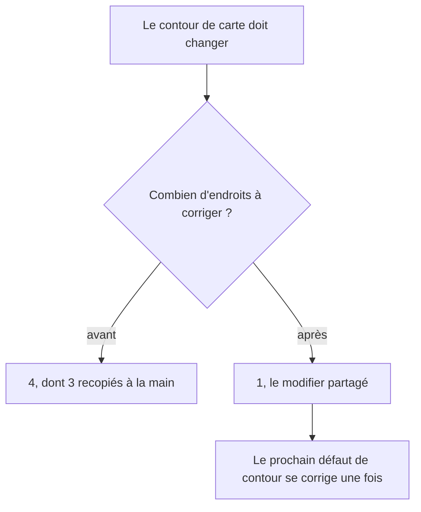
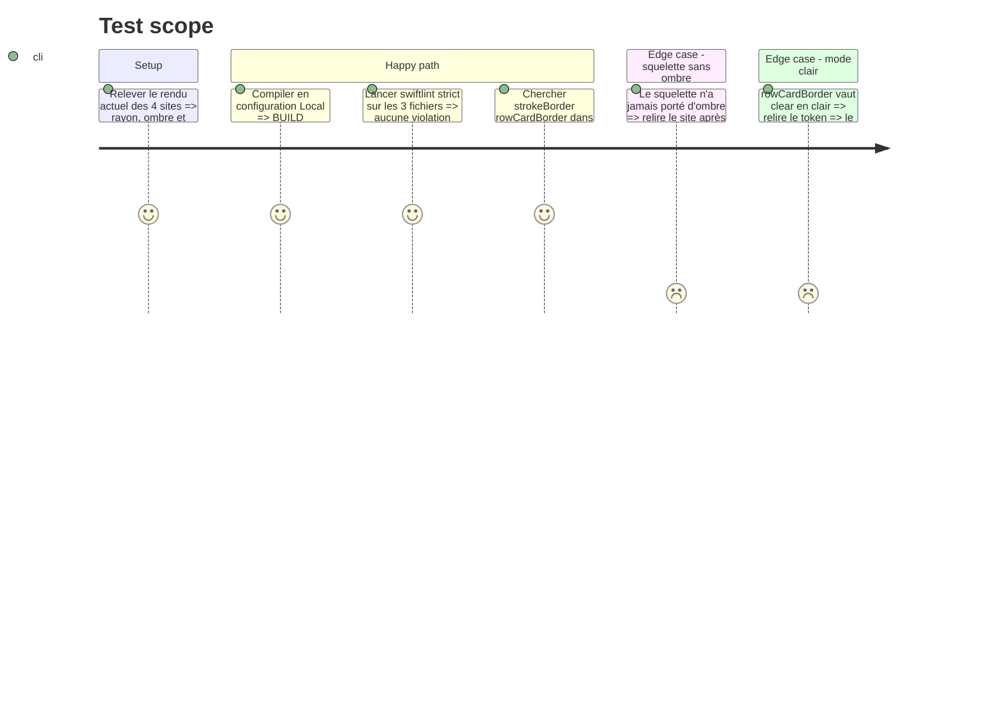

<!-- Fill or omit these sections; never add, rename, or reorder one. -->

# Instruction: un seul auteur pour le contour de carte

`strokeBorder(Color.rowCardBorder, lineWidth: DesignTokens.BorderWidth.hairline)` est recopié à
quatre endroits, trois hors du modifier partagé :

| Site                                    | Rayon         | Ombre        | Ce qu'il veut         |
| --------------------------------------- | ------------- | ------------ | --------------------- |
| `View+Extensions.swift:335`              | `card` (18pt) | `subtle`     | carte de ligne entière |
| `BudgetListView+Subviews.swift:68`       | `xl` (32pt)   | `subtle`     | contour seul           |
| `BudgetListView+Subviews.swift:131`      | `xl` (32pt)   | `subtle`     | contour seul           |
| `BudgetDetailsSkeletonView.swift:197`    | `xl` (32pt)   | **aucune**   | contour seul           |

C'est pour cela que `pulpeRowCard()` ne convient à aucun des trois : les deux premiers sont des
cartes hero, le troisième n'a jamais porté d'ombre. Le contour est la seule chose que les quatre
partagent, donc c'est lui qui devient partagé — et non un paramètre de plus sur un modifier que
chaque appelant devrait ensuite désactiver en partie.

## Architecture projection

> Tree of the final files. ✅ create · ✏️ modify · ❌ delete

```txt
.
└── ios/Pulpe/
    ├── Shared/Extensions/
    │   └── View+Extensions.swift                   ✏️  `pulpeRowCardBorder(cornerRadius:)`, que
    │                                                   `pulpeRowCard()` compose au lieu de l'écrire
    └── Features/Budgets/
        ├── BudgetList/BudgetListView+Subviews.swift ✏️  2 `.overlay` manuels → 1 ligne chacun
        └── BudgetDetails/BudgetDetailsSkeletonView.swift ✏️  idem, sans ombre ajoutée
```

## User Journey



## Test Scope



## Tasks to do

### `1)` Extraire le contour dans son propre modifier

> Une seule déclaration décide de la couleur, de la largeur et de la forme du trait.

1. Ajouter dans `View+Extensions.swift`, à côté de `pulpeRowCard()`, un
   `func pulpeRowCardBorder(cornerRadius: CGFloat) -> some View` qui pose l'`.overlay` avec
   `RoundedRectangle(cornerRadius:style: .continuous).strokeBorder(Color.rowCardBorder, lineWidth: DesignTokens.BorderWidth.hairline)`.
2. Pas de valeur par défaut sur le rayon : les quatre appelants en connaissent un, et deux le
   contredisent. Un défaut ici rendrait silencieux un choix qui doit rester lu.
3. Documenter ce que le modifier **ne fait pas** — ni fond ni ombre — puisque c'est ce qui le rend
   utilisable par un squelette qui n'a jamais porté d'ombre.
4. Garder `strokeBorder` et non `stroke` : il rentre vers l'intérieur, donc le `clipShape` du
   `CardBackgroundModifier` ne le rogne pas de moitié.

### `2)` Faire composer `pulpeRowCard()` au lieu d'écrire

> Le modifier de carte cesse d'être un second auteur du contour.

1. Remplacer son bloc `.overlay { … }` par `.pulpeRowCardBorder(cornerRadius: cornerRadius)`.
2. Laisser `.shadow(DesignTokens.Shadow.subtle)` : c'est lui qui porte la séparation en clair.
3. Ne pas toucher au paramètre `cornerRadius` de `pulpeRowCard()` ni à sa valeur par défaut : la
   question du rayon de la carte de ligne est ouverte ailleurs et ne se tranche pas dans un
   changement dont l'objet est la déduplication.

### `3)` Router les trois sites manuels

> Chaque site perd son `.overlay` et garde exactement ce qu'il avait autour.

1. `BudgetListView+Subviews.swift:61-69` et `:128-132` → `.pulpeRowCardBorder(cornerRadius: DesignTokens.CornerRadius.xl)`,
   `.shadow(DesignTokens.Shadow.subtle)` conservé au-dessus.
2. `BudgetDetailsSkeletonView.swift:191-198` → même ligne, **sans** ajouter d'ombre.
3. Réduire les commentaires laissés sur place : le pourquoi de l'ombre morte vit désormais sur
   `Color.rowCardBorder` et sur le modifier. Ne garder au site que ce qui lui est propre — le
   rayon hero, ou l'absence d'ombre du squelette.
4. Ne pas toucher `BudgetListView+Subviews.swift:230` : ce site porte déjà son propre contour
   tireté, aligné sur la courbe de sa carte par `62ad5dd09`.

### `4)` Vérifier

1. `xcodebuild build -scheme PulpeLocal -configuration Local -destination 'platform=iOS Simulator,name=Pulpe Tests' CODE_SIGNING_ALLOWED=NO`, lire `** BUILD SUCCEEDED **`.
2. `swiftlint lint --strict` filtré sur les trois fichiers touchés.
3. Compter les occurrences de `strokeBorder(Color.rowCardBorder` dans `ios/Pulpe` : il doit en
   rester exactement une.

## Test acceptance criteria

<!-- Each criterion is an observable behavior, not a command. -->

| Task | Acceptance criteria                                                                                                                                    |
| ---- | -------------------------------------------------------------------------------------------------------------------------------------------------------- |
| 1    | `pulpeRowCardBorder(cornerRadius:)` existe, exige son rayon, et ne pose ni fond ni ombre.                                                                  |
| 2    | `pulpeRowCard()` rend le même contour et la même ombre qu'avant, sans plus contenir de `strokeBorder`.                                                     |
| 3    | Les trois sites appellent le modifier partagé ; le squelette ne porte toujours aucune ombre, et les deux cartes hero gardent leur rayon de 32pt.           |
| 4    | `strokeBorder(Color.rowCardBorder` n'apparaît plus qu'à un seul endroit du dépôt ; le build passe et `swiftlint --strict` est propre sur les trois fichiers. |
