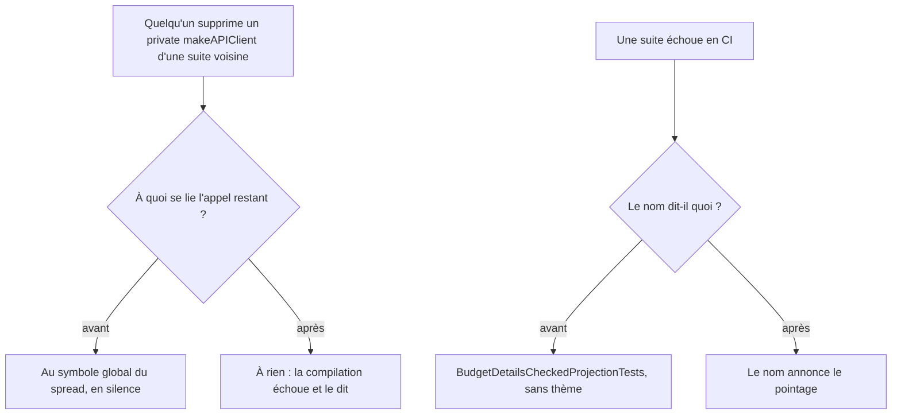
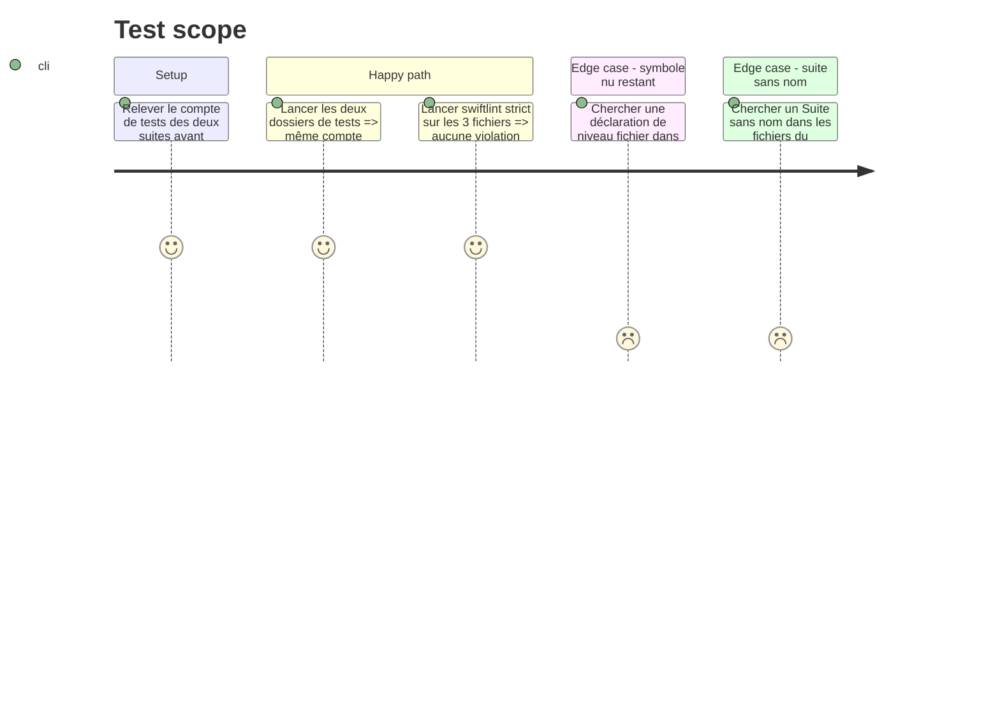

<!-- Fill or omit these sections; never add, rename, or reorder one. -->

# Instruction: les fixtures de spread ne laissent plus de symbole nu

`BudgetLineSpreadTestFixtures.swift` porte un doc-comment qui explique pourquoi un symbole global nu
est un piège de liaison silencieuse dans cette cible de test — la cible déclare déjà plusieurs
`private func makeAPIClient()` de même signature — puis déclare `let fixtureGroupId` en global nu,
hors de l'`enum` que ce commentaire vient de justifier.

Dans la foulée, `BudgetDetailsCheckedProjectionTests` porte un `@Suite(.serialized)` sans nom quand
ses trois sœurs du même découpage en portent un qui dit le thème.

## Architecture projection

> Tree of the final files. ✅ create · ✏️ modify · ❌ delete

```txt
.
└── ios/PulpeTests/
    ├── Domain/Services/
    │   ├── BudgetLineSpreadTestFixtures.swift   ✏️  `fixtureGroupId` entre dans l'enum
    │   └── BudgetLineSpreadResponseTests.swift  ✏️  2 lectures préfixées
    └── Features/Budgets/BudgetDetails/Projection/
        └── BudgetDetailsCheckedProjectionTests.swift ✏️  la suite prend le nom de son thème
```

## User Journey



## Test Scope



## Tasks to do

### `1)` Faire entrer l'identifiant dans l'enum qui le justifie

> Le fichier applique enfin à sa constante la règle qu'il énonce pour ses fonctions.

1. Déplacer `fixtureGroupId` dans `BudgetLineSpreadFixtures` sous la forme `static let groupId`.
2. Le nom perd son préfixe `fixture` : le type le porte déjà, et `BudgetLineSpreadFixtures.fixtureGroupId`
   dirait deux fois la même chose.
3. Mettre à jour les 5 lectures — 3 dans les JSON du fichier lui-même, 2 dans
   `BudgetLineSpreadResponseTests.swift:31,33`.
4. Vérifier qu'aucune déclaration de **valeur ni de fonction** ne subsiste au niveau fichier : c'est
   exactement ce que le doc-comment interdit. `DecodedSpreadBody` et `SpreadRequestRecorder` restent
   des types de niveau fichier, sans jumeau `private` nulle part — le piège décrit est la liaison
   silencieuse à un symbole homonyme, pas la portée en elle-même.

### `2)` Donner son thème au nom de la suite

> Une suite rouge en CI doit dire de quoi elle parle avant qu'on ouvre le fichier.

1. `@Suite(.serialized)` → `@Suite("BudgetDetails — projection du pointage", .serialized)`, sur le
   modèle de `@Suite("BudgetLineService.createSpread response decoding", .serialized)`.
2. Ne rien changer d'autre dans ce fichier : le reste de son contenu est hors périmètre.

### `3)` Vérifier sans se fier au marqueur

> Un `-only-testing:` qui ne matche rien affiche `TEST SUCCEEDED` avec zéro test.

1. Relever le compte de tests exécutés **avant** modification sur les deux dossiers concernés, et
   le noter.
2. Relancer après modification et comparer le compte exécuté, jamais le seul marqueur de succès.
3. `swiftlint lint --strict` sur les trois fichiers touchés.

## Test acceptance criteria

<!-- Each criterion is an observable behavior, not a command. -->

| Task | Acceptance criteria                                                                                                                       |
| ---- | ------------------------------------------------------------------------------------------------------------------------------------------- |
| 1    | Aucune déclaration de valeur ni de fonction ne subsiste au niveau fichier dans `BudgetLineSpreadTestFixtures.swift` ; ses 5 lectures passent par le type. |
| 2    | Le nom de chaque suite issue du découpage dit son thème, et `.serialized` est conservé sur toutes.                                            |
| 3    | Le compte de tests exécutés après modification est identique au compte relevé avant, chiffres cités ; `swiftlint --strict` ne rapporte rien.  |
