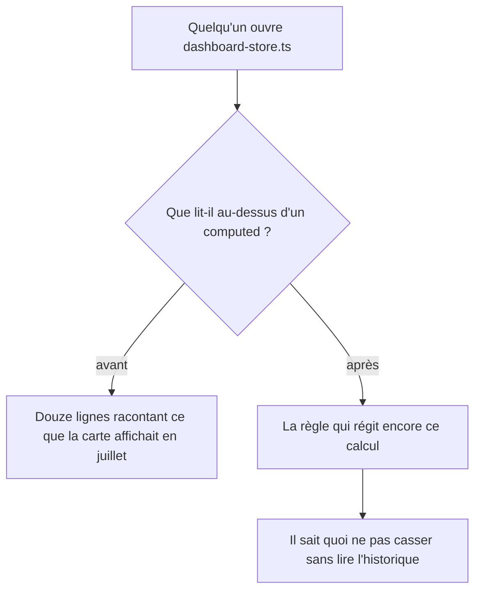
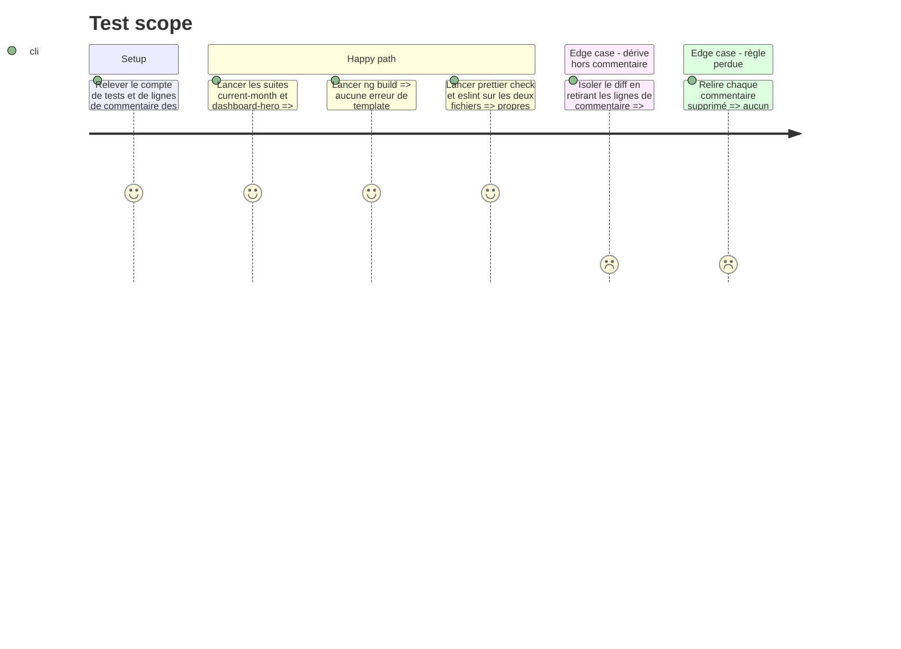

<!-- Fill or omit these sections; never add, rename, or reorder one. -->

# Instruction: la home dit la règle, plus le récit du défaut

| Fichier              | Lignes | Lignes de commentaire | Part |
| -------------------- | ------ | --------------------- | ---- |
| `dashboard-store.ts` | 876    | 235                   | 27 % |
| `dashboard-hero.ts`  | 930    | 218                   | 23 % |

`.claude/rules/01-standards/clean-code.md` range « Comments explaining code » parmi les
anti-patterns. Ces commentaires-ci portent le *pourquoi*, ce qui est légitime — mais chacun le fait
en racontant d'abord le défaut d'avant, sur cinq à quinze lignes. Le lecteur suivant doit trier ce
qui régit encore le code de ce qui décrit un bug soldé.

**La coupe porte sur la narration, jamais sur la règle.** Un commentaire qui énonce un invariant se
lit à chaque passage et reste. Un commentaire qui raconte ce que l'écran affichait avant se lit une
fois et part.

**Aucun corps de `computed`, de `signal` ou de méthode ne bouge.** C'est ce qui rend la phase
vérifiable : les 294 tests existants sont le filet, et s'ils bougent, c'est que la coupe a dérapé.

## Architecture projection

> Tree of the final files. ✅ create · ✏️ modify · ❌ delete

```txt
.
└── frontend/projects/webapp/src/app/
    ├── feature/current-month/services/
    │   └── dashboard-store.ts   ✏️  commentaires seuls
    └── ui/dashboard-hero/
        └── dashboard-hero.ts    ✏️  commentaires seuls, template et styles compris
```

## User Journey



## Test Scope



## Tasks to do

### `1)` Poser le tri avant de couper

> Sans critère écrit, la coupe devient une affaire de goût et se rediscute à chaque relecture.

1. Classer chaque bloc de commentaire des deux fichiers en trois : **règle** (un invariant qui
   régit le code d'aujourd'hui), **récit** (ce que l'écran affichait avant, et pourquoi c'était
   faux), **mixte**.
2. Règle : intacte. Récit : supprimé. Mixte : réécrit pour ne garder que la clause de règle.
3. Le test du tri, appliqué à chaque bloc : *si ce code était écrit aujourd'hui de zéro, cette
   phrase serait-elle encore vraie ?* Non ⇒ c'est du récit.
4. Cas particulier à garder tel quel : un commentaire qui nomme un **piège reproductible** —
   `cachedMutation` en latest-wins, le token `DASHBOARD_NOW` capturant l'heure du premier
   chargement, l'inclusivité des deux bornes de période. Ce ne sont pas des récits, ce sont les
   raisons pour lesquelles le code voisin a la forme qu'il a.

### `2)` Élaguer le store

> 235 lignes de commentaire, dont l'essentiel raconte des cartes qui n'existent plus.

1. Appliquer le tri de la tâche 1 à `dashboard-store.ts`.
2. Garder la définition métier de chaque sélecteur — ce que `realizedExpenses`, `#unplannedSpending`
   et `#plannedMargin` comptent et n'admettent pas — puisque c'est ce qui empêche le prochain de
   recompter l'épargne deux fois.
3. Retirer les comparaisons chiffrées à des états d'écran révolus (« affichait Dépensé 554 contre
   Engagé 3'947 »), qui ne se vérifient plus contre rien.
4. Ne pas toucher aux deux constantes de tolérance ni à leur justification : elles expliquent une
   formule, pas un défaut.

### `3)` Élaguer le hero

> Même tri, plus un cas propre au composant : les commentaires de gabarit et de style.

1. Appliquer le tri de la tâche 1 au `template:` et aux `styles:` autant qu'au corps de la classe.
2. Garder les contraintes mesurées qui gouvernent encore une valeur : un ratio de contraste qui
   justifie une opacité, la raison d'un `strokeBorder` plutôt que d'un fond, le motif du
   `tabular-nums`. Ce sont des règles, pas des récits.
3. Retirer les récits d'accessibilité résolus (« ARIA élaguait les rôles, le titre disparaissait de
   la liste ») en gardant leur conclusion structurelle : le bouton couvre la carte et reste sans nom
   propre, la section est nommée par son titre.
4. Ne jamais laisser un backtick entrer dans `template:` ou `styles:` en réécrivant un commentaire.

### `4)` Vérifier que rien d'autre n'a bougé

1. Isoler le diff sur les lignes qui ne sont pas des commentaires : il doit être vide.
2. `cd frontend && pnpm exec ng test --include "**/current-month/**/*.spec.ts" --include "**/dashboard-hero/*.spec.ts"` — 294 tests, le compte d'avant.
3. `ng build` : seul lui type-vérifie les gabarits Angular.
4. `prettier --check` et `eslint` sur les deux fichiers.

## Test acceptance criteria

<!-- Each criterion is an observable behavior, not a command. -->

| Task | Acceptance criteria                                                                                                                              |
| ---- | -------------------------------------------------------------------------------------------------------------------------------------------------- |
| 1    | Le critère de tri est écrit et appliqué de la même façon aux deux fichiers ; aucun bloc n'est coupé sans qu'il réponde « non » au test de la tâche 1. |
| 2    | Chaque sélecteur du store garde en une à trois lignes ce qu'il compte et ce qu'il exclut ; plus aucun montant d'un écran révolu n'est cité.          |
| 3    | Chaque valeur de style contrainte par une mesure garde sa mesure ; les récits de défauts d'accessibilité sont réduits à la structure qui en découle. |
| 4    | Le diff ne contient aucune ligne de code, les 294 tests passent comme avant, `ng build`, `prettier --check` et `eslint` sont propres.                |
