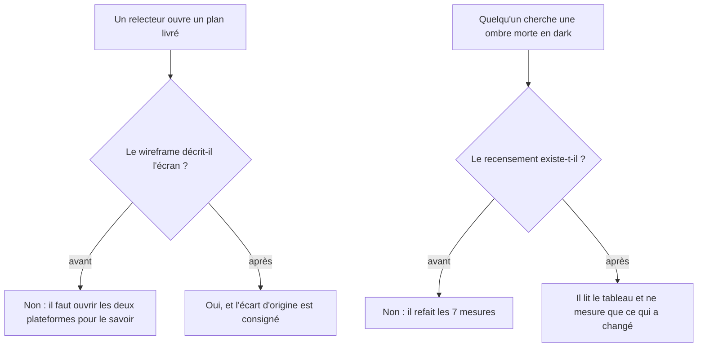
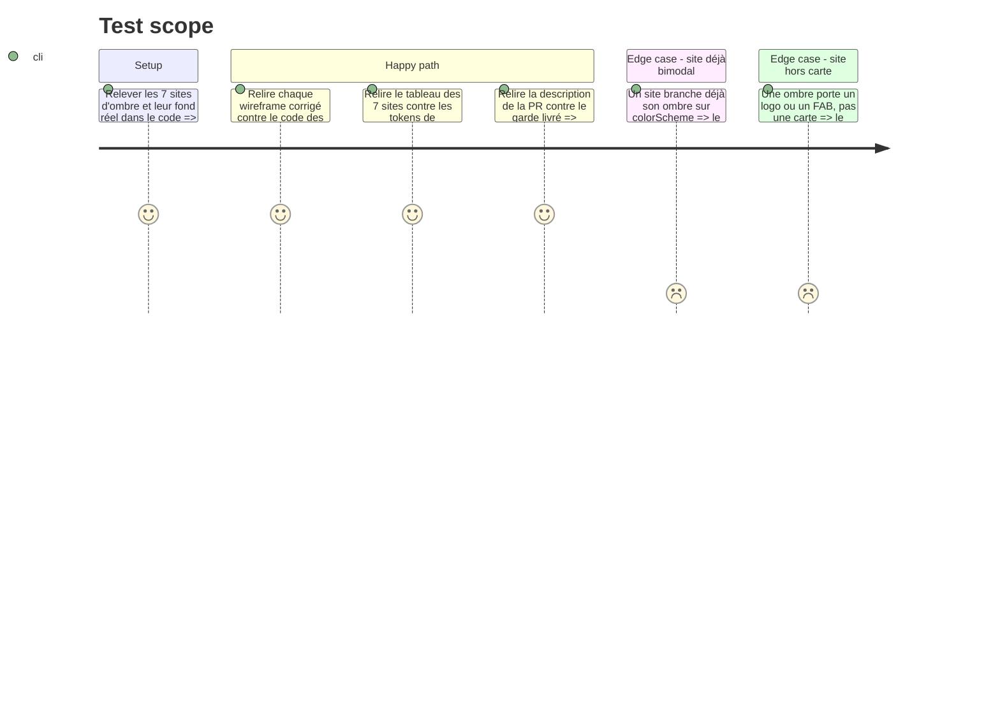

<!-- Fill or omit these sections; never add, rename, or reorder one. -->

# Instruction: les plans décrivent ce qui a été livré

Quatre records du dépôt disent autre chose que le livré :

| Record                                            | Ce qu'il dit                                     | Ce qui est livré                                                     |
| ------------------------------------------------- | ------------------------------------------------ | -------------------------------------------------------------------- |
| Wireframes des phases 2 et 4 (plan lexical)       | « pas de (4) : on ne pointe pas une intention »  | Web **et** iOS portent « Déjà pointé » sur le formulaire de prévision |
| Phase 2 du plan follow-ups, critère 1             | un compte de tests de référence est cité         | aucun chiffre dans le dépôt                                          |
| Phase 3 du plan follow-ups, critère 1             | le tableau 7 sites → fond → verdict est livré    | le tableau n'existe nulle part                                       |
| Description de la PR 594                          | « ne s'affiche plus nulle part »                 | vrai pour l'app, et garanti pour l'avenir seulement après la phase 1 |

Un plan qu'on laisse mentir sur le livré coûte au relecteur suivant le temps de le rejouer contre
le code. C'est la seule raison de cette phase — aucun de ces quatre points n'est un défaut de
produit.

## Architecture projection

> Tree of the final files. ✅ create · ✏️ modify · ❌ delete

```txt
.
└── aidd_docs/tasks/2026_08/
    ├── 2026_08_09_vocabulaire-prevision-mouvement/
    │   ├── phase-2.md   ✏️  wireframe : le bloc (4) est porté par les deux entités
    │   └── phase-4.md   ✏️  même correction, et l'écart consigné dans son verdict
    └── 2026_08_11_followups-dark-card-et-plafond-tests/
        ├── phase-2.md   ✏️  le compte de tests, relevé et cité
        └── phase-3.md   ✏️  le tableau des 7 sites, livrable nommé de la tâche 1
```

> La description de la PR 594 est éditée sur GitHub, hors dépôt.

## User Journey



## Test Scope



## Tasks to do

### `1)` Rendre aux deux wireframes l'écran qu'ils dessinent

> Décision produit rendue en session : le contrôle reste, c'est le croquis qui est faux.

1. Dans `phase-2.md` et `phase-4.md` du plan lexical, remplacer le bloc `(pas de (4) : on ne pointe
   pas une intention)` par un bloc (4) présent des deux côtés.
2. Écrire la raison sous le croquis, une phrase : le pointage est un axe orthogonal que les deux
   entités portent, et il est déjà en place sur les deux plateformes — ce qui est aussi pourquoi il
   descend près des actions plutôt que dans le bandeau qui distingue.
3. Ajouter une ligne aux « ÉCARTS AVEC LE PLAN » du verdict de `phase-4.md` : le croquis d'origine
   décrivait un écran qui n'a jamais existé, l'écart a été tranché en gardant le contrôle.
4. Ne toucher à aucun autre bloc des deux wireframes : l'ordre livré est conforme et vérifié.

### `2)` Consigner le compte de tests que la phase 2 devait citer

> Le relevé pré-découpage n'existe plus. Ce qui le remplace doit être vérifiable après coup, sinon
> le critère reste une affirmation.

1. Dans `phase-2.md` du plan follow-ups, remplacer le critère 1 par ce qui se vérifie encore :
   l'égalité des ensembles de `@Test` entre l'avant et l'après du commit de découpage.
2. Citer les chiffres : projection 17 → 10 + 7, spread 8 → 6 + 2, mesurés sur `06bce3465` et son
   parent.
3. Écrire pourquoi le critère change de forme : un compte exécuté ne se relève plus après coup,
   là où l'égalité des `@Test` se recompte depuis git à n'importe quel moment.
4. Garder l'avertissement qui motivait le critère — un `-only-testing:` qui ne matche rien affiche
   `TEST SUCCEEDED` à zéro test — puisque c'est lui qui reste vrai.

### `3)` Écrire le tableau des 7 sites d'ombre

> C'est le livrable nommé de la tâche 1 de la phase 3, et il manque.

1. Pour chacun des 7 sites, remonter la hiérarchie de vues jusqu'au premier fond opaque et noter sa
   couleur en dark, telle qu'elle est déclarée dans `Color+Pulpe.swift`.
2. Produire le tableau site → token d'ombre → fond réel → verdict dans `phase-3.md`, sous la
   tâche 1.
3. Trois verdicts au lieu de deux, parce que les sites ne se rangent pas en deux tas :
   `morte` (ombre noire sur fond quasi-noir), `vivante` (fond assez clair pour la porter), et
   `déjà bimodale` (le site branche lui-même son rendu sur `colorScheme`).
4. Ce troisième verdict est ce qui manquait : `AuthTextField:65` et `CurrencyField:233` portent une
   ombre à 1 % de noir en dark — délibérément neutralisée, jamais « vivante ». Les classer
   « vivante » égarerait le prochain qui cherche les ombres mortes.
5. Noter pour chaque site non modifié pourquoi il ne l'a pas été, en une ligne. Un site sain doit
   pouvoir être reconnu comme tel sans être re-mesuré.

### `4)` Rendre la description de la PR vérifiable

> Deux affirmations à ajuster, aucune à retirer.

1. Remplacer « ne s'affiche plus nulle part » par ce qui se prouve : le mot ne paraît sur aucun
   écran des deux applications, et un garde de dépôt l'y tient — la phase 1 étant ce qui rend la
   seconde moitié vraie pour toutes les formes de littéral.
2. Ajouter deux phrases sur l'origine du chantier « home » : travail piloté par `/impeccable` sur la
   page, sans dossier de plan, à la différence des deux autres chantiers de la branche. C'est ce qui
   explique qu'aucun critère d'acceptation ne lui corresponde.
3. Ne pas écrire de liste de suivi dans la description : `CLAUDE.md § Scope Discipline` l'interdit,
   et ce plan est déjà le suivi.

## Test acceptance criteria

<!-- Each criterion is an observable behavior, not a command. -->

| Task | Acceptance criteria                                                                                                                                          |
| ---- | -------------------------------------------------------------------------------------------------------------------------------------------------------------- |
| 1    | Quelqu'un qui lit les deux wireframes puis ouvre les deux formulaires de prévision voit le même écran, et sait pourquoi le croquis d'origine disait le contraire. |
| 2    | Le critère 1 de la phase 2 se vérifie depuis git seul, chiffres cités, et l'avertissement sur `-only-testing:` est conservé.                                     |
| 3    | Le tableau couvre les 7 sites, chaque verdict adossé à une couleur relevée dans le code, et chaque site non modifié porte la raison de ne pas l'avoir été.        |
| 4    | Aucune phrase de la description de la PR n'affirme plus que la revue ne peut vérifier, et l'origine du chantier « home » y est nommée.                            |
