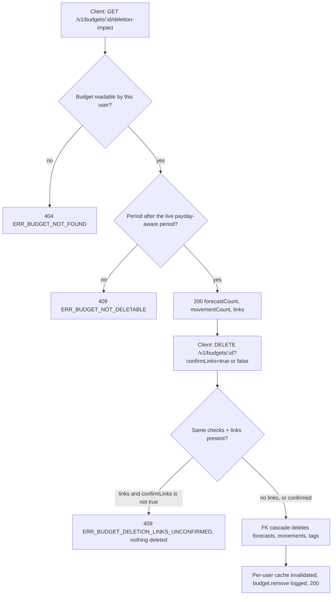
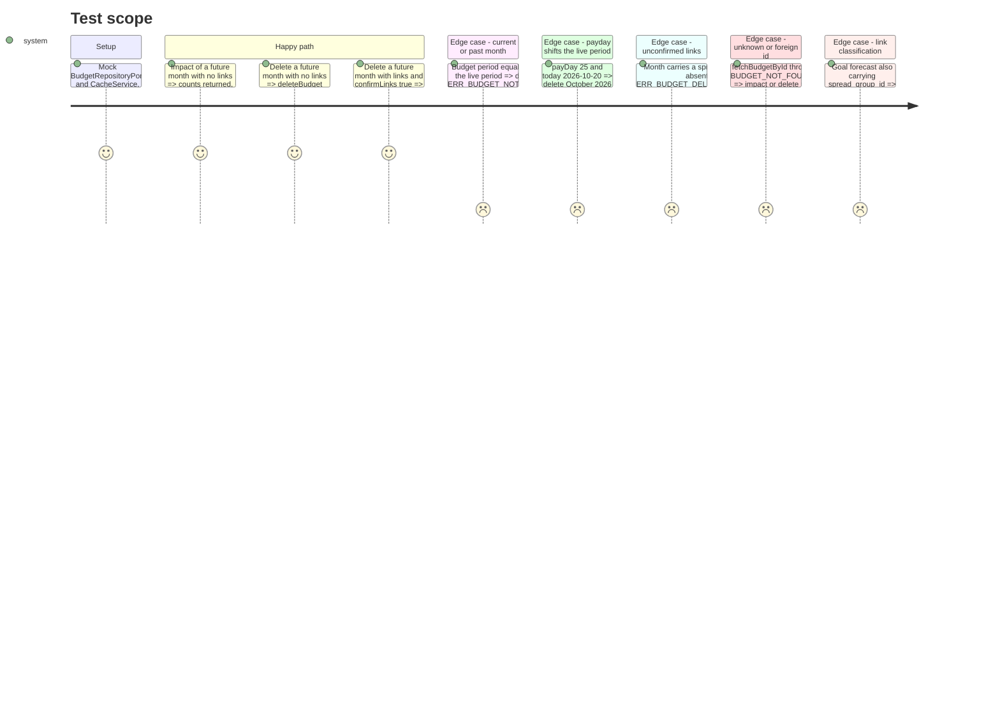

<!-- Fill or omit these sections; never add, rename, or reorder one. -->

# Instruction: Server rule, deletion impact and shared contracts

## Architecture projection

> Tree of the final files. ✅ create · ✏️ modify · ❌ delete

```txt
.
├── shared/
│   ├── schemas.ts                                   ✏️ budgetDeletionImpactSchema, budgetDeletionImpactResponseSchema, budgetDeleteQuerySchema + types
│   ├── index.ts                                     ✏️ export the three schemas and their types
│   └── src/error-codes.ts                           ✏️ BUDGET_NOT_DELETABLE, BUDGET_DELETION_LINKS_UNCONFIRMED
├── backend-nest/src/
│   ├── common/constants/error-definitions.ts        ✏️ two 409 definitions (French messages)
│   └── modules/budget/
│       ├── domain/
│       │   ├── budget-deletion.ts                   ✅ link-row types, summarizeDeletionImpact, hasDeletionLinks
│       │   ├── budget-deletion.spec.ts              ✅ classification + counts
│       │   └── ports/budget-repository.port.ts      ✏️ fetchDeletionLinkRows(budgetId)
│       ├── application/
│       │   ├── remove-budget.use-case.ts            ✏️ impact(id, user) + execute(id, user, confirmLinks)
│       │   └── remove-budget.use-case.spec.ts       ✅ ownership, period rule, link handshake
│       └── infrastructure/
│           ├── persistence/supabase-budget.repository.ts   ✏️ fetchDeletionLinkRows (two user-scoped selects)
│           └── http/
│               ├── budget.controller.ts             ✏️ GET :id/deletion-impact, DELETE ?confirmLinks
│               └── dto/budget-swagger.dto.ts        ✏️ BudgetDeletionImpactResponseDto, BudgetDeleteQueryDto
└── docs/BUSINESS_RULES.md                            ✏️ section "Suppression d'un mois"
```

## User Journey



## Test Scope



## Tasks to do

### `1)` Shared contracts

> One source of truth for the impact payload, the delete query and the two new error codes.

1. In `shared/schemas.ts`, next to `savingsGoalDeletionImpactSchema`, add `budgetDeletionImpactSchema`:
   - `forecastCount`, `movementCount`: non-negative integers.
   - `links`: an object of non-negative integers `spreadForecasts`, `savingsGoalForecasts`, `savingsWithdrawalForecasts`, `savingsWithdrawalMovements`.
   - Export the type `BudgetDeletionImpact`.
2. Next to `savingsGoalDeletionImpactResponseSchema`, add `budgetDeletionImpactResponseSchema = createSuccessResponse(budgetDeletionImpactSchema)` and its type.
3. Next to `budgetDeleteResponseSchema`, add `budgetDeleteQuerySchema = z.strictObject({ confirmLinks: z.enum(['true', 'false']).optional() })` and its type. Use a plain enum, not `z.stringbool`, because `z.stringbool` is a codec and a codec through `createZodDto` is untested here.
4. Export the three schemas and their types from `shared/index.ts`, next to the existing budget and deletion-impact exports.
5. In `shared/src/error-codes.ts`, Budget section, add `BUDGET_NOT_DELETABLE: 'ERR_BUDGET_NOT_DELETABLE'` and `BUDGET_DELETION_LINKS_UNCONFIRMED: 'ERR_BUDGET_DELETION_LINKS_UNCONFIRMED'`.
6. Run `pnpm build:shared`.

### `2)` Error definitions

> Refusals are 409s with French messages, because the MCP controller forwards messages under 500 to the agent.

1. In `backend-nest/src/common/constants/error-definitions.ts`, add `BUDGET_NOT_DELETABLE`, `HttpStatus.CONFLICT`, with the message "Seuls les mois à venir peuvent être supprimés".
2. Add `BUDGET_DELETION_LINKS_UNCONFIRMED`, `HttpStatus.CONFLICT`, with the message "Ce mois est lié à d'autres mois : confirme la suppression de ces liens".
3. Copy the shape of `BUDGET_LINE_NOT_POSTPONABLE`.

### `3)` Pure deletion summary

> Turn raw link columns into the impact payload with one exclusive classification per forecast.

1. Create `budget/domain/budget-deletion.ts` with these types:
   - `BudgetDeletionLinkRows = { lines: { spreadGroupId; savingsGoalId; savingsWithdrawalGroupId; sourceSavingsGoalId }[]; movements: { sourceSavingsGoalId }[] }`, every field `string | null`.
2. `summarizeDeletionImpact(rows): BudgetDeletionImpact` returns:
   - `forecastCount = lines.length` and `movementCount = movements.length`.
   - For each line, the first match wins:
     1. withdrawal (`savingsWithdrawalGroupId` or `sourceSavingsGoalId`)
     2. goal (`savingsGoalId`)
     3. spread (`spreadGroupId`)
   - `savingsWithdrawalMovements` = the movements with a `sourceSavingsGoalId`.
   - Write a ponytail comment on the precedence: goal-generated lines also carry `spread_group_id` = the goal id.
3. `hasDeletionLinks(impact)` is true when any `links` count is above 0.
4. In `budget-deletion.spec.ts`, cover:
   - empty rows
   - each category
   - precedence: goal + spread is counted as goal, withdrawal + goal as withdrawal
   - movements
   - `hasDeletionLinks`

### `4)` Repository read of the link columns

> Read the month's link columns through the user-scoped client, so RLS still applies.

1. In `budget-repository.port.ts`, add `fetchDeletionLinkRows(budgetId: string): Promise<BudgetDeletionLinkRows>`.
2. In `supabase-budget.repository.ts`, implement it with two selects on the authenticated client:
   - `budget_line`: `spread_group_id, savings_goal_id, savings_withdrawal_group_id, source_savings_goal_id`, with `.eq('budget_id', id)`.
   - `transaction`: `source_savings_goal_id`, with `.eq('budget_id', id)`.
   - Map both to camelCase.
   - Map any error to `BUDGET_FETCH_FAILED`, as the neighbouring reads do.

### `5)` Use case: rule + handshake

> One place decides whether a month can go, and what goes with it.

1. In `remove-budget.use-case.ts`, add `impact(id, user): Promise<BudgetDeletionImpact>`:
   - `const budget = await repo.fetchBudgetById(id, user.id)`. Its 404 propagates.
   - `live = getBudgetPeriodForDate(parseIsoDateLocal(formatBusinessCalendarDate()), user.payDayOfMonth)`.
   - If `compareBudgetPeriods({ month: budget.month, year: budget.year }, live) <= 0`, throw `BusinessException(ERROR_DEFINITIONS.BUDGET_NOT_DELETABLE)`.
   - Return `summarizeDeletionImpact(await repo.fetchDeletionLinkRows(id))`.
2. Change `execute(id, user, confirmLinks = false): Promise<BudgetDeletionImpact>`:
   - `const impact = await this.impact(id, user)`.
   - If `hasDeletionLinks(impact) && !confirmLinks`, throw `BUDGET_DELETION_LINKS_UNCONFIRMED` with `details: { links: impact.links }`.
   - Otherwise, run the existing `deleteBudget`, `invalidateForUser` and log. Add `confirmLinks` to the log context.
   - Return `impact`. The MCP adapter in phase 2 uses it to name the counts. The controller ignores it.
3. In `remove-budget.use-case.spec.ts`, cover every Test Scope section (pattern: `resolve-next-month-budget.use-case.spec.ts`, mocks from `bun:test`, `setSystemTime`).

### `6)` HTTP surface

> Expose the impact read and the confirmation flag. The routes stay documented in Swagger.

1. In `budget-swagger.dto.ts`, add `BudgetDeletionImpactResponseDto` (`createZodDto(budgetDeletionImpactResponseSchema)`) and `BudgetDeleteQueryDto` (`createZodDto(budgetDeleteQuerySchema)`).
2. In `budget.controller.ts`, add `@Get(':id/deletion-impact')`:
   - Params: `ParseUUIDPipe` and `@User()`.
   - Returns `{ success: true, data: await removeBudgetUseCase.impact(id, user) }`.
   - Swagger: 200 / 404 / 409.
3. In `budget.controller.ts`, change `remove`:
   - Add `@Query() query: BudgetDeleteQueryDto` and pass `query.confirmLinks === 'true'`.
   - Add `@ApiQuery` for `confirmLinks` and a 409 `@ApiResponse`.
   - The response body stays the same.

### `7)` Business rule doc

> Record the cross-cutting invariant where the next reader looks.

1. In `docs/BUSINESS_RULES.md`, add a `## Suppression d'un mois` section after `## Lissage`. In French, state:
   - only a month after the live period (pay-day aware, calendar `Europe/Zurich`) can be deleted;
   - its Prévisions, Réels and tags go with it;
   - the other months keep their share of a dépense lissée, a goal or a withdrawal;
   - the rollover needs no recompute;
   - links require `confirmLinks=true`.
2. Link to `remove-budget.use-case.ts`.

## Test acceptance criteria

| Task | Acceptance criteria                                                                                                                                                                      |
| ---- | ---------------------------------------------------------------------------------------------------------------------------------------------------------------------------------------- |
| 1    | `pulpe-shared` exports the three schemas and the two codes. `budgetDeleteQuerySchema` rejects any other query key and any value other than `'true'` or `'false'`.                         |
| 2    | Both new definitions answer HTTP 409 with their `ERR_*` code and a French message.                                                                                                        |
| 3    | A goal forecast that also carries `spread_group_id` counts once, as a goal. A withdrawal forecast counts once, as a withdrawal. Movements with a source goal count as withdrawal movements. |
| 4    | `fetchDeletionLinkRows` returns only the given budget's rows, read through the user-scoped client.                                                                                        |
| 5    | Current and past months are refused with 409 and `deleteBudget` is not called. A linked future month without confirmation is refused with 409 and `details.links`. A confirmed or unlinked future month is deleted and the cache is invalidated. An unknown id is a 404. |
| 6    | `GET /v1/budgets/:id/deletion-impact` returns `{ success, data }` matching the shared schema. `DELETE ?confirmLinks=true` reaches the use case as `true`, and a missing flag reaches it as `false`. |
| 7    | `docs/BUSINESS_RULES.md` has a "Suppression d'un mois" section that states the period rule, the link confirmation and the "no rollover recompute" fact.                                   |

Validation (scoped):

```bash
pnpm build:shared
cd backend-nest && bun test src/modules/budget/domain/budget-deletion.spec.ts src/modules/budget/application/remove-budget.use-case.spec.ts src/modules/budget/infrastructure/persistence/supabase-budget.repository.spec.ts
cd backend-nest && bun run type-check:full && bun run lint && bun run lint:arch && bun run format:check
pnpm test:public-surface
```
