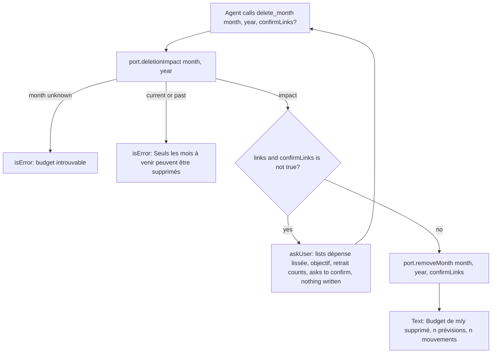
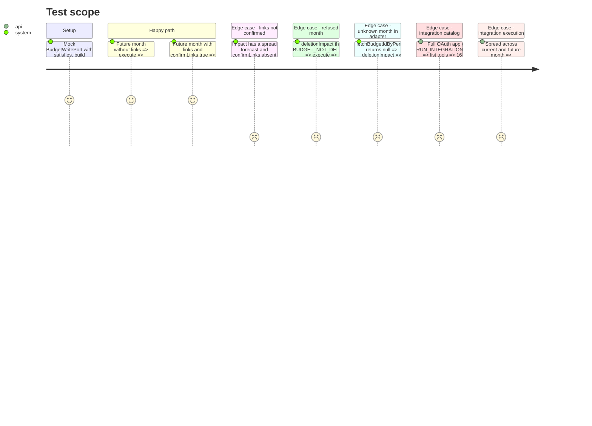

<!-- Fill or omit these sections; never add, rename, or reorder one. -->

# Instruction: MCP `delete_month` tool

## Architecture projection

> Tree of the final files. ✅ create · ✏️ modify · ❌ delete

```txt
.
└── backend-nest/src/modules/
    ├── budget/
    │   ├── domain/ports/budget-write.port.ts                    ✏️ + deletionImpact(month, year), removeMonth(month, year, confirmLinks)
    │   ├── application/
    │   │   ├── create-budget-in-process.use-case.ts             ❌ renamed (git mv)
    │   │   ├── write-budgets-in-process.use-case.ts              ✅ WriteBudgetsInProcessUseCase: createFromTemplate + the two new methods
    │   │   └── write-budgets-in-process.use-case.spec.ts         ✅ period → id resolution, 404, session user + confirmLinks passthrough
    │   └── budget.module.ts                                     ✏️ provider + useExisting binding renamed
    └── mcp/
        ├── mcp.module.ts                                        ✏️ DeleteMonthTool in TOOLS
        └── infrastructure/
            ├── tools/write/
            │   ├── delete-month.tool.ts                         ✅ delete_month
            │   └── delete-month.tool.spec.ts                    ✅ askUser on links, delete on confirm, annotations
            └── oauth/mcp-oauth.integration.spec.ts              ✏️ 15 → 16 tools, lists, execute-all scenario
```

## User Journey



## Test Scope



## Tasks to do

### `1)` Extend the budget write port

> MCP reaches budget deletion only through the exported port (ADR-0002).

1. In `budget-write.port.ts`, add these methods and update the JSDoc to "Create or delete the budget of a month…":
   - `deletionImpact(month: number, year: number): Promise<BudgetDeletionImpact>`
   - `removeMonth(month: number, year: number, confirmLinks: boolean): Promise<BudgetDeletionImpact>`
2. Rename the adapter with `git mv` from `create-budget-in-process.use-case.ts` to `write-budgets-in-process.use-case.ts`, class `WriteBudgetsInProcessUseCase`.
   - Inject `RemoveBudgetUseCase` and `@Inject(BUDGET_REPOSITORY) repo`.
   - Add a private `#budgetId(month, year)`: `repo.fetchBudgetIdByPeriod(month, year)`. If the result is `null`, throw `BusinessException(ERROR_DEFINITIONS.BUDGET_NOT_FOUND)`.
   - `deletionImpact` delegates to `removeBudget.impact(id, session.user)`.
   - `removeMonth` returns `removeBudget.execute(id, session.user, confirmLinks)`, which returns the deleted month's impact so the tool can name the counts.
3. In `budget.module.ts`, rename the import, the provider and `{ provide: BUDGET_WRITE_PORT, useExisting: WriteBudgetsInProcessUseCase }`.
4. In `write-budgets-in-process.use-case.spec.ts`, use mocked `RemoveBudgetUseCase`, repo and session. Cover:
   - id resolution
   - a null id gives a 404
   - `confirmLinks` and `session.user` are passed through
   - `createFromTemplate` is unchanged

### `2)` The tool

> A destructive and non-idempotent tool that never deletes linked months without an explicit yes.

1. Create `delete-month.tool.ts`, modeled on `create-month-from-template.tool.ts`:
   - `inputSchema`:
     - `month: budgetSchema.shape.month.describe('Mois à supprimer, 1 pour janvier')`
     - `year: budgetSchema.shape.year.describe('Année du mois à supprimer')`
     - `confirmLinks: z.boolean().optional().describe('true seulement après que l’utilisateur a accepté de supprimer aussi les liens avec d’autres mois')`
   - `name = 'delete_month'`
   - `title = 'Supprimer le budget d’un mois'`
   - `description`: "Supprime définitivement le budget d’un mois à venir, avec ses prévisions et ses mouvements. Le mois en cours et les mois passés ne peuvent pas être supprimés. À n’appeler qu’après confirmation explicite de l’utilisateur."
   - `mode = 'read_write'`
   - annotations: `readOnlyHint: false`, `destructiveHint: true`, `idempotentHint: false`, `openWorldHint: false as const`
2. In `execute`:
   1. `const impact = await budgets.deletionImpact(month, year)`.
   2. If any link count is above 0 and `confirmLinks !== true`, return `askUser(...)`. The question names the month and the non-zero counts: "dépense lissée (n)", "objectif d’épargne (n)", "retrait d’épargne (n)". Count both withdrawal forecasts and withdrawal movements. Finish with "puis rappelle delete_month avec confirmLinks: true".
   3. Otherwise, call `removeMonth(month, year, confirmLinks === true)`.
   4. Return `Budget de ${month}/${year} supprimé (${forecastCount} prévisions, ${movementCount} mouvements).`
   - The word "transaction" never appears.
3. Register `DeleteMonthTool` in `TOOLS` in `mcp.module.ts`, after `CreateMonthFromTemplateTool`.
4. In `delete-month.tool.spec.ts`, use a mocked port (`satisfies BudgetWritePort`). Cover every unit Test Scope section, plus an annotation assertion.

### `3)` Integration spec lists

> Keep the advertised catalog and the execution matrix honest.

1. In `mcp-oauth.integration.spec.ts`, change the counts:
   - "lists the 15 tools" → 16, and `toHaveLength(15)` → 16
   - "advertises all 15 tools" → 16
   - "executes all 15 tools" → 16, and `used.size` 15 → 16
2. Add `delete_month` to `writes` and to `destructive`. Leave the idempotent list unchanged.
3. In the execute-all test, after `delete_movement`:
   1. `call('delete_month', future)` → expect `'Information manquante'`. The future month carries the spread part.
   2. `call('delete_month', { ...future, confirmLinks: true })` → expect `'supprimé'`.
   3. Use the admin client to assert that `monthly_budget` `futureId` is gone, and that the current month still has its "Matrix rent" part.
   4. A raw `mcp(token, 'tools/call', { name: 'delete_month', arguments: period })` → `result.isError === true`.

## Test acceptance criteria

| Task | Acceptance criteria                                                                                                                                                                                                              |
| ---- | -------------------------------------------------------------------------------------------------------------------------------------------------------------------------------------------------------------------------------- |
| 1    | The MCP module reaches deletion only through `BUDGET_WRITE_PORT`, so `lint:arch` passes. An unknown month gives a 404 business error. The session user and `confirmLinks` reach `RemoveBudgetUseCase`. Month creation behaves as before. |
| 2    | Without `confirmLinks`, a linked month returns an "Information manquante" question that lists the links and deletes nothing. With it, the month is deleted and the reply names month, year and counts. Current and past months come back as tool errors. |
| 3    | The catalog advertises 16 tools. `delete_month` has `destructiveHint` true and `idempotentHint` false, and is refused under a read-only grant. The execute-all scenario deletes the future month only after confirmation. |

Validation (scoped):

```bash
cd backend-nest && bun test src/modules/mcp/infrastructure/tools/write/delete-month.tool.spec.ts src/modules/budget/application/write-budgets-in-process.use-case.spec.ts
cd backend-nest && bun run type-check:full && bun run lint && bun run lint:arch && bun run format:check
cd backend-nest && RUN_INTEGRATION_TESTS=true bun --env-file=.env.local test src/modules/mcp/infrastructure/oauth/mcp-oauth.integration.spec.ts   # needs local Supabase started from the main repo
```
