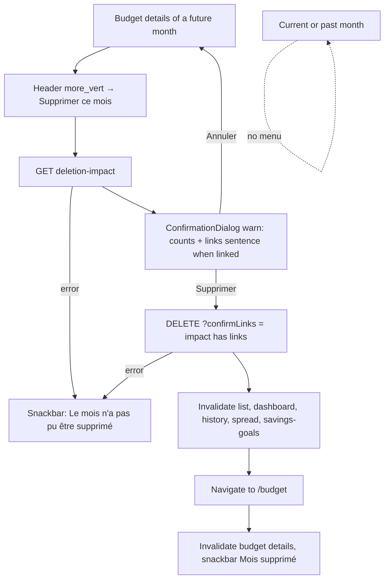
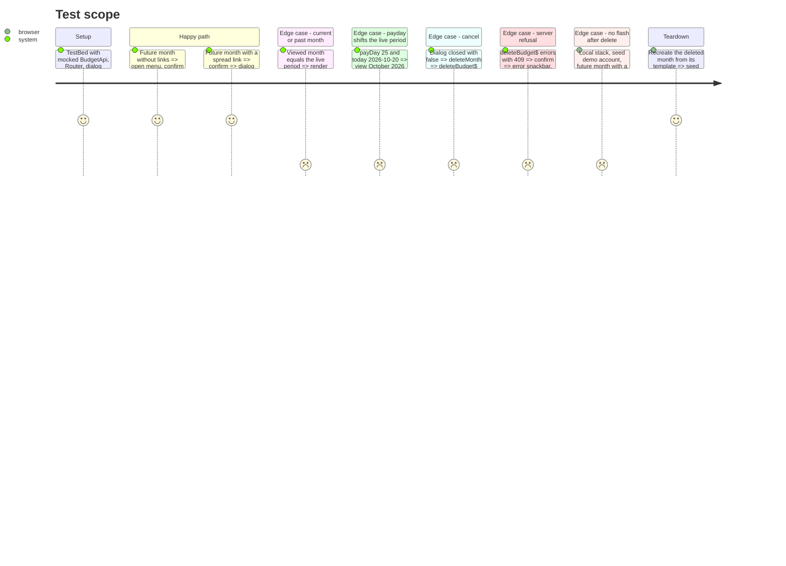

<!-- Fill or omit these sections; never add, rename, or reorder one. -->

# Instruction: Web app, "Supprimer ce mois" on the budget details page

## Architecture projection

> Tree of the final files. ✅ create · ✏️ modify · ❌ delete

```txt
.
└── frontend/projects/webapp/
    ├── src/app/core/budget/
    │   ├── budget-api.ts                                         ✏️ getDeletionImpact$(id), deleteBudget$(id, confirmLinks)
    │   └── budget-api.spec.ts                                    ✏️ URL, query flag, schema unwrap
    ├── src/app/feature/budget/budget-details/
    │   ├── store/budget-details-store.ts                         ✏️ isViewedMonthFuture, deletionImpact(), deleteMonth(confirmLinks, leave)
    │   ├── store/budget-details-store.spec.ts                    ✏️ future gate (payday-aware), invalidation order
    │   ├── budget-details-page.ts                                ✏️ MatMenuModule, deleteMonth() orchestration + message builder
    │   ├── budget-details-page.html                              ✏️ more_vert menu in the header, future months only
    │   └── budget-details-page.spec.ts                           ✏️ menu visibility, confirm → delete → navigate, cancel → nothing
    └── public/i18n/{fr,en,de,it}.json                            ✏️ budget.deleteMonth*, budget.monthDeleted, budget.monthDeleteError, settings.connections.tools.delete_month
```

## User Journey



## Test Scope



## Wireframe

```txt
┌──────────────────────────────────────────────────────────────┐
│ (1) Header                                                   │
│ [‹]  ┌──────────────────────────────┐  [›]  [⋮] (2)          │
│      │      novembre 2026           │                        │
│      │  25 oct. – 24 nov.           │        ┌─────────────┐ │
│      └──────────────────────────────┘        │(3) 🗑 Suppr. │ │
│                                              │   ce mois    │ │
│                                              └─────────────┘ │
├──────────────────────────────────────────────────────────────┤
│ (4) Financial overview / items (unchanged)                   │
└──────────────────────────────────────────────────────────────┘

┌───────────────────────────────────────────┐
│ (5) Confirmation dialog (warn)            │
│  Title: Supprimer novembre 2026 ?         │
│  Message: counts sentence                 │
│           + links sentence (if linked)    │
│                     [Annuler] [Supprimer] │
└───────────────────────────────────────────┘
```

1. Header: the existing flex row with the month chevrons and the centered title.
2. Month menu trigger: icon button, last flex item, rendered only for future months. On desktop it sits after the "Mois suivant" text button.
3. Menu: one destructive item styled like the delete item of `budget-action-menu`.
4. The rest of the page does not change.
5. The existing `ConfirmationDialog`, reached through `BudgetDetailsDialogService.confirmDelete`. The confirm button uses the warn color.

## Tasks to do

### `1)` API client

> Two calls, both validated by the shared schemas.

1. In `budget-api.ts`, add `getDeletionImpact$(budgetId)`: `#api.get$(`/budgets/${budgetId}/deletion-impact`, budgetDeletionImpactResponseSchema)` mapped to `.data`.
2. Add `deleteBudget$(budgetId, confirmLinks: boolean)`: `#api.delete$(`/budgets/${budgetId}?confirmLinks=${confirmLinks}`, budgetDeleteResponseSchema)`. Same query-string precedent as `deleteSavingsWithdrawal$`.
3. In `budget-api.spec.ts`, cover both URLs, the flag value and the unwrap.

### `2)` Store

> The future-month gate and the deletion live where the other period gates and mutations live.

1. In `budget-details-store.ts`, add a public `isViewedMonthFuture = computed(() => reference && compareBudgetPeriods(reference, this.#spreadLivePeriod()) > 0)`. It sits next to `#isViewedMonthCurrentOrFuture` and reuses the same payday-aware axes.
2. Add `async deletionImpact(): Promise<BudgetDeletionImpact | null>`: `firstValueFrom(#budgetApi.getDeletionImpact$(id))`, with `null` on error.
3. Add `async deleteMonth(confirmLinks: boolean, leave: () => Promise<unknown>): Promise<boolean>`:
   1. `await firstValueFrom(#budgetApi.deleteBudget$(id, confirmLinks))`. On error, return `false`.
   2. Invalidate `['budget','list']`, `['budget','dashboard']`, `['budget','history']` and `['budget','spread']` on `#budgetApi.cache`, and `['savings-goals']` on `#savingsGoalApi.cache`.
   3. `await leave()`.
   4. Only then invalidate `['budget','details']`. Add a ponytail comment: invalidating details while this page is still mounted would refetch the deleted id and flash a 404.
   5. Return `true`.
4. In `budget-details-store.spec.ts`, cover:
   - `isViewedMonthFuture` for current, past, future and the payday shift;
   - `deleteMonth`: no invalidation on failure; `leave` runs before the details key is invalidated.

### `3)` Page and header

> One menu entry, one confirmation, then back to the list.

1. In `budget-details-page.ts`, import `MatMenuModule` and add `protected async deleteMonth()`:
   1. `const impact = await store.deletionImpact()`. If it is `null`, show the error snackbar `budget.monthDeleteError` and stop.
   2. `confirmed = await #dialogService.confirmDelete({ title: t('budget.deleteMonthTitle', { month: displayName() }), message })`.
   3. If confirmed: `ok = await store.deleteMonth(hasLinks, () => #router.navigate(['/', ROUTES.BUDGET]))`. Then show the snackbar `budget.monthDeleted`, or `budget.monthDeleteError` when `ok` is false.
2. Build `message` from `budget.deleteMonthMessage` (counts). When there are links, append `budget.deleteMonthLinks` with `links` set to the non-zero `budget.deleteMonthLink{Spread,Goal,Withdrawal}` labels joined by ", ". The withdrawal label adds withdrawal forecasts and withdrawal movements together.
3. `hasLinks` = any `impact.links` value is above 0.
4. In `budget-details-page.html`, add `@if (store.isViewedMonthFuture())` after the desktop next-month button:
   - an icon button `more_vert` with `[matMenuTriggerFor]`, `aria-label` `common.more`, `data-testid="budget-month-menu"`, `shrink-0`;
   - a `mat-menu` with one `mat-menu-item`: `delete` icon, `budget.deleteMonth`, `class="text-error"`, `data-testid="delete-month-button"`.
5. In `budget-details-page.spec.ts`, cover the visibility and flow sections of the Test Scope.

### `4)` Copy, 4 catalogs

> French first, tutoiement, Pulpe lexicon ("dépense lissée", "mouvements", never "transaction").

1. Under `budget` in `fr.json`, add:
   - `deleteMonth`: "Supprimer ce mois"
   - `deleteMonthTitle`: "Supprimer {{ month }} ?"
   - `deleteMonthMessage`: "Ses prévisions ({{ forecastCount }}) et ses mouvements ({{ movementCount }}) seront supprimés. Cette action est irréversible."
   - `deleteMonthLinks`: "Ce mois est aussi lié à d'autres mois : {{ links }}. Les autres mois gardent leur part."
   - `deleteMonthLinkSpread`: "dépense lissée ({{ count }})"
   - `deleteMonthLinkGoal`: "objectif d'épargne ({{ count }})"
   - `deleteMonthLinkWithdrawal`: "retrait d'épargne ({{ count }})"
   - `monthDeleted`: "Mois supprimé"
   - `monthDeleteError`: "Le mois n'a pas pu être supprimé"
2. Under `settings.connections.tools` in `fr.json`, add `delete_month`: "Mois supprimé".
3. Mirror every key in `en.json`, `de.json` and `it.json` with the same placeholders, following the `docs/I18N.md` registers (tu / du / tu).

## Test acceptance criteria

| Task | Acceptance criteria                                                                                                                                                                                   |
| ---- | ----------------------------------------------------------------------------------------------------------------------------------------------------------------------------------------------------- |
| 1    | The impact call hits `/budgets/:id/deletion-impact` and returns the parsed payload. The delete call carries `confirmLinks=true` or `confirmLinks=false`.                                                 |
| 2    | `isViewedMonthFuture` is true only after the live payday-aware period. After a successful delete, the list no longer shows the month, and the deleted month's details are never refetched while its page is mounted. |
| 3    | The menu appears on future months only. Confirming deletes and lands on the budget list with "Mois supprimé". Cancelling changes nothing. A refusal shows the error snackbar and stays on the page. |
| 4    | All four catalogs carry the same keys and placeholders. `pnpm test:lexicon` passes. The connections screen shows "Mois supprimé" for a `delete_month` activity.                                     |

Validation (scoped):

```bash
cd frontend && pnpm exec ng test --include "**/budget-api.spec.ts" --include "**/budget-details-store.spec.ts" --include "**/budget-details-page.spec.ts"
cd frontend && pnpm type-check && pnpm typecheck:spec && pnpm lint && pnpm format:check
cd frontend && pnpm exec ng build   # strictTemplates: only ng build checks the template; a fresh worktree needs frontend/.env
pnpm test:lexicon
```
