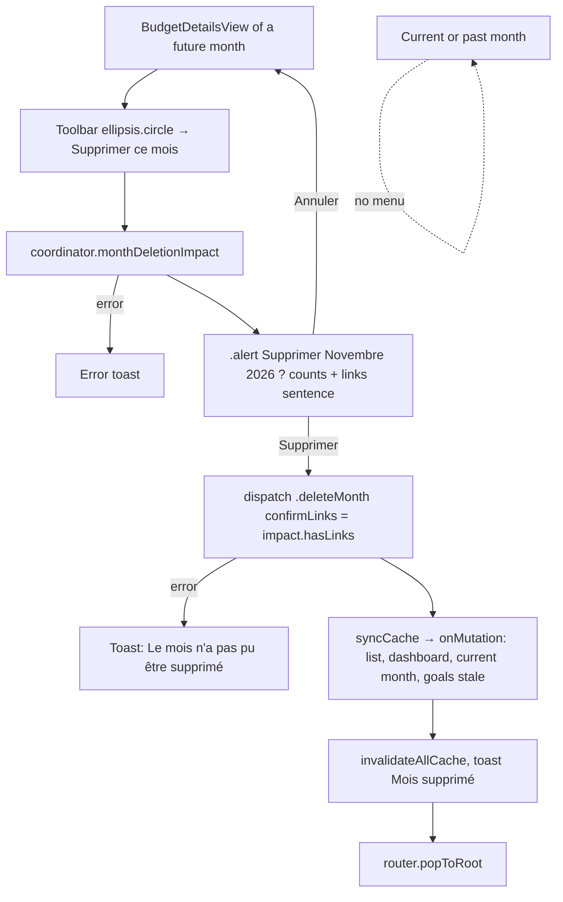
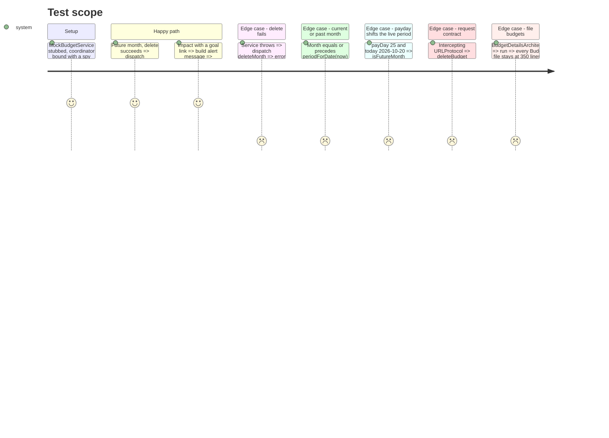

<!-- Fill or omit these sections; never add, rename, or reorder one. -->

# Instruction: iOS, "Supprimer ce mois" in the budget details toolbar

## Architecture projection

> Tree of the final files. ✅ create · ✏️ modify · ❌ delete

```txt
.
└── ios/
    ├── Pulpe/
    │   ├── Core/Network/Endpoints.swift                                  ✏️ budgetDelete(id:confirmLinks:), budgetDeletionImpact(id:)
    │   ├── Domain/Models/BudgetDeletionImpact.swift                      ✅ Codable impact + links + hasLinks
    │   ├── Domain/Services/BudgetService.swift                           ✏️ protocol gains getDeletionImpact + deleteBudget(id:confirmLinks:)
    │   ├── App/BudgetLongPressUITestHarness.swift                        ✏️ stubs for the two protocol methods
    │   ├── Features/Account/Connections/ConnectionDetailView.swift       ✏️ "delete_month" → "Mois supprimé"
    │   ├── Features/Budgets/BudgetDetails/
    │   │   ├── BudgetDetailsView.swift                                   ✏️ one `.modifier(DeleteMonthMenu(...))` line (347 → 348 LOC)
    │   │   ├── DeleteMonthMenu.swift                                     ✅ ViewModifier: toolbar Menu, alert, isFutureMonth, message
    │   │   └── Coordinator/
    │   │       ├── BudgetDetailsAction.swift                             ✏️ case deleteMonth(confirmLinks:, ToastContext, onDeleted:)
    │   │       ├── BudgetDetailsCoordinator.swift                        ✏️ chain dispatchMonthDeletion, move dispatchSideEffect out, budgetService internal
    │   │       ├── BudgetDetailsCoordinator+SoftDelete.swift             ✏️ receives dispatchSideEffect next to showCheckToastIfNeeded
    │   │       └── BudgetDetailsCoordinator+DeleteMonth.swift            ✅ monthDeletionImpact(), dispatchMonthDeletion(_:)
    │   └── Resources/Localizable.xcstrings                               ✏️ new keys, fr + en/de/it
    └── PulpeTests/
        ├── Helpers/MockBudgetService.swift                               ✏️ stubs + recorded calls
        ├── Domain/Services/BudgetDeleteRequestTests.swift                ✅ DELETE path + confirmLinks query, impact GET path
        └── Features/Budgets/BudgetDetails/
            ├── BudgetDetailsCoordinatorDeleteMonthTests.swift            ✅ success / failure paths
            ├── DeleteMonthMenuTests.swift                                ✅ payday-aware future gate + message
            └── DestructiveMenuStyleTests.swift                           ✏️ DeleteMonthMenu.swift in actionMenuFiles
```

## User Journey



## Test Scope



## Wireframe

```txt
┌───────────────────────────────────────────────┐
│ (1) Nav bar                                   │
│ [‹]     Novembre 2026 ▾        [▥] [⋯] (2)    │
│                               ┌─────────────┐ │
│                               │(3) 🗑 Suppr. │ │
│                               │  ce mois     │ │
│                               └─────────────┘ │
├───────────────────────────────────────────────┤
│ (4) Hero + sections (unchanged)               │
└───────────────────────────────────────────────┘

┌───────────────────────────────────────┐
│ (5) Alert                             │
│   Supprimer Novembre 2026 ?           │
│   counts sentence                     │
│   + links sentence (if linked)        │
│   [Annuler]            [Supprimer]    │
└───────────────────────────────────────┘
```

1. Nav bar: the existing back button, the title month menu and the `chart.bar` tracking button.
2. New `ellipsis.circle` Menu as a second `.topBarTrailing` item, shown on future months only.
3. One destructive entry, red title and red trash icon, inside a menu styled with `pulpeMenuContent()`.
4. The hero and the sections do not change.
5. A system `.alert` with the same shape as `TemplateListView`: cancel plus a destructive button.

## Tasks to do

### `1)` Network + service

> Two calls through the existing `APIClient`, behind the `BudgetServicing` seam the coordinator already uses.

1. In `Endpoints.swift`, add two cases:
   - `budgetDelete(id: String, confirmLinks: Bool)`: path `/budgets/\(id)`, method `.delete`, query item `confirmLinks` set to `"true"` or `"false"` in `urlRequest` (precedent: `.budgetLinesSavingsWithdrawalDelete`).
   - `budgetDeletionImpact(id: String)`: path `/budgets/\(id)/deletion-impact`, method `.get`.
2. Create `Domain/Models/BudgetDeletionImpact.swift`:
   - `struct BudgetDeletionImpact: Decodable, Equatable, Sendable { forecastCount, movementCount, links }`
   - `Links`: `spreadForecasts`, `savingsGoalForecasts`, `savingsWithdrawalForecasts`, `savingsWithdrawalMovements`
   - `var hasLinks: Bool`
3. In `BudgetService.swift`:
   - Add `getDeletionImpact(id:)` and `deleteBudget(id:confirmLinks:)` to `BudgetServicing`.
   - Replace the caller-less `deleteBudget(id:)` with `requestVoid(.budgetDelete(id:confirmLinks:), method: .delete)`.
   - `getDeletionImpact` uses `apiClient.request(.budgetDeletionImpact(id:), method: .get)`, like `SavingsGoalService.getDeletionImpact`.
4. Implement both methods in `MockBudgetService`, with recorded args and an injectable error, and in `BudgetGoalSpreadUITestService`, which throws `URLError(.unsupportedURL)` like its siblings.
5. Run `xcodegen generate --use-cache` for the new files.

### `2)` Coordinator: action, route, deletion

> Rule 9: the mutation goes through `dispatch`. Rule 11: `syncCache()` stays the invalidation choke point.

1. In `BudgetDetailsAction.swift`, add `case deleteMonth(confirmLinks: Bool, ToastContext, onDeleted: @MainActor () -> Void)`, with a one-line doc comment.
2. In `BudgetDetailsCoordinator.swift`, free lines first. The file is at the 350-line ceiling (`split("\n")` count).
   1. Move `dispatchSideEffect` into `BudgetDetailsCoordinator+SoftDelete.swift`, next to `showCheckToastIfNeeded`. Drop `private`; the `+Postpone` precedent does the same.
   2. Drop `private` from `budgetService`.
   3. Add `if await dispatchMonthDeletion(action) { return }` before `await dispatchSideEffect(action)`.
3. Create `BudgetDetailsCoordinator+DeleteMonth.swift`:
   - `func monthDeletionImpact() async throws -> BudgetDeletionImpact`: `budgetService.getDeletionImpact(id: dataStore.budgetId)`.
   - `func dispatchMonthDeletion(_ action:) async -> Bool`:
     1. Guard on `.deleteMonth`.
     2. `try await budgetService.deleteBudget(id:confirmLinks:)`. On error, show the toast "Le mois n'a pas pu être supprimé" (`.error`) and return `true`.
     3. On success, call `dataStore.syncCache()` (fires `onMutation`), then `dataStore.invalidateAllCache()`. Same precedent as `graftSavingsWithdrawal`, with a comment saying the month no longer exists.
     4. Show the toast "Mois supprimé", call `onDeleted()`, return `true`.
4. In `BudgetDetailsCoordinatorDeleteMonthTests.swift`, cover the happy and failure sections.

### `3)` View: toolbar menu + alert

> One line in the 347-line view. Everything else lives in a modifier file, like `PlannedWithdrawalUndoAlert`.

1. Create `DeleteMonthMenu.swift`, a `struct DeleteMonthMenu: ViewModifier`:
   - Inputs: `coordinator`, `screenState: BudgetDetailsScreenState`, `toastContext`.
   - Environment: `BudgetDetailsRouter`, `UserSettingsStore`.
   - State: `@State impact: BudgetDeletionImpact?`.
2. Add `static func isFutureMonth(month:year:payDayOfMonth:now:) -> Bool`, true when `BudgetPeriodCalculator.comparePeriods(BudgetPeriod(month:year:), BudgetPeriodCalculator.periodForDate(now, payDayOfMonth:)) > 0`. Do not use `Date.isFutureMonth`, which ignores the pay day.
3. Add `static func message(for impact:) -> String`: the counts sentence, plus the links sentence when `hasLinks`. The links sentence holds the non-zero "dépense lissée (n)", "objectif d'épargne (n)" and "retrait d'épargne (n)" labels joined by ", ". The withdrawal label adds withdrawal forecasts and movements together.
4. In `body`:
   1. `.toolbar { if isFutureMonth { ToolbarItem(placement: .topBarTrailing) { Menu { … } label: { Image(systemName: "ellipsis.circle") } } } }`:
      - The menu holds one `Button("Supprimer ce mois", systemImage: "trash", role: .destructive)` with `.tint(Color.destructivePrimary)`.
      - The menu gets `.pulpeMenuContent()` and `.accessibilityLabel(AppLocale.string("Plus d'options"))`.
      - The button runs `Task { impact = try? await coordinator.monthDeletionImpact() }` and shows an error toast when the result is nil.
   2. `.alert("Supprimer \(screenState.monthYear) ?", isPresented: impact != nil binding, presenting: impact)`:
      - `Annuler` is the cancel button.
      - `Supprimer` is destructive and dispatches `.deleteMonth(confirmLinks: impact.hasLinks, toastContext, onDeleted: { router.popToRoot() })`.
      - The message is `Text(Self.message(for:))`.
5. In `BudgetDetailsView.swift`, add `.modifier(DeleteMonthMenu(coordinator: coordinator, screenState: screenState, toastContext: toastContext))` after the `PlannedWithdrawalUndoAlert` modifier. The file goes to 348 lines.
6. Add `"DeleteMonthMenu.swift"` to `actionMenuFiles` in `DestructiveMenuStyleTests.swift`.
7. In `DeleteMonthMenuTests.swift`, cover the future gate (with the payday shift) and the message builder.

### `4)` Copy + MCP activity label

> French source strings, with every key translated in en/de/it, and the agent's new action named on the connections screen.

1. Add these keys to `Localizable.xcstrings`:
   - "Supprimer ce mois"
   - "Supprimer %@ ?"
   - "Ses prévisions (%lld) et ses mouvements (%lld) seront supprimés. Cette action est irréversible."
   - "Ce mois est aussi lié à d'autres mois : %@. Les autres mois gardent leur part."
   - "dépense lissée (%lld)"
   - "objectif d'épargne (%lld)"
   - "retrait d'épargne (%lld)"
   - "Mois supprimé"
   - "Le mois n'a pas pu être supprimé"
   - Give each key en, de and it values, following the `docs/I18N.md` registers. Keys that already exist, like "Plus d'options", "Annuler" and "Supprimer", are reused.
2. In `ConnectionDetailView.label(for:)`, add `case "delete_month": AppLocale.string("Mois supprimé")`.

## Test acceptance criteria

| Task | Acceptance criteria                                                                                                                                                                                                         |
| ---- | --------------------------------------------------------------------------------------------------------------------------------------------------------------------------------------------------------------------------- |
| 1    | The delete request is `DELETE /budgets/{id}?confirmLinks=true` or `confirmLinks=false`. The impact request is `GET /budgets/{id}/deletion-impact`, decoded from `data`. Both test doubles compile.                          |
| 2    | A successful delete marks the budget list, dashboard, current month and goals stale, empties the detail cache and calls `onDeleted` once. A failed delete shows an error toast and leaves the screen and cache unchanged. |
| 3    | The menu appears only on months after the live payday-aware period. Confirming deletes and pops back to the stack root, and the list no longer shows the month. Cancelling changes nothing. Every BudgetDetails file stays at 350 lines or fewer. |
| 4    | All new strings resolve in fr, en, de and it. A `delete_month` activity reads "Mois supprimé" on the connections screen.                                                                                                      |

Validation (scoped):

```bash
cd ios && xcodegen generate --use-cache
cd ios && xcodebuild test -scheme PulpeLocal -destination 'platform=iOS Simulator,name=Pulpe Tests' CODE_SIGNING_ALLOWED=NO \
  -only-testing:PulpeTests/BudgetDetailsCoordinatorDeleteMonthTests -only-testing:PulpeTests/DeleteMonthMenuTests \
  -only-testing:PulpeTests/BudgetDeleteRequestTests -only-testing:PulpeTests/DestructiveMenuStyleTests \
  -only-testing:PulpeTests/BudgetDetailsArchitectureTests -only-testing:PulpeTests/BudgetDetailsCoordinatorMutationTests -only-testing:PulpeTests/BudgetDetailsCoordinatorToastTests
# Swift Testing + -only-testing can report SUCCEEDED with 0 tests: check the executed count in the log before trusting green.
cd ios && swiftlint lint --strict Pulpe/Features/Budgets/BudgetDetails Pulpe/Domain Pulpe/Core/Network Pulpe/Features/Account/Connections
```
