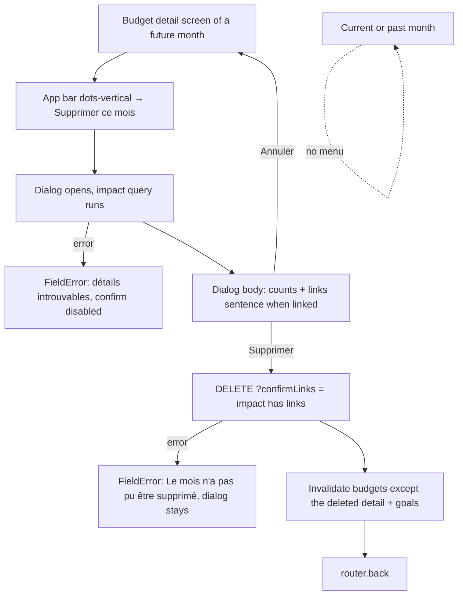
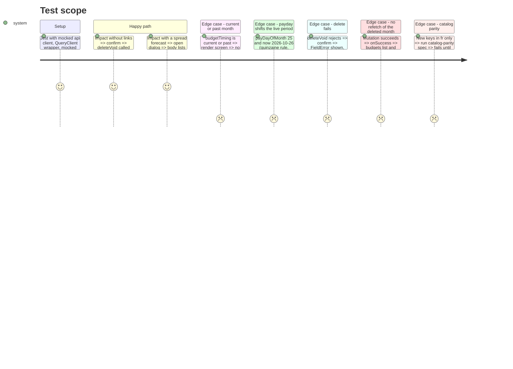

<!-- Fill or omit these sections; never add, rename, or reorder one. -->

# Instruction: Android, "Supprimer ce mois" in the budget details app bar

## Architecture projection

> Tree of the final files. ✅ create · ✏️ modify · ❌ delete

```txt
.
└── android/src/
    ├── core/api/endpoints.ts                                         ✏️ budgetDeletionImpact(id)
    ├── core/i18n/catalogs/{fr,en,de,it}.json                         ✏️ budgets.detail.deleteMonth.*
    ├── features/budgets/
    │   ├── budget-api.ts                                             ✏️ fetchBudgetDeletionImpact(id)
    │   ├── budget-api.spec.ts                                        ✏️ path + unwrap
    │   ├── delete-budget-mutation.ts                                 ✅ useDeleteBudget(budgetId)
    │   └── delete-budget-mutation.spec.tsx                           ✅ query flag + invalidation spares the deleted detail
    ├── features/budget-details/components/
    │   ├── delete-month-action.tsx                                   ✅ Menu (dots-vertical) + Portal Dialog
    │   └── delete-month-action.spec.tsx                              ✅ impact text, confirm, cancel, error
    ├── features/budget-details/budget-detail-screen.spec.tsx         ✏️ menu only on a future month
    └── app/(main)/budget/[id].tsx                                    ✏️ render DeleteMonthAction when budgetTiming is "future"
```

## User Journey



## Test Scope



## Wireframe

```txt
┌───────────────────────────────────────────────┐
│ (1) HeroAppBar                                │
│ [←] Novembre 2026          [🔍] [▥] [⋮] (2)   │
│                               ┌─────────────┐ │
│                               │(3) 🗑 Suppr. │ │
│                               │  ce mois     │ │
│                               └─────────────┘ │
├───────────────────────────────────────────────┤
│ (4) Month pager + hero + sections (unchanged) │
└───────────────────────────────────────────────┘

┌───────────────────────────────────────┐
│ (5) Dialog                            │
│   Supprimer Novembre 2026 ?           │
│   counts sentence                     │
│   + links sentence (if linked)        │
│   (6) error line (on failure)         │
│   [Annuler]            [Supprimer]    │
└───────────────────────────────────────┘
```

1. HeroAppBar: the back arrow, the month title and the existing search and tracking actions.
2. New `dots-vertical` `HeroAppBarAction`, used as the anchor of a paper `Menu`. Future months only.
3. One `Menu.Item` with a `delete-outline` leading icon.
4. The rest of the screen does not change.
5. A paper `Dialog` inside a `Portal`. It cannot be dismissed while the mutation is pending, and the confirm button shows `loading`.
6. A `FieldError` shown when the impact read or the delete fails, as in the template deletion dialog.

## Tasks to do

### `1)` API + mutation

> One read and one write. The cache sweep keeps the deleted month from refetching while its screen is still mounted.

1. In `endpoints.ts`, add `budgetDeletionImpact: (id) => /budgets/${id}/deletion-impact`.
2. In `budget-api.ts`, add `fetchBudgetDeletionImpact(id)`: `api.get(ENDPOINTS.budgetDeletionImpact(id), budgetDeletionImpactResponseSchema).then((r) => r.data)`. Add a case to `budget-api.spec.ts`.
3. Create `delete-budget-mutation.ts`, following `create-budget-mutation.ts`. `useDeleteBudget(budgetId)`:
   - `mutationFn: (confirmLinks: boolean) => api.deleteVoid(ENDPOINTS.budget(budgetId), { confirmLinks })`.
   - `onSuccess`: `Promise.all` of these two invalidations:
     - `queryClient.invalidateQueries({ queryKey: budgetKeys.all, predicate: (q) => q.queryKey[2] !== budgetId })`
     - `queryClient.invalidateQueries({ queryKey: goalKeys.all })`
   - Add a ponytail comment on the predicate: refetching the deleted detail while its screen is mounted would 404.
4. In `delete-budget-mutation.spec.tsx`, cover the query flag and the predicate. Precedent: `generate-budgets-mutation.spec.tsx`.

### `2)` Menu + dialog component

> Self-contained, so the 684-line screen only gains a conditional child.

1. Create `delete-month-action.tsx` with props `{ budgetId: string; monthTitle: string }`:
   - local `isMenuVisible` and `isDialogOpen`;
   - `useQuery({ queryKey: [...budgetKeys.detail(budgetId), "deletion-impact"], queryFn: () => fetchBudgetDeletionImpact(budgetId), enabled: isDialogOpen, gcTime: 0 })`;
   - `useDeleteBudget(budgetId)`.
2. Render a `Menu` with `anchor={<HeroAppBarAction icon="dots-vertical" accessibilityLabel={t("common.moreOptions")} onPress={open} />}` and one `Menu.Item` (`delete-outline`, `budgets.detail.deleteMonth.action`).
3. Render `<Portal><Dialog …>`, following the template deletion dialog in `app/(main)/template/[id].tsx`:
   - The title is `budgets.detail.deleteMonth.title` with `month`.
   - The body is `deleteMonth.body` (counts). When there are links, add `deleteMonth.links` with the non-zero `linkSpread`, `linkGoal` and `linkWithdrawal` labels joined by ", ". The withdrawal count adds forecasts and movements together.
   - Show a `FieldError` on an impact or mutation error.
   - Confirm is disabled until the impact has loaded. It calls `mutate(hasLinks, { onSuccess: () => { close(); router.back(); } })`.
4. In `delete-month-action.spec.tsx`, cover the happy path, the links text, cancel and the failure sections.

### `3)` Screen wiring

> Payday-aware gate with the helper the budget list already uses.

1. In `app/(main)/budget/[id].tsx`, compute `const isFutureMonth = budgetTiming(budget, getBudgetPeriodForDate(new Date(), payDayOfMonth)) === "future"`. `budgetTiming` comes from `budget-list-selectors` and `getBudgetPeriodForDate` from `pulpe-shared`.
2. Render `{isFutureMonth && <DeleteMonthAction budgetId={budget.id} monthTitle={monthTitle} />}` as the last child of `HeroAppBar`.
3. In `budget-detail-screen.spec.tsx`, assert that the action is absent on the current month and present on a future one.

### `4)` Catalogs, 4 languages

> French first, tutoiement, i18n-js `%{var}` placeholders, the Pulpe lexicon.

1. Under `budgets.detail.deleteMonth` in `fr.json`, add:
   - `action`: "Supprimer ce mois"
   - `title`: "Supprimer %{month} ?"
   - `body`: "Ses prévisions (%{forecastCount}) et ses mouvements (%{movementCount}) seront supprimés. Cette action est irréversible."
   - `links`: "Ce mois est aussi lié à d'autres mois : %{links}. Les autres mois gardent leur part."
   - `linkSpread`: "dépense lissée (%{count})"
   - `linkGoal`: "objectif d'épargne (%{count})"
   - `linkWithdrawal`: "retrait d'épargne (%{count})"
   - `confirm`: "Supprimer"
   - `loadError`: "Les détails du mois n'ont pas pu être chargés"
   - `failure`: "Le mois n'a pas pu être supprimé"
2. Mirror them in `en.json`, `de.json` and `it.json` with the same placeholders.

## Test acceptance criteria

| Task | Acceptance criteria                                                                                                                                                                                          |
| ---- | ------------------------------------------------------------------------------------------------------------------------------------------------------------------------------------------------------------ |
| 1    | The delete call carries `confirmLinks`. After success, the budget list, periods and goals refetch, and the deleted month's detail query does not.                                                            |
| 2    | The dialog shows counts, and the links when present. Confirm deletes and navigates back. Cancel closes without a call. A failure keeps the dialog open with an error line.                                   |
| 3    | The action shows only when the viewed month comes after the live payday-aware period.                                                                                                                        |
| 4    | `catalog-parity.spec.ts` passes. Every new string resolves in fr, en, de and it. "transaction" never shows.                                                                                                  |

Validation (scoped):

```bash
cd android && pnpm exec jest src/features/budgets/delete-budget-mutation.spec.tsx src/features/budgets/budget-api.spec.ts src/features/budget-details/components/delete-month-action.spec.tsx src/features/budget-details/budget-detail-screen.spec.tsx src/core/i18n/catalog-parity.spec.ts
cd android && pnpm type-check && pnpm lint && pnpm format:check
pnpm test:lexicon
```
