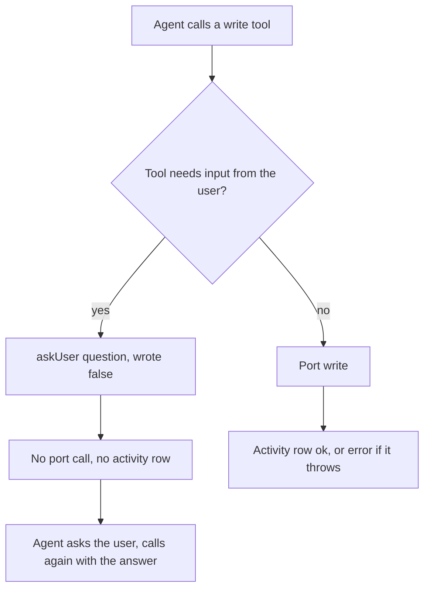
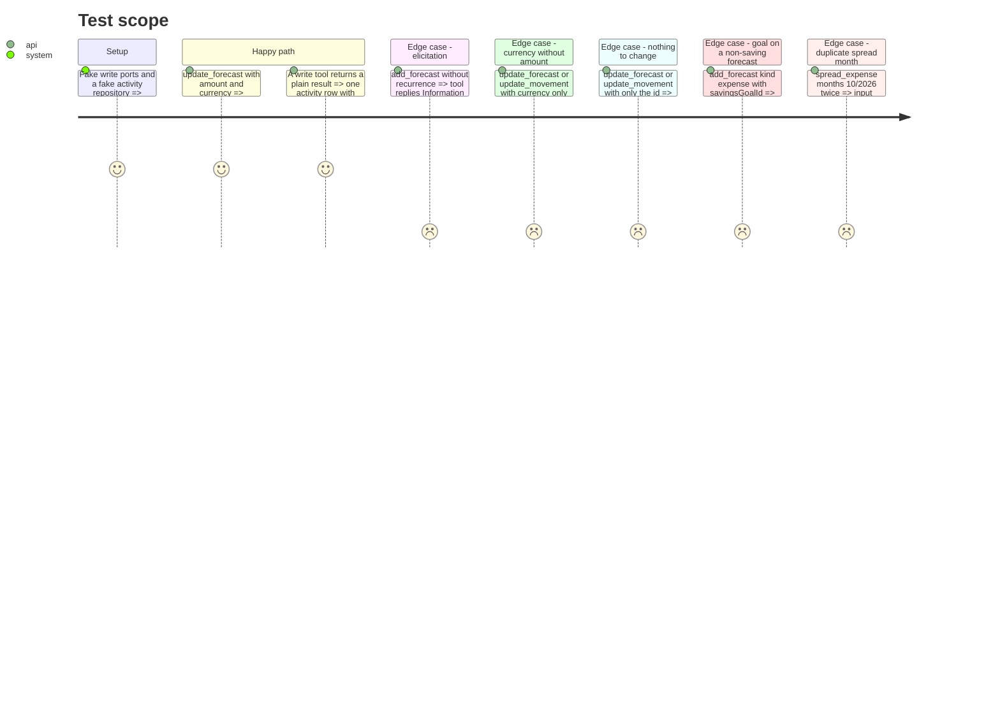

# Instruction: Questions stay out of the activity log, and tool-level refusals (CA8, CA4, CA5, CA6)

## Architecture projection

> Tree of the final files. ✅ create · ✏️ modify · ❌ delete

```txt
backend-nest/src/modules/mcp/
├── domain/
│   └── mcp-tool.entity.ts                         ✏️ McpToolResult gains `wrote?: false` (a reply that changed nothing)
├── application/
│   └── call-tool.use-case.ts                      ✏️ no activity row when the result says `wrote: false`
└── infrastructure/
    ├── auth/
    │   └── mcp-token.guard.spec.ts                ✏️ CallToolUseCase: a question is not logged, a write still is
    ├── oauth/
    │   └── mcp-oauth.integration.spec.ts          ✏️ elicitation test: mcp_activity row count unchanged (gated)
    └── tools/write/
        ├── elicitation.ts                         ✏️ askUser returns `wrote: false`; JSDoc states the contract
        ├── update-forecast.tool.ts                ✏️ CA4: currency without amount, or nothing to change → askUser
        ├── update-movement.tool.ts                ✏️ CA4: same two guards
        ├── add-forecast.tool.ts                   ✏️ CA5: goal with kind ≠ saving → askUser; describe names list_savings_goals
        ├── spread-expense.tool.ts                 ✏️ CA6: months = budgetLineSpreadFromLineCreateSchema.shape.periods
        └── write-tool-guards.spec.ts              ✅ CA4, CA5, CA6 against fake ports
```

## User Journey



## Test Scope



## Tasks to do

### `1)` Mark a reply that wrote nothing

> One domain flag, set by `askUser` only, read once by `CallToolUseCase`.

1. `domain/mcp-tool.entity.ts`: add to `McpToolResult` `readonly wrote?: false;` with a one-line JSDoc: present only on a reply that changed nothing (a question back to the user); the activity log skips it.
2. `tools/write/elicitation.ts`: `askUser` returns `{ text: …, wrote: false }` (text unchanged). Extend the JSDoc: return it before any port call, never after a write, or a real write disappears from the log.
3. `application/call-tool.use-case.ts`: in `execute`, after `const result = await tool.execute(args)`, call `#record(…, 'ok')` only when `result.wrote !== false`. Update the method JSDoc: every write the tool performed lands in the log; a question does not. `mcp.controller.ts` already sends only `text`, so the flag never reaches the client.
4. `mcp-token.guard.spec.ts` (`describe('tool catalog by access mode')`): add a write tool `q` whose `execute` returns `askUser('x')`; assert calling it leaves `recorded` empty while `w` still records `w:ok`.

### `2)` CA4: refuse a currency without an amount, and a call that changes nothing

> Both update tools ask instead of reporting « modifiée » for an empty write.

1. `update-forecast.tool.ts` `execute`, before the currency resolution, in this order:
   - `currency !== undefined && amount === undefined` → `return askUser('le montant dans cette devise : une devise seule ne change rien. Rappelle update_forecast avec amount et currency.')`.
   - every remaining argument undefined (`Object.values(rest).every((v) => v === undefined) && amount === undefined`) → `return askUser('ce qu’il faut modifier sur cette prévision (intitulé, montant, nature ou fréquence), puis rappelle update_forecast.')`.
   Written over `rest`, not a field list, so an optional field added later (PUL-359 `tagIds`) counts as a change without editing the guard.
2. `update-movement.tool.ts`: the same two guards, wording « mouvement » and the fields intitulé, montant, nature ou date, tool name `update_movement`.

### `3)` CA5: a savings goal only rides on an Épargne forecast

> Ask instead of silently dropping the goal link.

1. `add-forecast.tool.ts` `execute`, after the recurrence check: `args.savingsGoalId && args.kind !== 'saving'` → `return askUser('si cette prévision est une Épargne qui alimente cet objectif (kind saving), ou une prévision sans objectif. Rappelle add_forecast en conséquence.')`.
2. `savingsGoalId` `.describe(…)`: « Objectif d’épargne alimenté par cette prévision, seulement avec kind saving. Identifiant tiré de list_savings_goals ».

### `4)` CA6: no month twice in a spread

> Same uniqueness rule as `POST /budget-lines/:id/spread`.

1. `spread-expense.tool.ts`: `months: budgetLineSpreadFromLineCreateSchema.shape.periods.describe('Mois sur lesquels étaler la dépense, deux au minimum, chacun une seule fois. Les mois sans budget sont créés depuis le modèle par défaut')`, imported from `pulpe-shared`; drop the local `z.object` and the now unused `budgetSchema` import (`z` stays for `forecastId`). The SDK (`@modelcontextprotocol/sdk` 1.30.0, `server/mcp.js` `safeParseAsync`) validates the arguments with this schema before the callback, so a duplicate is an `InvalidParams` error and `CallToolUseCase` never runs (no activity row).

### `5)` Focused spec for the tool guards

> One file, fake ports, no Nest module.

1. Create `tools/write/write-tool-guards.spec.ts` (bun:test). Build tools with `new UpdateForecastTool(fakeLines, fakeCurrency)` etc.; `fakeCurrency = { execute: async (amount) => ({ amount, targetCurrency: 'CHF' }) } as unknown as ResolveCurrencyUseCase`; ports as `mock()` objects `satisfies` their port type.
2. Cases: currency only and id only on both update tools → text starts with `Information manquante`, `wrote === false`, port not called; `update_forecast` with `amount` + `currency` → port called once; `add_forecast` `kind: 'expense'` + `savingsGoalId` + `recurrence` → askUser, `create` not called; `kind: 'saving'` + goal → `create` called; `z.object(tool.inputSchema).safeParse` on spread months with a duplicate → `success === false`, two distinct months → `true`.

### `6)` Pin it at the real boundary (gated)

> The integration spec already drives the three elicitations; it now proves they leave no row.

1. `mcp-oauth.integration.spec.ts`, elicitation test (around L1119-1148): count `mcp_activity` rows for `owner.id` with `admin` before the three `Information manquante` calls and assert the same count after.

### `7)` Validate the phase

> Scoped commands only; the integration run needs local Supabase.

1. `cd backend-nest && bun test src/modules/mcp`
2. `cd backend-nest && bun run type-check:full && bun run lint && bun run lint:arch && bun run format:check`
3. When local Supabase runs: `cd backend-nest && bun run test:integration`

## Test acceptance criteria

| Task | Acceptance criteria |
| ---- | ------------------- |
| 1 | A write tool that answers with a question leaves no row in the activity log; a write tool that writes leaves exactly one `ok` row, and one that throws leaves one `error` row |
| 2 | `update_forecast` / `update_movement` with a currency and no amount, or with no field besides the id, reply with a question and write nothing |
| 3 | `add_forecast` with a savings goal and a kind other than Épargne replies with a question and creates nothing; its goal field says it comes from `list_savings_goals` and needs kind saving |
| 4 | `spread_expense` with the same month twice is rejected before any write, as `POST /budget-lines/:id/spread` rejects it |
| 5 | The guard spec fails if any of the guards above is removed |
| 6 | With local Supabase, the three elicitation calls leave the `mcp_activity` row count unchanged |
| 7 | The scoped MCP specs, type check, lint, architecture lint and format check all pass |
