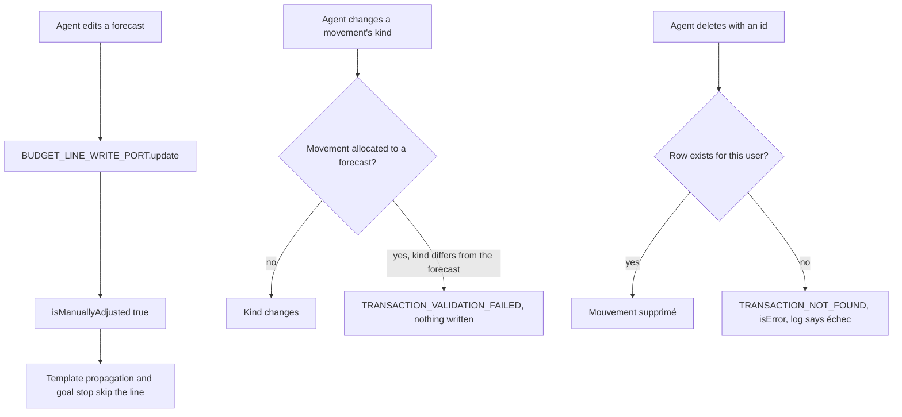
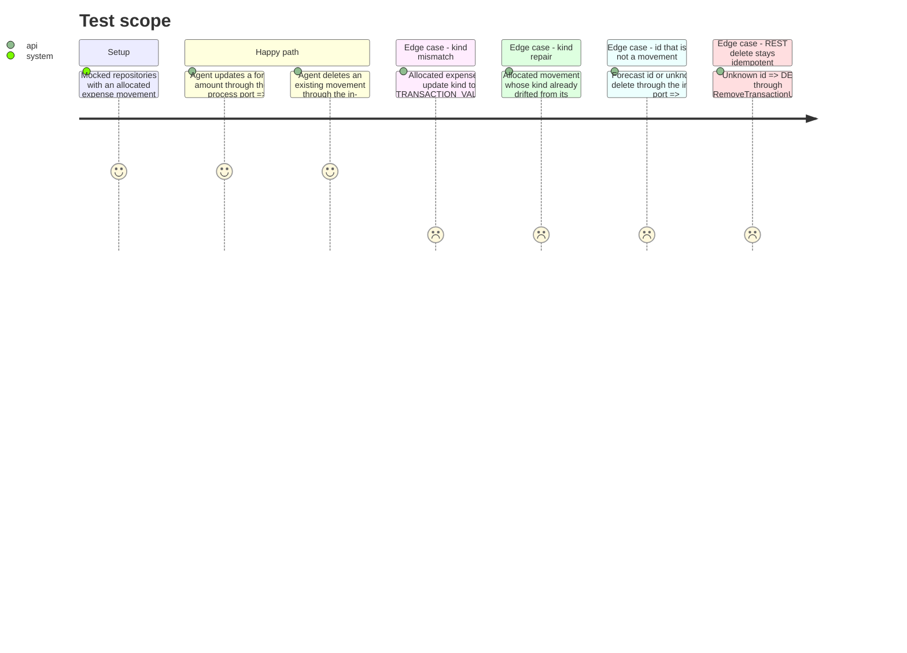

# Instruction: Agent write ports and the allocated-movement kind rule (CA1, CA2, CA3)

## Architecture projection

> Tree of the final files. ✅ create · ✏️ modify · ❌ delete

```txt
backend-nest/src/modules/
├── budget-line/
│   ├── domain/ports/
│   │   └── budget-line-write.port.ts                     ✏️ JSDoc: an agent edit is a manual adjustment
│   └── application/
│       ├── write-budget-lines-in-process.use-case.ts     ✏️ CA1: update forces isManuallyAdjusted: true
│       └── write-budget-lines-in-process.use-case.spec.ts ✅ the patch reaching UpdateBudgetLineUseCase carries the flag
├── transaction/
│   ├── domain/
│   │   ├── transaction.invariants.ts                     ✏️ CA2: validateKindMatchesLine(lineKind, kind), moved out of create
│   │   └── ports/transaction-write.port.ts               ✏️ JSDoc: remove refuses an id that is not one of the user's movements
│   └── application/
│       ├── create-transaction.use-case.ts                ✏️ calls the invariant instead of its inline kind check
│       ├── update-transaction.use-case.ts                ✏️ CA2: a kind change on an allocated movement must match its forecast
│       ├── update-transaction.use-case.spec.ts           ✏️ mismatch refused, repair allowed, free movement untouched
│       ├── remove-transaction.use-case.ts                ✏️ CA3: `{ mustExist }` option, default off (REST unchanged)
│       ├── remove-transaction.use-case.spec.ts           ✏️ mustExist + no row → TRANSACTION_NOT_FOUND, nothing deleted
│       └── write-transactions-in-process.use-case.ts     ✏️ CA3: remove passes `{ mustExist: true }`
└── mcp/infrastructure/tools/write/
    └── delete-movement.tool.ts                           ✏️ describe: movement ids only, never a forecast id
```

## User Journey



## Test Scope



## Tasks to do

### `1)` CA1: every agent edit of a forecast is a manual adjustment

> Protects the line from template propagation and from a savings-goal stop, like the web and iOS edit forms.

1. `write-budget-lines-in-process.use-case.ts` `update`: when the patch changes any field other than `tagIds` (name, amount, kind, recurrence, currency fields), pass `{ ...patch, isManuallyAdjusted: true }` to `UpdateBudgetLineUseCase.execute`. A tags-only patch is passed through untouched: PUL-359's `tag_items` must not freeze a forecast against propagation (ticket rule: tagging does not mark a forecast as adjusted). `update_forecast` (and PUL-360's multi-month adjustment, same port) inherit it with no tool change.
2. `budget-line-write.port.ts`: one JSDoc line on `update`: an agent edit of a value field marks the line `isManuallyAdjusted` (BUSINESS_RULES: no longer overwritten by Mois Type propagation); a tags-only patch does not.
3. Create `write-budget-lines-in-process.use-case.spec.ts`: construct the class directly with a fake `UpdateBudgetLineUseCase` capturing its patch and `{ user }` as session; assert `isManuallyAdjusted === true` for a patch that only renames, and for one that sent `false`; assert it is absent for a `{ tagIds }`-only patch.

### `2)` CA2: an allocated movement keeps its forecast's kind

> Same rule as creation, enforced on update for every caller (MCP and iOS PATCH).

1. `transaction.invariants.ts`: add `static validateKindMatchesLine(lineKind: TransactionKind, kind: TransactionKind): void` throwing `TRANSACTION_VALIDATION_FAILED` with the exact reason used today in `create-transaction.use-case.ts:168-175` (`Transaction kind must match budget line kind (expected: …, got: …)`).
2. `create-transaction.use-case.ts` `resolveBudgetLineForAllocation`: replace the inline kind check with the invariant call (behaviour and message unchanged).
3. `update-transaction.use-case.ts` `execute`, right after the withdrawal check: when `dto.kind !== undefined && context?.budgetLineId && dto.kind !== context.kind`, `const line = await this.repo.fetchBudgetLineForAllocation(context.budgetLineId)` and, when `line`, `TransactionInvariants.validateKindMatchesLine(line.kind, dto.kind)`. The fetch runs only on a real kind change of an allocated movement; iOS always sends `kind`, so an unchanged kind costs nothing.
4. `update-transaction.use-case.spec.ts`: add `fetchBudgetLineForAllocation` to the repository mock; cases: allocated expense → `kind: 'income'` against an expense line rejects with `TRANSACTION_VALIDATION_FAILED` and `repo.update` is not called; drifted movement (context kind `income`, line kind `expense`) → `kind: 'expense'` resolves; free movement (`budgetLineId: null`) → kind change resolves without fetching the line.

### `3)` CA3: the agent cannot "delete" what is not a movement

> Guard at the in-process port; `DELETE /transactions/:id` keeps its idempotent contract for iOS.

1. `remove-transaction.use-case.ts`: `execute(id, user, options: { mustExist?: boolean } = {})`. After `findMutationContext`, when `!context && options.mustExist`, throw `BusinessException(ERROR_DEFINITIONS.TRANSACTION_NOT_FOUND, { id }, { operation: 'transaction.remove', userId: user.id, entityId: id, entityType: 'transaction' })` before any delete or cache work.
2. `write-transactions-in-process.use-case.ts` `remove`: `this.removeTransaction.execute(id, this.session.user, { mustExist: true })`.
3. `transaction-write.port.ts`: JSDoc on `remove`: rejects with `TRANSACTION_NOT_FOUND` when the id is not one of the user's movements (a forecast id, an unknown or already deleted id); the REST route stays idempotent.
4. `delete-movement.tool.ts`: `movementId` describe → « Identifiant d’un mouvement (ligne Mouvement de get_month, get_current_month ou search_movements). Un identifiant de prévision est refusé ». The tool body is unchanged: the port's `TRANSACTION_NOT_FOUND` (404) reaches the agent as `isError` with its message, and `CallToolUseCase` logs `error`.
5. `remove-transaction.use-case.spec.ts`: new case, `findMutationContext` → `null` with `{ mustExist: true }` rejects with code `TRANSACTION_NOT_FOUND`, `delete`, `deleteWithdrawal` and cache invalidation not called. Keep the existing "PGRST116 path" case untouched as the proof that REST is unchanged.

### `4)` Validate the phase

> Scoped commands only.

1. `cd backend-nest && bun test src/modules/transaction src/modules/budget-line/application/write-budget-lines-in-process.use-case.spec.ts`
2. `cd backend-nest && bun run type-check:full && bun run lint && bun run lint:arch && bun run format:check`

## Test acceptance criteria

| Task | Acceptance criteria |
| ---- | ------------------- |
| 1 | A forecast edited through the agent carries `is_manually_adjusted = true`, so a later Mois Type propagation or a goal stop leaves it as the agent set it |
| 2 | Changing the kind of a movement allocated to a forecast of another kind is refused with the same reason as at creation, through `update_movement` and through `PATCH /transactions/:id`; a free movement still changes kind freely |
| 3 | `delete_movement` with a forecast id, an invented id or an already deleted id returns an error naming the movement as not found and logs `error`, never « Mouvement supprimé »; `DELETE /transactions/:id` on an unknown id still answers success |
| 4 | Transaction and budget-line specs, type check, lint, architecture lint and format check pass |
