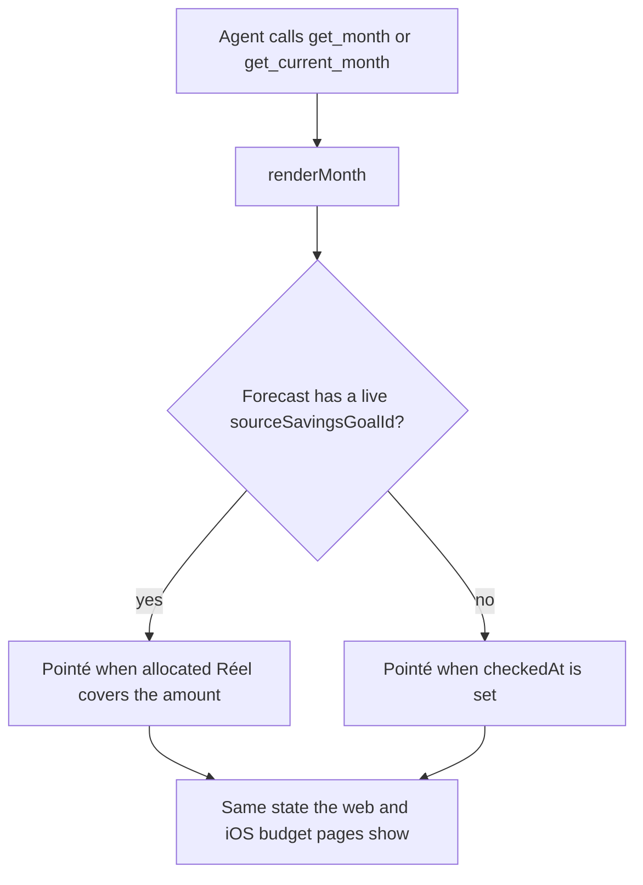
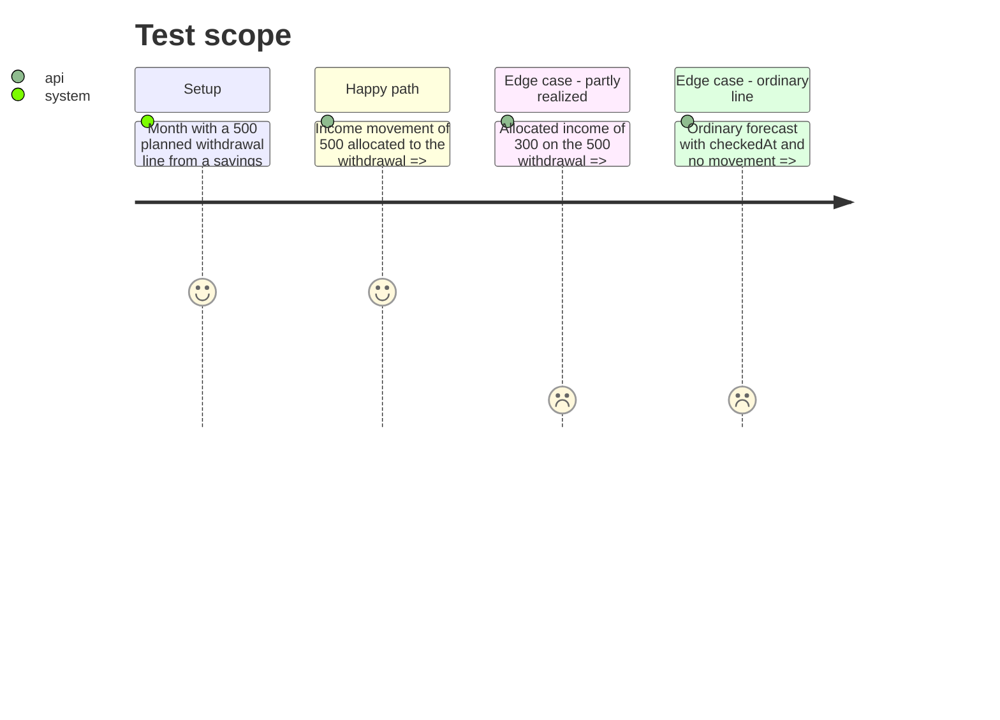

# Instruction: Planned withdrawal state in month reports (CA7)

## Architecture projection

> Tree of the final files. ✅ create · ✏️ modify · ❌ delete

```txt
backend-nest/src/modules/mcp/infrastructure/tools/read/
├── month-report.ts               ✏️ a live planned withdrawal is Pointé once its allocated Réel covers it
└── number-concordance.spec.ts    ✏️ realized, partly realized and ordinary lines
```

## User Journey



## Test Scope



## Tasks to do

### `1)` Derive the withdrawal's pointed state like the app

> Reuse the shared consumption; apply the same comparison as `budget-item-data-builder.ts:287-289` and iOS `BudgetLine.isPointed(allocated:)`.

1. `month-report.ts` `renderMonth`: compute the forecast's state as `l.sourceSavingsGoalId ? BudgetFormulas.calculateConsumption(l, transactions).available <= 0 : !!l.checkedAt` and print `Pointé` / `À pointer` from it. `BudgetFormulas` is already imported. A broken link (`sourceSavingsGoalId` null) falls back to `checkedAt`, as on web and iOS.
2. One comment line naming the two app sources of the rule, so a later change finds all three.

### `2)` Pin it in the concordance spec

> The file whose purpose is "the agent quotes what the app shows".

1. `number-concordance.spec.ts`: new `it` building a month with `line({ id: 'withdrawal', kind: 'income', amount: 500, sourceSavingsGoalId: 'goal-1', checkedAt: null })` and `movement({ kind: 'income', amount: 500, budgetLineId: 'withdrawal' })`; assert the rendered withdrawal row ends with `· Pointé`. Same fixture with 300 → `· À pointer`. An ordinary line with `checkedAt` set and no movement → `· Pointé`.

### `3)` Validate the phase

> Scoped commands only.

1. `cd backend-nest && bun test src/modules/mcp/infrastructure/tools/read`
2. `cd backend-nest && bun run type-check:full && bun run lint && bun run format:check`

## Test acceptance criteria

| Task | Acceptance criteria |
| ---- | ------------------- |
| 1 | `get_month` and `get_current_month` show « Pointé » for a planned withdrawal whose allocated income covers its amount, « À pointer » while it is partly realized, and keep `checkedAt` for every other forecast |
| 2 | The concordance spec fails if the renderer goes back to reading `checkedAt` for a planned withdrawal |
| 3 | Read-tool specs, type check, lint and format check pass |
