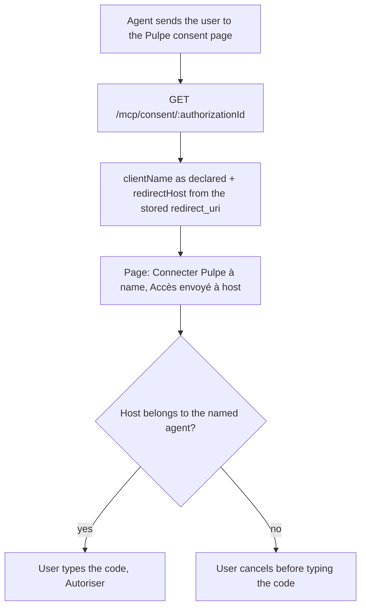
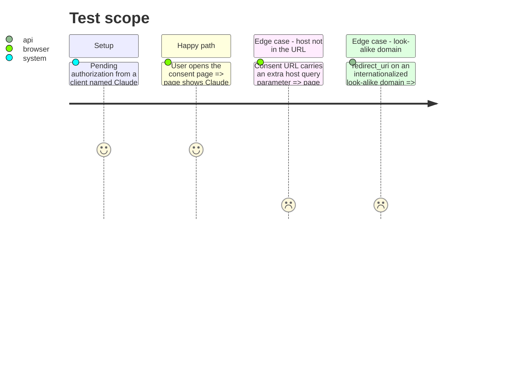

# Instruction: Consent screen shows where access is sent (CA10)

## Architecture projection

> Tree of the final files. ✅ create · ✏️ modify · ❌ delete

```txt
shared/
└── schemas.ts                                              ✏️ mcpConsentDetailsResponseSchema gains redirectHost
backend-nest/src/modules/mcp/
├── domain/ports/
│   └── oauth-authorization.port.ts                         ✏️ OAuthAuthorizationRequest gains redirectHost
├── application/
│   └── approve-connection.use-case.spec.ts                 ✏️ fake getDetails returns redirectHost (type)
└── infrastructure/
    ├── oauth/
    │   ├── supabase-oauth-authorization.adapter.ts         ✏️ getDetails: hostname of the stored redirect_uri
    │   ├── supabase-oauth-authorization.adapter.spec.ts    ✅ forged name, real host
    │   └── mcp-oauth.integration.spec.ts                   ✏️ details.body.redirectHost is client.example (gated)
    └── http/
        └── mcp-consent.controller.ts                       ✏️ returns { clientName, redirectHost }
frontend/projects/webapp/
├── src/app/feature/auth/mcp-consent/
│   ├── mcp-consent-store.ts                                ✏️ redirectHost signal, set by load
│   ├── mcp-consent-store.spec.ts                           ✏️ load sets redirectHost
│   ├── mcp-consent.ts                                      ✏️ host line + hint under the subtitle
│   └── mcp-consent.spec.ts                                 ✏️ the host from the request is shown next to the name
└── public/i18n/
    ├── fr.json                                             ✏️ auth.mcpConsent.redirectHost, redirectHostHint
    ├── en.json                                             ✏️ same keys
    ├── de.json                                             ✏️ same keys
    └── it.json                                             ✏️ same keys
```

## User Journey



## Test Scope



## Wireframe

```txt
┌────────────────────────────────────────────┐
│ (1) Connecter Pulpe à Claude                │
│     Claude demande l’accès à ton budget.    │
│ (2) Accès envoyé à  claude.ai               │
│     Vérifie que cette adresse appartient…   │
├────────────────────────────────────────────┤
│ (3) ( ) Lecture seule   ( ) Lecture/écriture│
│ (4) Avant d’autoriser: 3 warnings           │
│ (5) [lock] Ton code Pulpe [••••••]          │
│ (6)                  [Annuler] [Autoriser]  │
│ (7) Ce que je fais de tes données           │
└────────────────────────────────────────────┘
```

1. Header: the self-declared name, unchanged.
2. New: the host the code and data go to, set apart from the name, plus a one-line hint to compare them; sits above the code field so it is read before the PIN.
3. Access mode, unchanged.
4. Warnings, unchanged.
5. Code field, unchanged.
6. Decision buttons, unchanged.
7. Privacy link, unchanged.

## Tasks to do

### `1)` Carry the host through the contract

> Additive response field; the server already stores the URI.

1. `shared/schemas.ts` `mcpConsentDetailsResponseSchema`: add `redirectHost: z.string().min(1)`; update its comment (the client as declared, and the host its callback goes to). Non-breaking for deployed clients (added response field); the webapp parses it strictly, so the backend must ship with or before the webapp.
2. `oauth-authorization.port.ts`: `OAuthAuthorizationRequest` gains `readonly redirectHost: string` (JSDoc: hostname of the redirect URI held by the server, never from the browser).
3. `supabase-oauth-authorization.adapter.ts` `getDetails`: return `redirectHost: new URL(request.redirect_uri).hostname` (punycode for an IDN; `isMcpRedirectUri` already guarantees https or loopback, so it is never empty).
4. `mcp-consent.controller.ts` `getDetails`: destructure and return `{ clientName, redirectHost }`; summary « Agent client asking for access, and where its callback goes ».
5. `approve-connection.use-case.spec.ts`: the fake `getDetails` returns `redirectHost: 'chatgpt.com'` so it satisfies the port type.
6. Create `supabase-oauth-authorization.adapter.spec.ts`: adapter built with `{ getOrThrow: () => 'http://supabase.test' }` as `ConfigService` and a fake store whose `pending` returns `{ client_id: 'c', redirect_uri: 'https://attacker.example/cb?x=1', state: null }` and `getClient` returns `{ client_id: 'c', client_name: 'Claude' }`; assert `getDetails` → `{ clientId: 'c', clientName: 'Claude', redirectHost: 'attacker.example' }`; an IDN host comes back as its `xn--` form.
7. `mcp-oauth.integration.spec.ts` (around L265): `expect(details.body.redirectHost).toBe('client.example')`.

### `2)` Show the host on the consent page

> Next to the declared name, before the code field.

1. `mcp-consent-store.ts`: `readonly redirectHost = signal<string | null>(null)`; `load` sets it from the same response as `clientName`.
2. `mcp-consent.ts`: in the header block under the subtitle, a `<p data-testid="mcp-consent-redirect-host">` rendering `'auth.mcpConsent.redirectHost' | transloco: { host: store.redirectHost() }` with the host visually distinct (`font-medium text-on-surface`, `break-all` so a long host never overflows), then a `text-body-small text-on-surface-variant` hint `'auth.mcpConsent.redirectHostHint' | transloco: { client }`. Update the class JSDoc: name and host both come from the authorization request.
3. Catalogs, `auth.mcpConsent`:
   - fr: `redirectHost` « Accès envoyé à {{host}} », `redirectHostHint` « Vérifie que cette adresse appartient bien à {{client}} avant de saisir ton code. »
   - en: « Access sent to {{host}} », « Check that this address really belongs to {{client}} before entering your code. »
   - de: « Zugriff geht an {{host}} », « Prüf, ob diese Adresse wirklich zu {{client}} gehört, bevor du deinen Code eingibst. »
   - it: « Accesso inviato a {{host}} », « Verifica che questo indirizzo appartenga davvero a {{client}} prima di inserire il tuo codice. »
4. `mcp-consent.spec.ts`: the store fake gains `redirectHost` (set to `attacker.example` in `load`); new case asserting `mcp-consent-redirect-host` contains `attacker.example` and the title still contains the declared name; the existing "not from the URL" case also passes `host: 'evil.example'` in the query params and asserts it is absent.
5. `mcp-consent-store.spec.ts`: `getConsent$` returns `{ clientName: 'ChatGPT', redirectHost: 'chatgpt.com' }`; assert `store.redirectHost()` after `load`.

### `3)` Validate the phase

> Shared first: the backend and the webapp read its build.

1. `pnpm build:shared` (clear `frontend/.angular/cache` if the specs still see the old schema)
2. `cd backend-nest && bun test src/modules/mcp/infrastructure/oauth src/modules/mcp/application && bun run type-check:full && bun run lint && bun run format:check`
3. `cd frontend && pnpm exec ng test --include "**/mcp-consent/**/*.spec.ts" --include "**/catalog-parity.spec.ts"`
4. `cd frontend && pnpm exec ng build && pnpm run lint && pnpm run format:check` (`ng build` is the only strictTemplates check; needs `frontend/.env`)
5. `pnpm test:lexicon`

## Test acceptance criteria

| Task | Acceptance criteria |
| ---- | ------------------- |
| 1 | `GET /mcp/consent/:id` answers the declared name and the hostname of the redirect URI stored on that authorization, never a value taken from the request URL |
| 2 | The consent page shows « Accès envoyé à » followed by the host next to the declared name, above the code field, in all four languages; an agent named « Claude » with a third-party callback shows that third-party host |
| 3 | Shared build, backend and frontend scoped specs, `ng build`, lint, format and lexicon checks pass |
