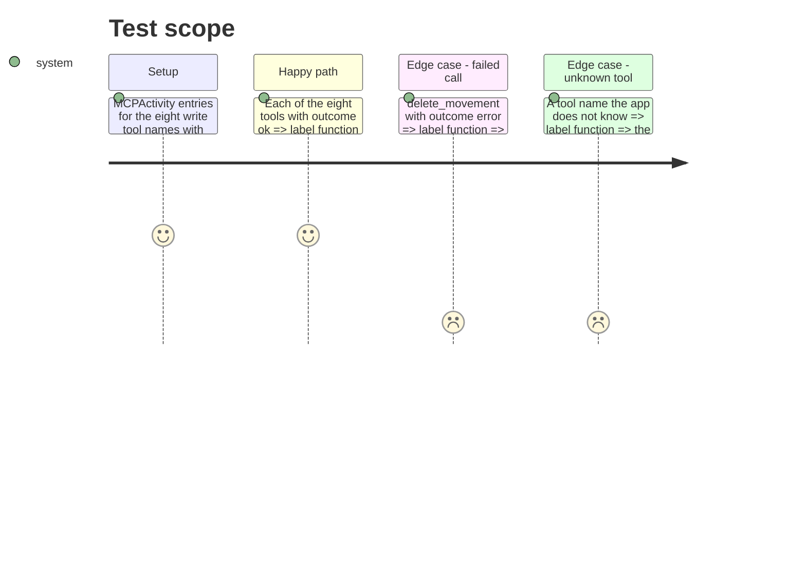

# Instruction: iOS activity labels for the eight write tools (CA9)

## Architecture projection

> Tree of the final files. ✅ create · ✏️ modify · ❌ delete

```txt
ios/
├── Pulpe/
│   ├── Features/Account/Connections/
│   │   └── ConnectionDetailView.swift                 ✏️ label(for:) maps all eight write tools; internal for the test
│   └── Resources/Localizable.xcstrings                ✏️ new source strings with de / en / it
└── PulpeTests/Features/Account/
    └── ConnectionActivityLabelTests.swift             ✅ no write tool shows its technical name
```

## User Journey

```mermaid
flowchart TD
  A[Compte > Connexions > a read-write connection] --> B[DERNIÈRES ACTIONS]
  B --> C["Each row shows the tool's label"]
  C --> D{Known write tool?}
  D -- yes --> E[French label, « (échec) » appended on error]
  D -- no, a tool newer than the build --> F[Raw tool name, unchanged fallback]
```

## Test Scope



## Tasks to do

### `1)` Name every write tool in French

> Same wording as the web catalog `settings.connections.tools` in `fr.json`.

1. `ConnectionDetailView.swift` `label(for:)`: drop `private` (keep `static`), and map the eight tools, reusing existing catalog keys where they exist:
   - `add_movement` « Mouvement ajouté », `update_movement` « Mouvement modifié », `delete_movement` « Mouvement supprimé »
   - `add_forecast` « Prévision ajoutée » and `update_forecast` « Prévision modifiée » (both keys already in the catalog)
   - `spread_expense` « Dépense répartie », `create_month_from_template` « Budget mensuel créé », `toggle_check` « Pointage modifié »
   Keep the `default: entry.tool` fallback and its doc comment (a tool newer than the build). PUL-359 and PUL-360 append their cases here.
2. `Localizable.xcstrings`: add the six missing source strings and `%@ (échec)`, each with de / en / it following `docs/I18N.md` and the iOS catalog's existing terms:
   - « Mouvement ajouté / modifié / supprimé »: en « Entry added / updated / deleted », de « Bewegung hinzugefügt / geändert / gelöscht », it « Movimento aggiunto / modificato / eliminato »
   - « Dépense répartie »: en « Expense spread », de « Ausgabe verteilt », it « Spesa ripartita »
   - « Budget mensuel créé »: en « Monthly budget created », de « Monatsbudget erstellt », it « Budget mensile creato »
   - « Pointage modifié »: en « Checking changed », de « Abhaken geändert », it « Spunta modificata » (catalog term « Pointage » → Checking / Abhaken / Spunta; never a banking word)
   - « %@ (échec) »: en « %@ (failed) », de « %@ (fehlgeschlagen) », it « %@ (non riuscito) »

### `1b)` Freeze the kind of an allocated movement in the iOS editor

> Phase 2 makes the server refuse a kind change on an allocated movement (CA2). iOS still offers the picker, so the user would only meet an error. Mirror the web (`hiddenFields: ['kind']` for allocated movements).

1. `EditTransactionLogic.isKindEditable(for:)`: also return `false` when the transaction is allocated to a forecast (its budget line id is set). Extend the doc comment with this second reason.
2. Add a case to the existing `EditTransactionLogic` tests (find them under `PulpeTests`) asserting an allocated movement is not kind-editable and a free one is.
3. Check Android's movement editor (`android/src/features/transactions/transaction-draft.ts` and its editor screen) for the same picker; if it lets the user change the kind of an allocated movement, freeze it the same way with a focused spec. If it already does not, write nothing.

### `2)` Guard the mapping

> Locale-independent: the assertion is "not the slug", so the pinned French scheme and any other locale both hold.

1. Create `ConnectionActivityLabelTests.swift` (Swift Testing, `@testable import Pulpe`): a parameterized `@Test(arguments:)` over the eight tool names asserting `ConnectionDetailView.label(for: MCPActivity(tool:, outcome: .ok, createdAt: .now)) != tool`; one case for `delete_movement` with `.error` asserting the label contains the `.ok` label and differs from it; one case for an unknown name returning the name.

### `3)` Validate the phase

> Dedicated test simulator only; read the executed count, `-only-testing` on Swift Testing can select zero tests and still succeed.

1. `cd ios && xcodegen generate --use-cache` (the new test file joins the generated project)
2. `cd ios && xcodebuild test -scheme PulpeLocal -destination 'platform=iOS Simulator,name=Pulpe Tests' -derivedDataPath build/DerivedData -only-testing:PulpeTests/ConnectionActivityLabelTests CODE_SIGNING_ALLOWED=NO`, then confirm the log lists the new tests as executed and ends with `** TEST SUCCEEDED **`
3. `cd ios && swiftlint lint --strict Pulpe/Features/Account/Connections/ConnectionDetailView.swift PulpeTests/Features/Account/ConnectionActivityLabelTests.swift`
4. `pnpm test:lexicon`

## Test acceptance criteria

| Task | Acceptance criteria |
| ---- | ------------------- |
| 1 | In Compte > Connexions, every action of the eight write tools reads as a French label (« Mouvement supprimé », « Dépense répartie (échec) »…), never `delete_movement` or `spread_expense`; de / en / it show their translation |
| 2 | The label test fails if any of the eight tools falls back to its technical name |
| 3 | The new tests are reported as executed on the dedicated simulator, SwiftLint strict and the lexicon check pass |
