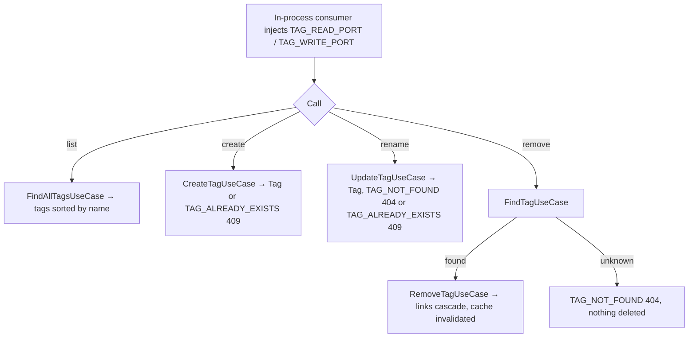
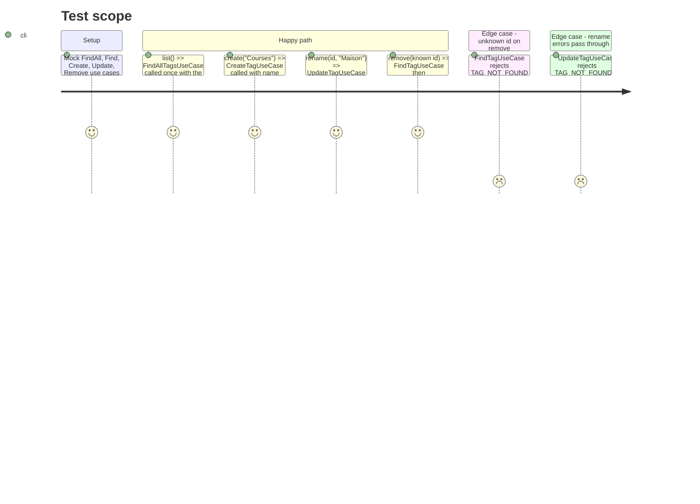

# Instruction: Tag module exposes in-process read and write ports

## Architecture projection

> Tree of the final files. ✅ create · ✏️ modify · ❌ delete

```txt
backend-nest/src/modules/tag/
├── domain/ports/
│   ├── tag-read.port.ts                          ✅ TAG_READ_PORT + TagReadPort.list()
│   └── tag-write.port.ts                         ✅ TAG_WRITE_PORT + TagWritePort.create/rename/remove
├── application/
│   ├── read-tags-in-process.use-case.ts          ✅ list() → FindAllTagsUseCase with the CLS user
│   ├── read-tags-in-process.use-case.spec.ts     ✅ delegation
│   ├── write-tags-in-process.use-case.ts         ✅ create/rename/remove; remove proves existence first
│   └── write-tags-in-process.use-case.spec.ts    ✅ delegation + 404 on unknown id
└── tag.module.ts                                 ✏️ provide both, bind the two ports useExisting, export them
```

## User Journey



## Test Scope



## Tasks to do

### `1)` Ports

> Two ports, one per direction, in the shape of `BudgetTemplateReadPort` and `TransactionWritePort`.

1. `tag-read.port.ts`: `TAG_READ_PORT = Symbol('TAG_READ_PORT')`, `TagReadPort { list(): Promise<Tag[]> }`. Doc comment: for in-process consumers (the MCP agent connector), CLS must hold `user` and `supabase`.
2. `tag-write.port.ts`: `TAG_WRITE_PORT`, `TagWritePort { create(name: string): Promise<Tag>; rename(id: string, name: string): Promise<Tag>; remove(id: string): Promise<void> }`. Doc comment states the contract: `rename` and `remove` throw `TAG_NOT_FOUND` on an unknown id; `create` and `rename` throw `TAG_ALREADY_EXISTS` when the name is taken, case ignored.
3. Import `Tag` from `../tag.entity`. Domain stays free of Nest and Zod.

### `2)` In-process use cases

> Thin delegation, like `ReadTemplatesInProcessUseCase` and `WriteTransactionsInProcessUseCase`.

1. `ReadTagsInProcessUseCase implements TagReadPort`: inject `FindAllTagsUseCase` + `AuthenticatedSupabaseProvider`; `list()` returns `findAll.execute(session.user)`.
2. `WriteTagsInProcessUseCase implements TagWritePort`: inject `CreateTagUseCase`, `UpdateTagUseCase`, `FindTagUseCase`, `RemoveTagUseCase` + `AuthenticatedSupabaseProvider`.
   - `create(name)` → `createTag.execute({ name }, user)`.
   - `rename(id, name)` → `updateTag.execute(id, { name }, user)` (the repository already throws `TAG_NOT_FOUND` when no row matches).
   - `remove(id)` → `await findTag.execute(id, user)` then `removeTag.execute(id, user)`. Comment why: the repository delete succeeds silently on an unknown id, and the REST route keeps that behavior.
3. No logger: these classes only delegate (the delegated use cases log).

### `3)` Module wiring

1. `tag.module.ts`: add both classes to `providers`, plus `{ provide: TAG_READ_PORT, useExisting: ReadTagsInProcessUseCase }` and `{ provide: TAG_WRITE_PORT, useExisting: WriteTagsInProcessUseCase }`.
2. `exports: [TAG_READ_PORT, TAG_WRITE_PORT]` (today `[]`).

### `4)` Specs

> bun:test, plain `mock()` objects cast to the use case types, session `{ user } as unknown as AuthenticatedSupabaseProvider` (see `mcp/infrastructure/tools/read/get-current-month.tool.spec.ts`).

1. `read-tags-in-process.use-case.spec.ts`: `list()` returns what `FindAllTagsUseCase` returns and passes the session user.
2. `write-tags-in-process.use-case.spec.ts`: create and rename argument shapes; rename propagates `TAG_NOT_FOUND` and `TAG_ALREADY_EXISTS`; remove calls find then remove in order; remove on an unknown id rejects with `TAG_NOT_FOUND` and never calls `RemoveTagUseCase`.

### `5)` Validate

```bash
cd backend-nest && bun test src/modules/tag/application/read-tags-in-process.use-case.spec.ts src/modules/tag/application/write-tags-in-process.use-case.spec.ts src/app.module.spec.ts
cd backend-nest && bun run type-check:full && bun run lint && bun run lint:arch
cd backend-nest && bunx prettier --check src/modules/tag
```

## Test acceptance criteria

| Task | Acceptance criteria |
| ---- | ------------------- |
| 1 | Both tokens and interfaces are importable from `@modules/tag/domain/ports/*` without importing anything from `tag/application` or `tag/infrastructure` |
| 2 | Removing an unknown tag through `TAG_WRITE_PORT` rejects with `TAG_NOT_FOUND` (404) and deletes nothing; removing a known tag deletes it |
| 2 | Renaming an unknown tag rejects with `TAG_NOT_FOUND`; renaming to a taken name rejects with `TAG_ALREADY_EXISTS` |
| 3 | A module importing `TagModule` can inject `TAG_READ_PORT` and `TAG_WRITE_PORT`; `lint:arch` stays green |
| 4 | Both new spec files pass; REST `DELETE /tags/:id` behavior is unchanged (no edit to `RemoveTagUseCase` or the controller) |
