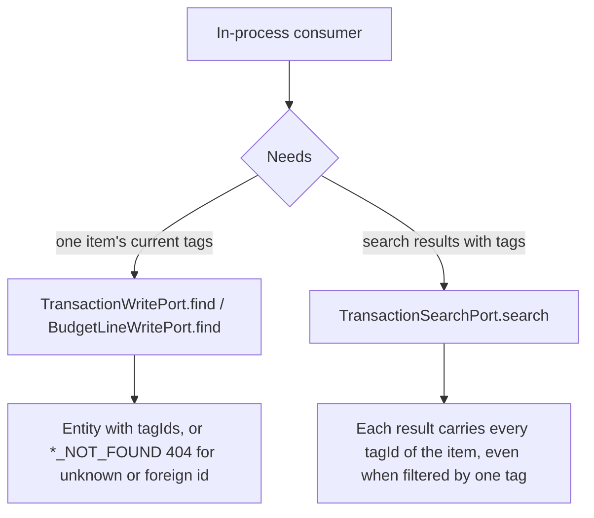
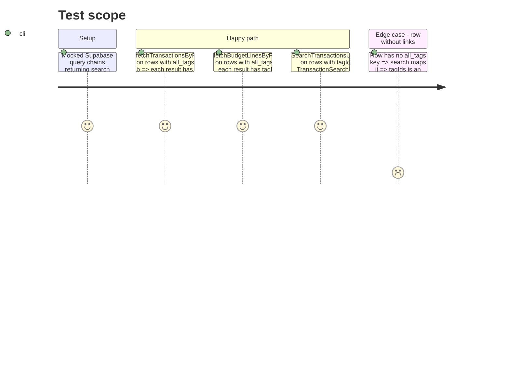

# Instruction: Item tag ids reachable in process (find + search results)

## Architecture projection

> Tree of the final files. ✅ create · ✏️ modify · ❌ delete

```txt
shared/
└── schemas.ts                                              ✏️ transactionSearchResultSchema.tagIds optional
backend-nest/src/modules/
├── transaction/
│   ├── domain/
│   │   ├── ports/transaction-write.port.ts                 ✏️ + find(id): Promise<Transaction>
│   │   └── transaction.entity.ts                           ✏️ search row types gain tagIds: string[]
│   ├── application/
│   │   ├── write-transactions-in-process.use-case.ts       ✏️ find → FindTransactionUseCase
│   │   ├── search-transactions.use-case.ts                 ✏️ map tagIds into both result kinds
│   │   └── search-transactions.use-case.spec.ts            ✏️ results carry the row tagIds
│   └── infrastructure/persistence/
│       ├── supabase-transaction.repository.ts              ✏️ unfiltered all_tags embed on the 3 search selects
│       └── supabase-transaction.repository.spec.ts         ✏️ all_tags rows map to tagIds
└── budget-line/
    ├── domain/ports/budget-line-write.port.ts              ✏️ + find(id): Promise<BudgetLine>
    └── application/write-budget-lines-in-process.use-case.ts ✏️ find → FindBudgetLineUseCase
```

## User Journey



## Test Scope



## Tasks to do

### `1)` Read an item through its write port

> `tag_items` reads before it writes; reuse the find use cases that already exist and are already providers.

1. `TransactionWritePort`: add `find(id: string): Promise<Transaction>` with a one-line doc ("lu avant une écriture qui raisonne en ajout/retrait, comme les tags"). Implement in `WriteTransactionsInProcessUseCase` by injecting `FindTransactionUseCase` → `execute(id, this.session.user)`.
2. `BudgetLineWritePort`: same with `find(id: string): Promise<BudgetLine>` → `FindBudgetLineUseCase`.
3. No module change: both find use cases are already in their module's `providers`.

### `2)` Search results carry tag ids

> CA2 needs tag names on `search_movements`; the filtering embed (`!inner`) only returns matched links.

1. `shared/schemas.ts` `transactionSearchResultSchema`: add `tagIds: z.array(z.uuid()).optional()` with a comment: always filled by the backend, optional so existing clients and fixtures stay valid.
2. `transaction.entity.ts`: `tagIds: string[]` on `TransactionSearchTransactionRow` and `TransactionSearchBudgetLineRow`.
3. `supabase-transaction.repository.ts`:
   - append `all_tags:transaction_tag(tag_id)` to `SEARCH_TRANSACTION_FIELDS` (covers the name and tag queries);
   - append `all_tags:budget_line_tag(tag_id)` to the selects of `queryBudgetLinesByPattern` and `queryBudgetLinesByTagIds`;
   - `RawSearchTransactionRow` / `RawSearchBudgetLineRow` gain `all_tags?: { tag_id: string }[]`;
   - `toSearchTransactionRow` / `toSearchBudgetLineRow` set `tagIds: (row.all_tags ?? []).map((link) => link.tag_id)`.
   - Leave the existing filter paths (`transaction_tag.tag_id`, `selected_tags.tag_id`, `text_tags.tag_id`, `budget_line_tag.tag_id`) untouched.
4. `search-transactions.use-case.ts`: both mappers copy `tagIds`.

### `3)` Specs

1. Repository spec, `fetchTransactionsByPattern` and `fetchBudgetLinesByPattern`: a row with `all_tags` maps to `tagIds`; the existing `searchRow` (no `all_tags`) maps to `[]`; existing `in(...)` assertions unchanged.
2. Use case spec: a returned row's `tagIds` reach the result.

### `4)` Validate

```bash
pnpm build:shared
cd backend-nest && bun test src/modules/transaction src/modules/budget-line src/app.module.spec.ts
cd backend-nest && bun run type-check:full && bun run lint && bun run lint:arch
cd frontend && pnpm exec ng test --include "**/search-transactions-dialog.spec.ts"
```

The PostgREST double embed (`transaction_tag!inner` filtered plus `all_tags:transaction_tag` unfiltered) is proven against a real database only in phase 6 (gated integration spec). If the executor has local Supabase up, run one REST search by tag (`GET /api/v1/transactions/search?tagIds=<id>`) on an item carrying two tags and check both ids come back.

## Test acceptance criteria

| Task | Acceptance criteria |
| ---- | ------------------- |
| 1 | `find(id)` on either write port returns the entity with its `tagIds`; an unknown id rejects with the module's `*_NOT_FOUND` (404) |
| 2 | A search filtered by one tag returns, for each matched item, all of that item's tag ids, not only the filtered one |
| 2 | `GET /transactions/search` responses gain `tagIds`; web search dialog spec still passes unchanged |
| 3 | Transaction and budget-line module specs pass, including the new tagIds mapping cases |
