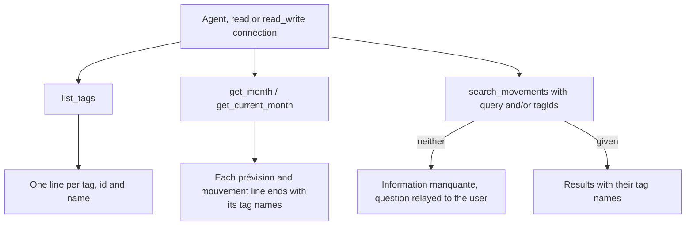
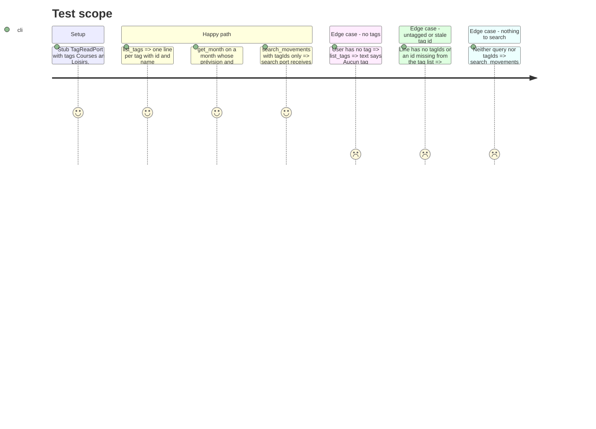

# Instruction: MCP read side, `list_tags`, tag names, search by tag

## Architecture projection

> Tree of the final files. ✅ create · ✏️ modify · ❌ delete

```txt
backend-nest/src/modules/mcp/
├── mcp.module.ts                                    ✏️ import TagModule; ListTagsTool in TOOLS
└── infrastructure/tools/read/
    ├── list-tags.tool.ts                            ✅ list_tags
    ├── list-tags.tool.spec.ts                       ✅
    ├── month-report.ts                              ✏️ tagNames() + tagSuffix(); renderMonth(details, names) suffixes lines
    ├── get-month.tool.ts                            ✏️ inject TAG_READ_PORT, names once per call
    ├── get-month.tool.spec.ts                       ✅ tag names on prévisions and mouvements
    ├── get-current-month.tool.ts                    ✏️ inject TAG_READ_PORT, names once per call
    ├── get-current-month.tool.spec.ts               ✏️ constructor gains the tag port stub
    ├── number-concordance.spec.ts                   ✏️ constructor gains the tag port stub
    ├── search-movements.tool.ts                     ✏️ query optional, tagIds filter, tag names per result
    └── search-movements.tool.spec.ts                ✅ filter forwarding, names, missing input
```

## User Journey



## Test Scope



## Tasks to do

### `1)` `list_tags`

> CA1: every tag with its id and name.

1. `ListTagsTool`: `name = 'list_tags'`, `title = 'Mes tags'`, description « Liste les tags de l’utilisateur avec leur id. Sert à choisir les tags à poser avec tag_items, ou à filtrer search_movements. », `mode = 'read'`, annotations `{ readOnlyHint: true, destructiveHint: false, idempotentHint: true, openWorldHint: false }`, `inputSchema = {}`.
2. Inject `TAG_READ_PORT`. Text: `Tags (n)` then `- [id] name`; empty → `Aucun tag.`

### `2)` Tag names in the month report

> CA2 for `get_month` and `get_current_month`: one rendering, shared, as today.

1. `month-report.ts`: export `tagNames(tags: readonly Tag[]): ReadonlyMap<string, string>` and `tagSuffix(tagIds: readonly string[], names): string` returning `''` when no known name, else ` · Tags : A, B` (ids missing from the map are skipped, never printed raw). `Tag` type from `@modules/tag/domain/tag.entity`.
2. `renderMonth(details, names = new Map())`: append `tagSuffix` to each prévision line and each mouvement line. The default keeps `number-concordance.spec.ts`'s direct `renderMonth({...})` call valid.
3. `GetMonthTool` and `GetCurrentMonthTool`: inject `@Inject(TAG_READ_PORT) tags: TagReadPort`; `Promise.all([readMonth, tags.list()])`; pass `tagNames(tags)` to `renderMonth`.
4. Update the two existing specs' constructors with `{ list: async () => [] } satisfies TagReadPort`.

### `3)` `search_movements` by tag

> CA2 + CA3. The shared query schema already supports `tagIds`; phase 2 put `tagIds` on results.

1. `query` becomes `.optional()`; add `tagIds: z.array(z.uuid()).min(1).optional()` described « Ids de tags (voir list_tags) : rend les éléments qui portent au moins un de ces tags ».
2. Neither given → `askUser('Quel intitulé ou quel tag chercher ? Appelle list_tags pour les ids de tags.')` (from `../write/elicitation`), no search call.
3. Call `search.search({ q: args.query, years: args.years, tagIds: args.tagIds })` in parallel with `tags.list()`; each result line ends with `tagSuffix(r.tagIds ?? [], names)`.
4. Header and empty text must read well when only tags are given (no `« undefined »`): e.g. `Résultats (n)` and `Aucun résultat.` when `query` is absent.
5. Description: « Cherche par intitulé ou par tag dans les mouvements réels et les prévisions de tous les mois. Rend les cinquante résultats les plus récents, avec leur mois et leurs tags. »

### `4)` Module

1. `mcp.module.ts`: add `TagModule` to `imports`; add `ListTagsTool` to `TOOLS` after `ListTemplatesTool`.

### `5)` Specs

1. `list-tags.tool.spec.ts`: format, empty case, `mode === 'read'`, annotations.
2. `get-month.tool.spec.ts`: a prévision and a mouvement tagged `Courses` both end with ` · Tags : Courses`; an untagged line has no suffix; an id absent from the tag list prints nothing; `tags.list` called once.
3. `search-movements.tool.spec.ts`: `tagIds` forwarded to the port; result lines show names; no input → askUser and the port mock is not called.

### `6)` Validate

```bash
cd backend-nest && bun test src/modules/mcp src/app.module.spec.ts
cd backend-nest && bun run type-check:full && bun run lint && bun run lint:arch
cd backend-nest && bunx prettier --check src/modules/mcp
```

## Test acceptance criteria

| Task | Acceptance criteria |
| ---- | ------------------- |
| 1 | `list_tags` returns each tag's id and name, and is listed for read-only connections |
| 2 | `get_month` and `get_current_month` show the tag names of every tagged prévision and mouvement, and nothing extra on untagged lines |
| 3 | `search_movements` accepts `tagIds` alone, `query` alone, or both; results show their tag names; with neither it asks instead of searching |
| 4 | `src/app.module.spec.ts` compiles the app with `TagModule` imported by `McpModule` (DI resolves `TAG_READ_PORT`) |
| 5 | `bun test src/modules/mcp` passes, including the existing concordance and timezone specs |
