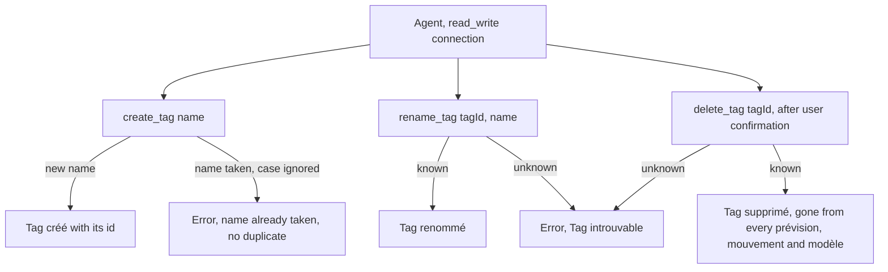
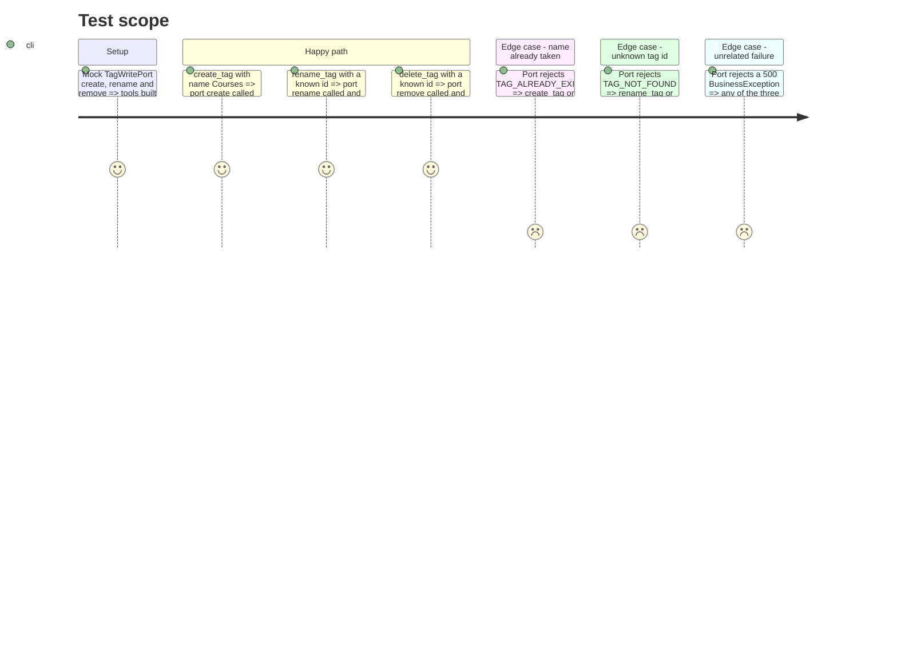

# Instruction: MCP tag CRUD, `create_tag`, `rename_tag`, `delete_tag`

## Architecture projection

> Tree of the final files. ✅ create · ✏️ modify · ❌ delete

```txt
backend-nest/src/modules/mcp/
├── mcp.module.ts                                 ✏️ CreateTagTool, RenameTagTool, DeleteTagTool in TOOLS
└── infrastructure/tools/write/
    ├── tag-errors.ts                             ✅ tag BusinessException codes → French 404 / 409
    ├── create-tag.tool.ts                        ✅ create_tag
    ├── create-tag.tool.spec.ts                   ✅
    ├── rename-tag.tool.ts                        ✅ rename_tag
    ├── rename-tag.tool.spec.ts                   ✅
    ├── delete-tag.tool.ts                        ✅ delete_tag
    └── delete-tag.tool.spec.ts                   ✅
```

## User Journey



## Test Scope



## Tasks to do

### `1)` French tag errors

> CA5 and CA9 ask for a clear message; `mcp.controller.ts` `describe()` shows `error.message` for any status below 500.

1. `tag-errors.ts`: `export function toTagToolError(error: unknown, name?: string): unknown`.
   - `BusinessException` with `code === ERROR_DEFINITIONS.TAG_NOT_FOUND.code` → `new NotFoundException('Tag introuvable. Appelle list_tags pour les ids valides.')`.
   - `code === ERROR_DEFINITIONS.TAG_ALREADY_EXISTS.code` → `new ConflictException(\`Un tag « ${name} » existe déjà (casse ignorée). Appelle list_tags pour reprendre son id.\`)`.
   - Anything else returned as is.
2. Each tool: `try { … } catch (error) { throw toTagToolError(error, args.name); }`.

### `2)` `create_tag`

1. Input `{ name: tagCreateSchema.shape.name.describe('Nom du tag, 1 à 30 caractères') }` (trims like the REST route; the MCP SDK passes parsed values).
2. `title = 'Créer un tag'`, description « Crée un tag. Un nom déjà pris, casse ignorée, est refusé : réutilise alors le tag existant (list_tags). », `mode = 'read_write'`, annotations `{ readOnlyHint: false, destructiveHint: false, idempotentHint: false, openWorldHint: false }`.
3. Text: `Tag créé (id <id>) : « <name> ».`

### `3)` `rename_tag`

1. Input `{ tagId: z.uuid().describe('Identifiant du tag à renommer'), name: tagCreateSchema.shape.name.describe('Nouveau nom, 1 à 30 caractères') }`.
2. `title = 'Renommer un tag'`, description « Renomme un tag. Le nouveau nom s’affiche partout où le tag est posé. », `mode = 'read_write'`, annotations `{ readOnlyHint: false, destructiveHint: true, idempotentHint: true, openWorldHint: false }`.
3. Text: `Tag renommé (id <id>) : « <name> ».`

### `4)` `delete_tag`

1. Input `{ tagId: z.uuid().describe('Identifiant du tag à supprimer') }`.
2. `title = 'Supprimer un tag'`, description « Supprime définitivement un tag : il disparaît de toutes les prévisions, de tous les mouvements et des modèles qui le portent. À n’appeler qu’après confirmation explicite de l’utilisateur. », `mode = 'read_write'`, annotations `{ readOnlyHint: false, destructiveHint: true, idempotentHint: true, openWorldHint: false }`.
3. Text: `Tag supprimé (id <id>).`

### `5)` Module

1. Append `CreateTagTool`, `RenameTagTool`, `DeleteTagTool` to the write part of `TOOLS`.

### `6)` Specs

> One spec per tool, ports mocked with `satisfies TagWritePort`, like `get-current-month.tool.spec.ts`.

1. Each spec asserts `name`, `mode === 'read_write'` and the exact annotations.
2. `create-tag`: success text contains the id; `TAG_ALREADY_EXISTS` → rejects with status 409 and a message containing « existe déjà ».
3. `rename-tag`: success; `TAG_NOT_FOUND` → 404 « Tag introuvable »; `TAG_ALREADY_EXISTS` → 409.
4. `delete-tag`: success; `TAG_NOT_FOUND` → 404 « Tag introuvable »; description contains « prévisions » and « mouvements »; a 500 `BusinessException` propagates untouched.

### `7)` Validate

```bash
cd backend-nest && bun test src/modules/mcp src/app.module.spec.ts
cd backend-nest && bun run type-check:full && bun run lint && bun run lint:arch
cd backend-nest && bunx prettier --check src/modules/mcp
```

## Test acceptance criteria

| Task | Acceptance criteria |
| ---- | ------------------- |
| 1 | A taken name (any case) yields an error result whose text says the name exists; no second tag is created (DB unique index) |
| 1 | An unknown id passed to `rename_tag` or `delete_tag` yields an error result « Tag introuvable », never a success text |
| 2 | `create_tag` creates the tag and returns its id |
| 3 | `rename_tag` renames; annotations `destructiveHint: true`, `idempotentHint: true` |
| 4 | `delete_tag` deletes; its description says the tag disappears from every prévision and mouvement; annotations `destructiveHint: true`, `idempotentHint: true` |
| 5 | The three tools are absent from a read-only connection's catalog (`mode: 'read_write'`) and every call is recorded in the activity log by tool name only |
| 6 | The three specs pass |
