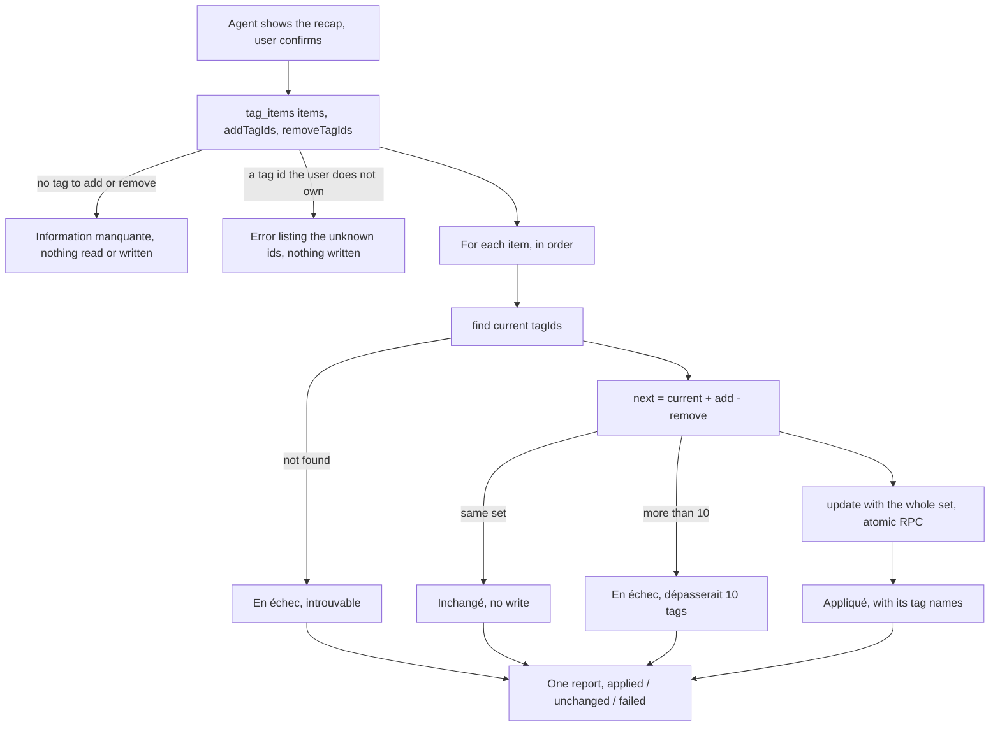
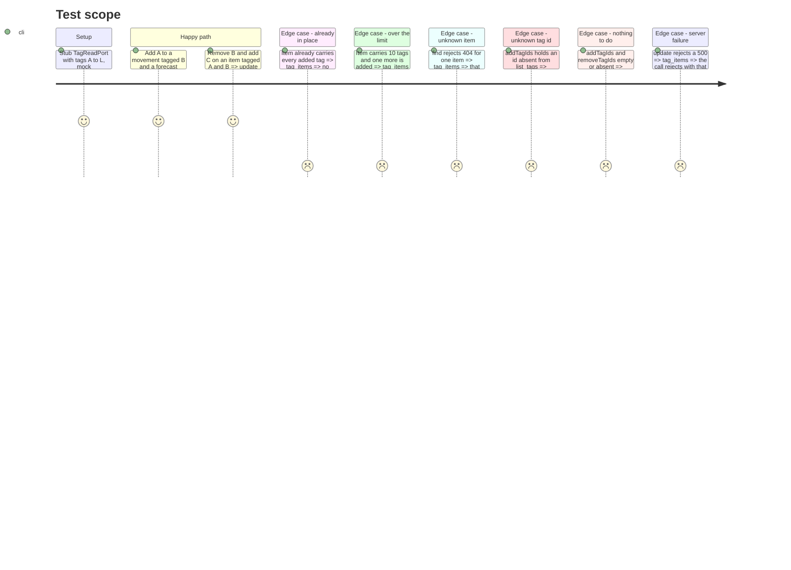

# Instruction: MCP bulk tagging, `tag_items`

## Architecture projection

> Tree of the final files. ✅ create · ✏️ modify · ❌ delete

```txt
backend-nest/src/modules/mcp/
├── mcp.module.ts                                 ✏️ TagItemsTool in TOOLS
└── infrastructure/tools/write/
    ├── tag-items.tool.ts                         ✅ tag_items
    └── tag-items.tool.spec.ts                    ✅
```

## User Journey



## Test Scope



## Tasks to do

### `1)` Input and metadata

> CA7: add and/or remove on at most 50 movements or prévisions in one call, without touching unmentioned tags.

1. Input:
   - `items: z.array(z.object({ target: z.enum(['movement', 'forecast']).describe('movement = un mouvement réel, forecast = une prévision'), id: z.uuid().describe('Identifiant du mouvement ou de la prévision') })).min(1).max(50)`
   - `addTagIds: z.array(z.uuid()).max(MAX_TAGS_PER_TRANSACTION).optional()` described « Tags à poser (ids, voir list_tags) »
   - `removeTagIds: z.array(z.uuid()).optional()` described « Tags à retirer (ids, voir list_tags) »
2. `name = 'tag_items'`, `title = 'Poser ou retirer des tags'`, `mode = 'read_write'`, annotations `{ readOnlyHint: false, destructiveHint: true, idempotentHint: true, openWorldHint: false }`.
3. Description « Pose et/ou retire des tags sur 1 à 50 mouvements ou prévisions en un appel. Les tags non mentionnés restent en place ; un tag présent dans les deux listes est retiré. 10 tags au plus par élément : un élément qui dépasserait cette limite, ou introuvable, est signalé en échec sans bloquer les autres. Taguer une prévision ne la marque pas comme ajustée : une mise à jour du modèle remplace ses tags. »

### `2)` Execution

> Read, compute, write per item; the API replaces the whole set (`update_*_with_tags`).

1. Inject `TAG_READ_PORT`, `TRANSACTION_WRITE_PORT`, `BUDGET_LINE_WRITE_PORT`.
2. Both lists empty or absent → `askUser('Quels tags poser ou retirer ? Appelle list_tags pour leurs ids, ou create_tag pour en créer un.')`.
3. `tags = await this.tags.list()`; any add/remove id not in it → `throw new BadRequestException(\`Tags inconnus : ${ids}. Appelle list_tags ; rien n’a été modifié.\`)`.
4. For each item, sequentially (`for…of`), with a `ponytail:` comment naming the ceiling (one update use case per item, so one budget recalculation each; upgrade path: a tag-only write that skips the recalculation if 50-item calls get slow):
   - `current = target === 'movement' ? movements.find(id) : forecasts.find(id)`;
   - `next = new Set(current.tagIds)`, add `addTagIds`, then delete `removeTagIds`;
   - same members as `current.tagIds` → unchanged;
   - `next.size > MAX_TAGS_PER_TRANSACTION` → failed « dépasserait 10 tags »;
   - else `movements.update(id, { tagIds: [...next] })` or `forecasts.update(id, { id, tagIds: [...next] })` → applied.
   - `catch`: an `HttpException` with status < 500 → failed (« introuvable » for 404, else its message); anything else → rethrow. Comment: add/remove converges, so a retry after an abort is safe.
5. Report text, using `tagNames` / `tagSuffix` from `../read/month-report`:
   - first line: tags posés and retirés by name;
   - `Appliqués (n)`: `- [id] Mouvement|Prévision « name »` + tag suffix of the new set;
   - `Inchangés (n)` and `En échec (n)` (`- [id] Mouvement|Prévision : reason`); omit an empty section.
   - Item names are plaintext like everywhere in the MCP output; nothing reaches the activity log but the tool name and outcome.

### `3)` Module

1. Append `TagItemsTool` to the write part of `TOOLS`.

### `4)` Spec

> `tag-items.tool.spec.ts`, ports mocked with `satisfies`, one `it` per Test Scope line.

1. Movement and forecast dispatch, including `id` in the forecast patch.
2. Unmentioned tags kept; a tag in both lists ends removed.
3. Unchanged → no `update` call.
4. Over 10 → failed, no `update`, next item applied.
5. `find` rejects `new NotFoundException()` → failed « introuvable », others applied.
6. Unknown tag id → rejects 400, `find` and `update` never called.
7. Neither list → askUser text, no port call (including `tags.list`).
8. `update` rejects a 500 `BusinessException` → the tool rejects.
9. `mode`, name and annotations.

### `5)` Validate

```bash
cd backend-nest && bun test src/modules/mcp src/app.module.spec.ts
cd backend-nest && bun run type-check:full && bun run lint && bun run lint:arch
cd backend-nest && bunx prettier --check src/modules/mcp
```

## Test acceptance criteria

| Task | Acceptance criteria |
| ---- | ------------------- |
| 1 | `tag_items` refuses more than 50 items at input validation; it is absent from a read-only catalog; annotations `destructiveHint: true`, `idempotentHint: true` |
| 2 | Adding then removing tags on a mix of mouvements and prévisions changes only the mentioned tags on each item |
| 2 | An item that would exceed 10 tags, or whose id is unknown, is listed in échec with its reason while the other items are applied |
| 2 | An unknown tag id fails the whole call before any write, naming the id |
| 2 | Re-running the same call reports every item as inchangé |
| 4 | `tag-items.tool.spec.ts` passes |
