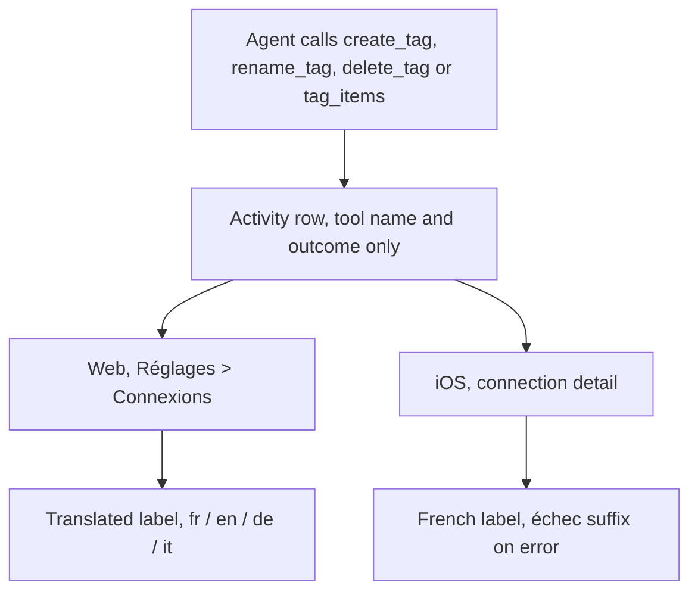
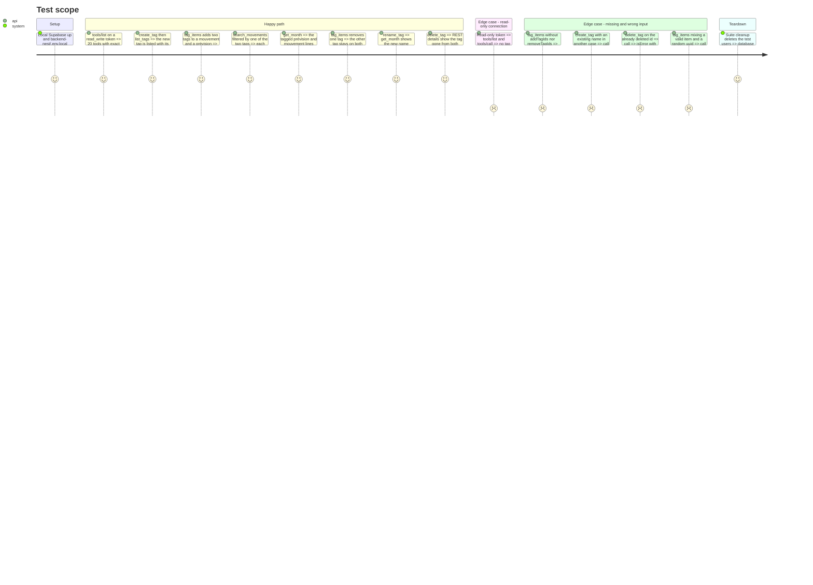

# Instruction: Tool catalog surfaces, activity labels and the e2e contract

## Architecture projection

> Tree of the final files. ✅ create · ✏️ modify · ❌ delete

```txt
frontend/projects/webapp/public/i18n/
└── {fr,en,de,it}.json                                    ✏️ settings.connections.tools: create_tag, delete_tag, rename_tag, tag_items
ios/Pulpe/Features/Account/Connections/
└── ConnectionDetailView.swift                            ✏️ label(for:) maps the four new tools
backend-nest/src/modules/mcp/infrastructure/oauth/
└── mcp-oauth.integration.spec.ts                         ✏️ 15 → 20 tools; name, annotation and read-only lists; tag tools exercised end to end
```

## User Journey



## Test Scope



## Tasks to do

### `1)` Web activity labels

> CA10, web side. Keys must match in the four catalogs (`catalog-parity.spec.ts`).

1. Under `settings.connections.tools`: `create_tag` after `create_month_from_template`, `delete_tag` after `delete_movement`, `rename_tag` before `spread_expense`, `tag_items` before `toggle_check`:
   - fr: `create_tag` « Tag créé », `delete_tag` « Tag supprimé », `rename_tag` « Tag renommé », `tag_items` « Tags modifiés »
   - en: « Tag created », « Tag deleted », « Tag renamed », « Tags updated »
   - de: « Tag erstellt », « Tag gelöscht », « Tag umbenannt », « Tags aktualisiert »
   - it: « Tag creato », « Tag eliminato », « Tag rinominato », « Tag aggiornati »

### `2)` iOS activity labels

> CA10, iOS side. Same pattern as `add_movement`; no catalog entry exists for it either.

1. `ConnectionDetailView.label(for:)`: add `case "create_tag": AppLocale.string("Tag créé")`, `"rename_tag"` « Tag renommé », `"delete_tag"` « Tag supprimé », `"tag_items"` « Tags modifiés ».

### `3)` Integration contract

> The explicit lists in `mcp-oauth.integration.spec.ts` are the catalog's contract; they run only with `RUN_INTEGRATION_TESTS=true`, so a plain `bun test` stays green while they are stale.

1. Counts: the test titles and assertions at « lists the 15 tools », `toHaveLength(15)`, « advertises all 15 tools », « executes all 15 tools », `used.size).toBe(15)` → 20.
2. « advertises all … tools »: `reads` += `list_tags`; `writes` += `create_tag`, `rename_tag`, `delete_tag`, `tag_items`; `destructive` += `rename_tag`, `delete_tag`, `tag_items`; the idempotent write list += `rename_tag`, `delete_tag`, `tag_items`. The existing read-only loop then refuses the four new writes.
3. « executes all … tools », before `delete_movement` removes the expense: drive the Test Scope happy path and edge cases above with `call(...)` for success paths and a raw `mcp(token, 'tools/call', …)` for the `isError` ones (`callTool` asserts no error). Add the `tag_items` missing-input check next to the existing « Information manquante » checks. Verify with `normal('budgets/<id>/details')` tagIds, not only tool text.

### `4)` Validate

```bash
cd frontend && pnpm exec ng test --include "**/catalog-parity.spec.ts"
pnpm test:lexicon
cd ios && xcodegen generate --use-cache && xcodebuild build -scheme PulpeLocal -destination 'platform=iOS Simulator,name=Pulpe Tests' CODE_SIGNING_ALLOWED=NO
cd backend-nest && RUN_INTEGRATION_TESTS=true bun --env-file=.env.local test src/modules/mcp/infrastructure/oauth/mcp-oauth.integration.spec.ts
cd backend-nest && bun run quality && bun test
```

The integration run needs local Supabase started and `backend-nest/.env.local`. If the database is not reachable from the executor, say so explicitly in the phase report instead of marking the integration criteria met.

## Test acceptance criteria

| Task | Acceptance criteria |
| ---- | ------------------- |
| 1 | Réglages > Connexions shows « Tag créé », « Tag renommé », « Tag supprimé », « Tags modifiés » (and their en/de/it equivalents) instead of « Action de l’assistant »; parity and lexicon checks pass |
| 2 | The iOS connection detail shows the same four French labels, with « (échec) » on errors; the PulpeLocal build succeeds |
| 3 | The gated suite lists exactly 20 tools with the declared annotations, hides the four tag writes from read-only connections, and proves CA1 to CA9 against encrypted owner data |
| 3 | A search filtered by one tag shows all tag names of each result (the double PostgREST embed works on a real database) |
