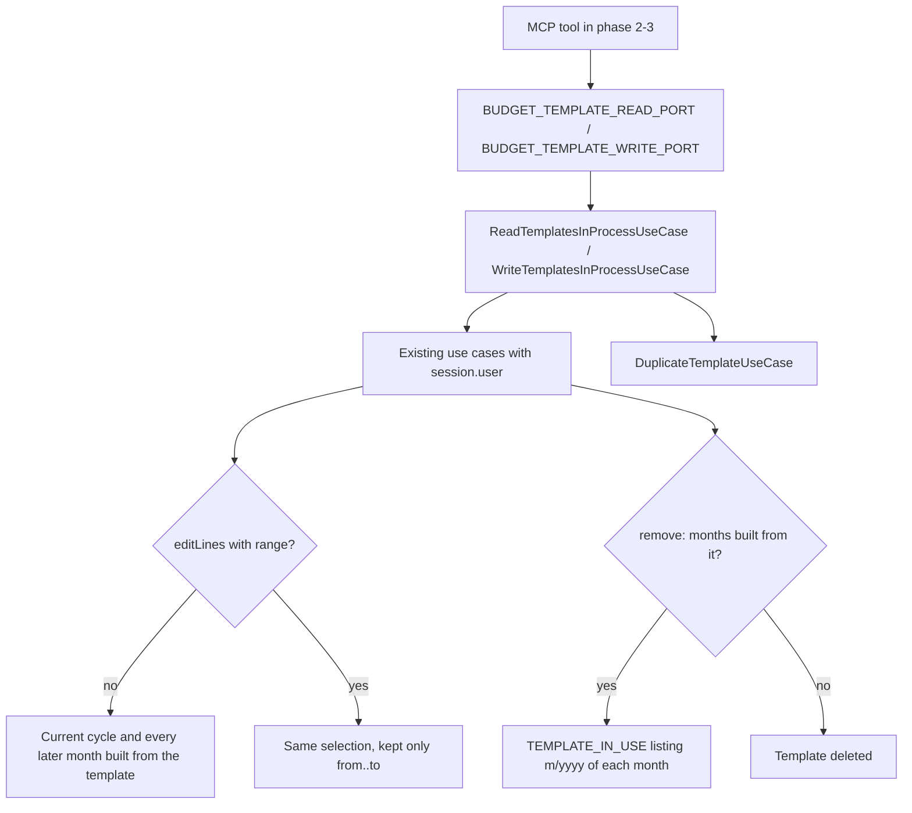
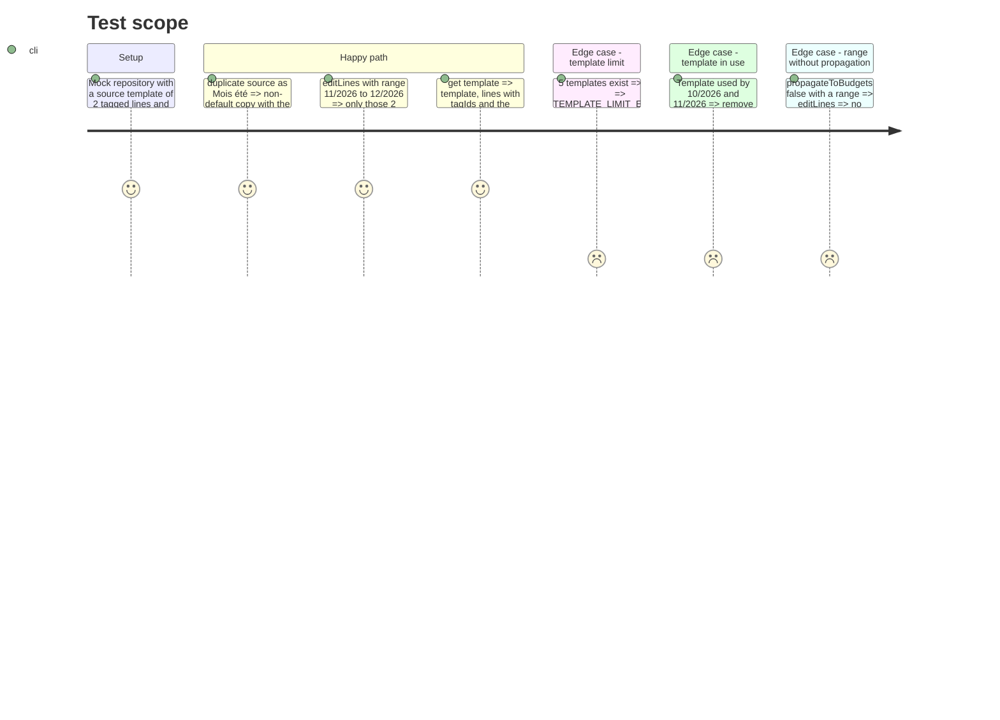

# Instruction: Template module, read/write ports, duplicate, bounded propagation, in-use months

## Architecture projection

> Tree of the final files. ✅ create · ✏️ modify · ❌ delete

```txt
docs/BUSINESS_RULES.md                                              ✏️ § Propagation du Mois Type: one sentence on a bounded range
backend-nest/src/
├── common/constants/error-definitions.ts                           ✏️ TEMPLATE_IN_USE message appends details.months when present
└── modules/budget-template/
    ├── budget-template.module.ts                                   ✏️ provide DuplicateTemplateUseCase + WriteTemplatesInProcessUseCase, bind BUDGET_TEMPLATE_WRITE_PORT (useExisting), export it
    ├── domain/
    │   ├── budget-template.invariants.ts                           ✏️ validateTemplateNotUsed(id, budgets) puts the months in the error
    │   ├── budget-template.invariants.spec.ts                      ✏️ new signature, months in the message
    │   └── ports/
    │       ├── budget-template-read.port.ts                        ✏️ + TemplateDetails, + get(id)
    │       ├── budget-template-write.port.ts                       ✅ BUDGET_TEMPLATE_WRITE_PORT: create, update, remove, duplicate, editLines
    │       └── budget-template-repository.port.ts                  ✏️ drop isTemplateInUse (its only caller moves to fetchTemplateBudgets)
    ├── application/
    │   ├── read-templates-in-process.use-case.ts                   ✏️ implement get()
    │   ├── read-templates-in-process.use-case.spec.ts              ✅
    │   ├── write-templates-in-process.use-case.ts                  ✅ delegates to the existing use cases with session.user
    │   ├── write-templates-in-process.use-case.spec.ts             ✅
    │   ├── duplicate-template.use-case.ts                          ✅
    │   ├── duplicate-template.use-case.spec.ts                     ✅
    │   ├── bulk-template-line-operations.use-case.ts               ✏️ optional 4th arg `range` filters fetchPropagationBudgets
    │   ├── bulk-template-line-operations.use-case.spec.ts          ✏️ range cases
    │   └── remove-template.use-case.ts                             ✏️ fetchTemplateBudgets → invariant with months
    └── infrastructure/persistence/supabase-budget-template.repository.ts  ✏️ drop isTemplateInUse
```

## User Journey



## Test Scope



## Tasks to do

### `1)` Read port: one template with its lines and usage

> `get_template` (phase 2) needs lines with tags and the months built from the template in one port call.

1. In `budget-template-read.port.ts`, add `export interface TemplateDetails { template: BudgetTemplate; lines: TemplateLine[]; months: TemplateUsageBudget[] }` and `get(id: string): Promise<TemplateDetails>` on `BudgetTemplateReadPort`.
2. In `ReadTemplatesInProcessUseCase`, inject `FindTemplateUseCase`, `FindTemplateLinesUseCase`, `CheckTemplateUsageUseCase`; `get(id)` runs the three with `this.session.user` (`Promise.all`) and returns `{ template, lines, months: usage.budgets }`. Each validates ownership; a foreign or unknown id throws their existing `TEMPLATE_NOT_FOUND`.

### `2)` Bounded propagation

> `edit_template_lines` scope `range` (phase 3) needs propagation limited to a month range, without changing the REST contract.

1. `BulkTemplateLineOperationsUseCase.execute(templateId, dto, user, range?: { from: BudgetPeriod; to: BudgetPeriod })` (`BudgetPeriod` from `pulpe-shared`).
2. Pass `range` to `fetchPropagationBudgets`; after `repo.fetchFutureBudgets(...)`, keep budgets with `periodIndex(range.from) <= periodIndex(budget) <= periodIndex(range.to)` (`periodIndex` from `pulpe-shared`). No range = today's behaviour. The range only narrows the current-and-future selection; it never reaches past cycles.
3. Leave `BudgetTemplateController` and `TemplateLinePropagationAdapter` untouched (they pass no range).

### `3)` `DuplicateTemplateUseCase`

> Copy a template and every line, tags included, under a new name; the copy is never the default.

1. `execute(sourceId: string, name: string, user: AuthenticatedUser): Promise<TemplateWithLines>`.
2. `repo.validateAccess(sourceId, user.id)` → `BudgetTemplateInvariants.validateTemplateLimit(await repo.countForUser(user.id))` → `repo.findLinesByTemplateId(sourceId)`.
3. `repo.createTemplateWithLines({ userId: user.id, name, description: source.description ?? undefined, isDefault: false, lines })`, each line copied as `TemplateLineRpcInput`: `name, amount, kind, recurrence, savingsGoalId, tagIds, description ?? '', originalAmount, originalCurrency, targetCurrency, exchangeRate`. The repository encrypts amounts; the RPC's trigger still guards the limit.
4. Return `{ template, lines: await repo.findLinesByTemplateId(template.id) }`; log `operation: 'duplicate'` with `userId`, `entityId`, source id, duration (never names or amounts). Register `createInfoLoggerProvider(DuplicateTemplateUseCase.name)`.

### `4)` Write port and in-process adapter

> One exported port carries every template write the agent may do.

1. `domain/ports/budget-template-write.port.ts`: `BUDGET_TEMPLATE_WRITE_PORT = Symbol(...)` and `BudgetTemplateWritePort` with `create(dto: BudgetTemplateCreate): Promise<TemplateWithLines>`, `update(id: string, dto: BudgetTemplateUpdate): Promise<BudgetTemplate>`, `remove(id: string): Promise<void>`, `duplicate(id: string, name: string): Promise<TemplateWithLines>`, `editLines(id: string, ops: TemplateLinesBulkOperations, range?: { from: BudgetPeriod; to: BudgetPeriod }): Promise<BulkTemplateLineOperationsResult>`. Type-only imports (domain may not import zod or Nest). JSDoc like the other in-process ports (requires `user` and `supabase` in CLS).
2. `application/write-templates-in-process.use-case.ts`: `WriteTemplatesInProcessUseCase implements BudgetTemplateWritePort`, injecting `CreateTemplateUseCase`, `UpdateTemplateUseCase`, `RemoveTemplateUseCase`, `DuplicateTemplateUseCase`, `BulkTemplateLineOperationsUseCase`, `AuthenticatedSupabaseProvider`; each method forwards to its use case with `this.session.user` (`editLines` forwards `range`).
3. `budget-template.module.ts`: add both classes to `providers`, `{ provide: BUDGET_TEMPLATE_WRITE_PORT, useExisting: WriteTemplatesInProcessUseCase }`, and `BUDGET_TEMPLATE_WRITE_PORT` to `exports`.

### `5)` A template in use names its months

> CA3: refusing to delete a used template lists those months, for REST and MCP alike.

1. `BudgetTemplateInvariants.validateTemplateNotUsed(templateId: string, budgets: readonly { month: number; year: number }[])`: when non-empty, throw `TEMPLATE_IN_USE` with details `{ id, months: budgets.map((b) => \`${b.month}/${b.year}\`).join(', ') }`.
2. `RemoveTemplateUseCase`: replace `repo.isTemplateInUse(id)` with `repo.fetchTemplateBudgets(id)` and pass the list to the invariant.
3. `error-definitions.ts` `TEMPLATE_IN_USE.message`: keep today's text, append `. Used by: ${details.months}` when `details.months` is present (clients key on the code, never on the text).
4. Delete `isTemplateInUse` from the repository port and the Supabase repository (no caller left).

### `6)` Business rule

> Keep `docs/BUSINESS_RULES.md` true.

1. § Propagation du Mois Type, after the first bullet: « Une propagation peut être bornée à une plage de mois ; la plage restreint cette sélection, elle ne l'étend jamais aux cycles passés. »

### `7)` Focused specs (bun, mocked ports)

1. `duplicate-template.use-case.spec.ts`: lines copied exactly (tagIds, savingsGoalId, FX fields, null description → `''`), `isDefault: false`, new name used; at 5 templates throws `TEMPLATE_LIMIT_EXCEEDED` and `createTemplateWithLines` is never called.
2. `bulk-template-line-operations.use-case.spec.ts`: with `fetchFutureBudgets` returning 10/2026, 11/2026, 12/2026, 1/2027 and range 11/2026-12/2026, `bulkApplyTemplateLineOperations` receives only those two ids (and `periodsOutsideInterval` only those periods); range with `propagateToBudgets: false` sends `budgetIds: []`.
3. `budget-template.invariants.spec.ts`: adapt to the list signature; the message contains `10/2026, 11/2026`.
4. `read-templates-in-process.use-case.spec.ts`: `get` returns `{ template, lines, months }` from the three use cases, called with `session.user`.
5. `write-templates-in-process.use-case.spec.ts`: `editLines` forwards ops, range and `session.user` (with `payDayOfMonth`); `duplicate` forwards id and name.

### `8)` Validate

1. `cd backend-nest && bun test src/modules/budget-template`
2. `cd backend-nest && bun run quality` (type-check:full, lint, lint:arch, format:check)

## Test acceptance criteria

| Task | Acceptance criteria |
| ---- | ------------------- |
| 1 | `get(id)` returns the template, its lines with `tagIds`, and every month built from it; an unknown or foreign id fails with `TEMPLATE_NOT_FOUND`. |
| 2 | With a range, only budgets inside it (and in the current cycle or later) are propagated; without one, REST bulk-operations behaves exactly as before. |
| 3 | A duplicate is a new non-default template with the same lines, tags, savings links and FX metadata; at 5 templates the call fails with `TEMPLATE_LIMIT_EXCEEDED` and nothing is written. |
| 4 | `BUDGET_TEMPLATE_WRITE_PORT` is exported, bound with `useExisting`, and `bun run lint:arch` stays green. |
| 5 | Deleting a used template fails with `TEMPLATE_IN_USE` whose message names every month built from it; an unused template is deleted. |
| 6 | `docs/BUSINESS_RULES.md` states that a range only narrows the propagation selection. |
| 7 | The five specs pass under `bun test src/modules/budget-template`. |
