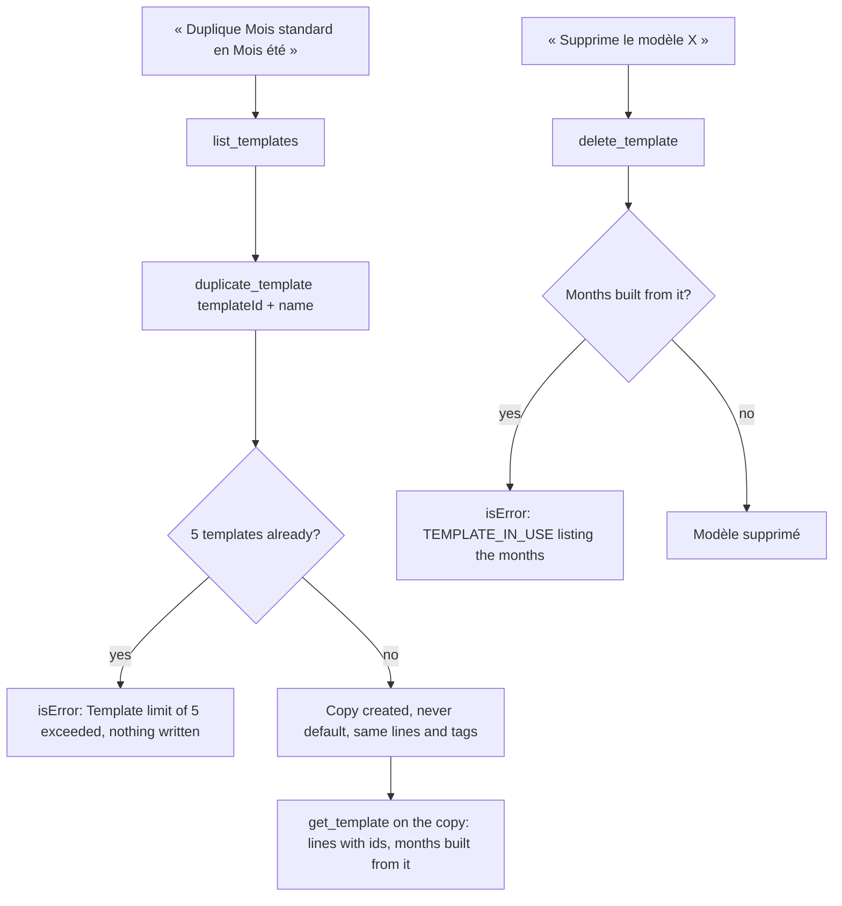
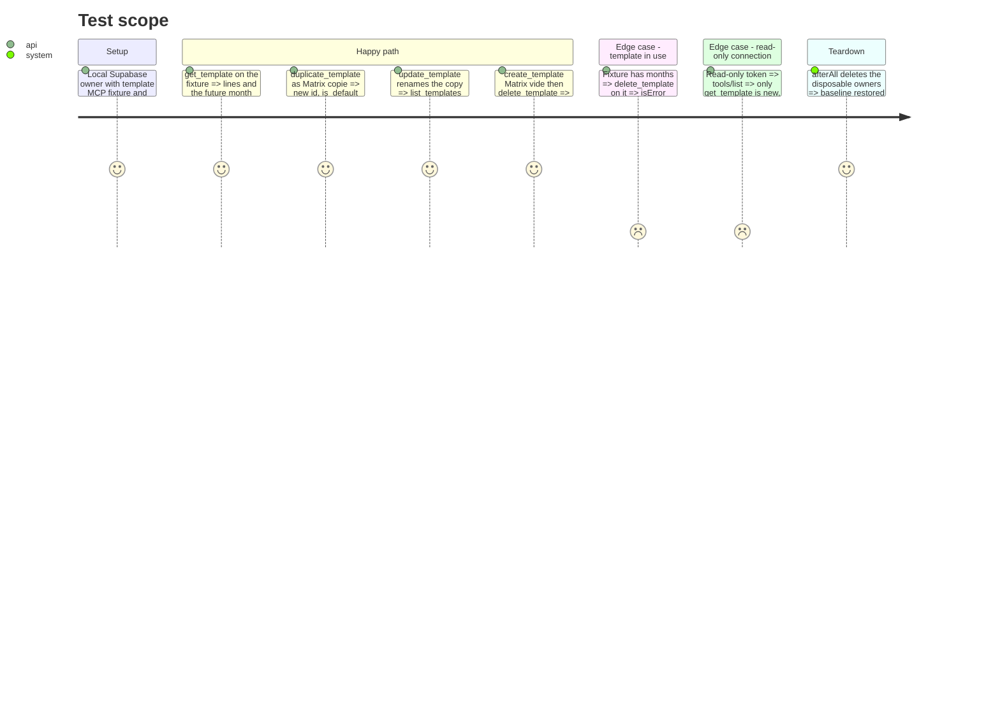

# Instruction: MCP tools to get, create, update, delete and duplicate a template

## Architecture projection

> Tree of the final files. ✅ create · ✏️ modify · ❌ delete

```txt
backend-nest/src/modules/mcp/
├── mcp.module.ts                                         ✏️ append GetTemplateTool, CreateTemplateTool, UpdateTemplateTool, DeleteTemplateTool, DuplicateTemplateTool to TOOLS
└── infrastructure/
    ├── oauth/mcp-oauth.integration.spec.ts               ✏️ catalog N+5, name/annotation lists, execute-all calls
    └── tools/
        ├── read/
        │   ├── get-template.tool.ts                      ✅
        │   └── get-template.tool.spec.ts                 ✅
        └── write/
            ├── create-template.tool.ts                   ✅
            ├── create-template.tool.spec.ts              ✅
            ├── update-template.tool.ts                   ✅
            ├── update-template.tool.spec.ts              ✅
            ├── delete-template.tool.ts                   ✅
            ├── delete-template.tool.spec.ts              ✅
            ├── duplicate-template.tool.ts                ✅
            └── duplicate-template.tool.spec.ts           ✅
frontend/projects/webapp/public/i18n/{fr,en,de,it}.json   ✏️ settings.connections.tools: create_template, update_template, delete_template, duplicate_template
```

## User Journey



## Test Scope



## Tasks to do

### `1)` `get_template` (read)

> CA1: a template's lines (id, nature, intitulé, montant, Mensuel/Ponctuel, tags) and the months created from it.

1. `read/get-template.tool.ts`, `GetTemplateTool`, injects `BUDGET_TEMPLATE_READ_PORT` and `TAG_READ_PORT` (PUL-359 imports `TagModule` into `McpModule`); `Promise.all([templates.get(templateId), tags.list()])`.
2. Input: `templateId: z.uuid().describe('Modèle à lire. Les modèles sont dans list_templates')`.
3. Metadata: `name = 'get_template'`, `title = 'Détail d’un modèle'`, `description = 'Montre un modèle de mois : ses prévisions (nature, intitulé, montant, Mensuel ou Ponctuel, tags) et les mois créés depuis ce modèle. Les identifiants servent à edit_template_lines.'`, `mode = 'read'`, annotations `{ readOnlyHint: true, destructiveHint: false, idempotentHint: true, openWorldHint: false }`.
4. Text, reusing `KIND_LABEL`, `round`, `tagNames` and `tagSuffix` from `read/month-report.ts` (the last two land with PUL-359):
   - `Modèle « {name} » (id {id})` + ` · par défaut` + ` · {description}` when set;
   - `Prévisions ({n})` then `- [{lineId}] {KIND_LABEL[kind]} · {name} · {round(amount)} · {Mensuel|Ponctuel}{tagSuffix(line.tagIds, names)}`;
   - `Mois créés depuis ce modèle ({k}) : m/yyyy, …` or `Aucun mois créé depuis ce modèle.`

### `2)` `create_template`

> CA2: create an empty template; lines come through `edit_template_lines`.

1. `write/create-template.tool.ts`, `CreateTemplateTool`, injects `BUDGET_TEMPLATE_WRITE_PORT`.
2. Input: `name` (`z.string().min(1).max(100)`, 'Nom du modèle'), `description` (`.min(1).max(500).optional()`), `isDefault` (`z.boolean().optional()`, 'En faire le modèle par défaut, seulement si l’utilisateur le demande').
3. `create({ name, description, isDefault: isDefault ?? false, lines: [] })` → `Modèle créé (id {id}) : {name}. Ajoute ses prévisions avec edit_template_lines.`
4. Metadata: `title = 'Créer un modèle'`, `description = 'Crée un modèle de mois vide, à remplir ensuite avec edit_template_lines. 5 modèles au plus par utilisateur.'`, `mode = 'read_write'`, annotations `{ readOnlyHint: false, destructiveHint: false, idempotentHint: false, openWorldHint: false }`.
5. The 5-template limit is the existing `TEMPLATE_LIMIT_EXCEEDED` (400, message reaches the model, CA5); no pre-check in the tool.

### `3)` `update_template`

> CA2: name, description, default flag.

1. `write/update-template.tool.ts`, `UpdateTemplateTool`. Input: `templateId`, `name?`, `description?` (`.max(500)`), `isDefault?`.
2. None of the three given → `askUser('ce qui change sur ce modèle : nom, description ou modèle par défaut, puis rappelle update_template.')`, no write.
3. `update(templateId, { name, description, isDefault })` → `Modèle modifié (id {id}) : {name}{ · par défaut}.`
4. Metadata: `title = 'Modifier un modèle'`, `description = 'Renomme un modèle, change sa description ou en fait le modèle par défaut. Seuls les champs fournis changent ; ses prévisions et les mois déjà créés ne bougent pas.'`, annotations `{ readOnlyHint: false, destructiveHint: true, idempotentHint: true, openWorldHint: false }`.

### `4)` `delete_template`

> CA2, CA3: destructive; refused while a month is built from the template.

1. `write/delete-template.tool.ts`, `DeleteTemplateTool`. Input: `templateId`.
2. `remove(templateId)` → `Modèle supprimé (id {id}).` A used template makes `RemoveTemplateUseCase` throw `TEMPLATE_IN_USE` with the months (phase 1); the controller returns it as `isError` and the activity log records `error`.
3. Metadata: `title = 'Supprimer un modèle'`, `description = 'Supprime un modèle de mois et ses prévisions. Refusé tant qu’un mois a été créé depuis ce modèle : la réponse liste ces mois.'`, annotations `{ readOnlyHint: false, destructiveHint: true, idempotentHint: true, openWorldHint: false }`.

### `5)` `duplicate_template`

> CA4, CA5: copy every line and its tags under a new name; never the default.

1. `write/duplicate-template.tool.ts`, `DuplicateTemplateTool`. Input: `templateId` ('Modèle à copier'), `name` (`z.string().min(1).max(100)`, required, 'Nom de la copie').
2. `duplicate(templateId, name)` → `Modèle dupliqué (id {newId}) : {name}, {lines.length} prévisions copiées. La copie n’est pas le modèle par défaut.`
3. Metadata: `title = 'Dupliquer un modèle'`, `description = 'Copie un modèle sous un nouveau nom avec toutes ses prévisions et leurs tags, pour en faire une variante (par exemple « Mois été »). La copie n’est jamais le modèle par défaut. 5 modèles au plus par utilisateur.'`, annotations `{ readOnlyHint: false, destructiveHint: false, idempotentHint: false, openWorldHint: false }`.

### `6)` Register and label

> CA15, CA16 (web part).

1. `mcp.module.ts`: append the five classes at the end of `TOOLS` (after PUL-359's entries). No new module import: `BudgetTemplateModule` is already imported.
2. Add under `settings.connections.tools`, after the existing keys, in all four catalogs:

| key | fr | en | de | it |
| --- | --- | --- | --- | --- |
| `create_template` | Modèle créé | Template created | Vorlage erstellt | Modello creato |
| `update_template` | Modèle modifié | Template updated | Vorlage aktualisiert | Modello aggiornato |
| `delete_template` | Modèle supprimé | Template deleted | Vorlage gelöscht | Modello eliminato |
| `duplicate_template` | Modèle dupliqué | Template duplicated | Vorlage dupliziert | Modello duplicato |

### `7)` Integration spec (gated by `RUN_INTEGRATION_TESTS`)

1. Catalog test: title and `toHaveLength(N + 5)`.
2. "advertises all tools" test: `reads` += `get_template`; `writes` += the four write tools; `destructive` += `update_template`, `delete_template`; the idempotent list += `update_template`, `delete_template`; update the title count.
3. "executes all tools" test, after the existing assertions and before `expect(used.size)`: `get_template` on `owner.templateId` contains `${future.month}/${future.year}`; `duplicate_template` → admin row has `is_default = false` and the same `template_line` count; `update_template` renames it and `list_templates` shows the new name; `create_template` then `delete_template` removes the row; a raw `mcp(token, 'tools/call', { name: 'delete_template', arguments: { templateId: owner.templateId } })` returns `isError` naming `${future.month}/${future.year}` and the fixture template still exists. Delete the copy at the end so reruns stay under the limit. `used.size` → `N + 5`.

### `8)` Focused specs (bun, ports mocked with `satisfies`, like `get-current-month.tool.spec.ts`)

1. `get-template.tool.spec.ts`: one line per forecast with kind label, rounded amount, Mensuel/Ponctuel and tag names (`{ list: async () => [tag] } satisfies TagReadPort`); months listed; `Aucun mois créé depuis ce modèle.` when none.
2. `create-template.tool.spec.ts`: omitted `isDefault` sent as `false`, `lines: []`; text carries the new id.
3. `update-template.tool.spec.ts`: no field → `Information manquante` and the port is not called; given fields forwarded unchanged.
4. `delete-template.tool.spec.ts`: calls `remove`; a rejected `remove` propagates (no success text).
5. `duplicate-template.tool.spec.ts`: forwards id and name; text has the new id and the copied line count.

### `9)` Validate

1. `cd backend-nest && bun test src/modules/mcp`
2. `cd backend-nest && bun run quality`
3. `cd frontend && pnpm exec ng test --include "**/catalog-parity.spec.ts"`
4. `cd frontend && pnpm exec prettier --check projects/webapp/public/i18n`
5. `pnpm test:lexicon` (repository root)
6. With local Supabase up (started from the main repo): `cd backend-nest && RUN_INTEGRATION_TESTS=true bun --env-file=.env.local test src/modules/mcp/infrastructure/oauth/mcp-oauth.integration.spec.ts`

## Test acceptance criteria

| Task | Acceptance criteria |
| ---- | ------------------- |
| 1 | `get_template` lists every line with id, nature, intitulé, montant, Mensuel/Ponctuel and tags, then the months built from the template; it is the only new tool a read-only connection sees. |
| 2 | `create_template` creates a template that is default only when asked; past 5 templates the call is `isError` with the limit message and nothing is created. |
| 3 | `update_template` without any field asks what changes and writes nothing; with fields it changes only those. |
| 4 | `delete_template` deletes an unused template; on a used one it is `isError`, names each month built from it, and the template remains. |
| 5 | `duplicate_template` yields a non-default copy with the same lines and tags under the new name. |
| 6 | Réglages > Connexions on the web shows the four new labels in fr, en, de and it; `catalog-parity.spec.ts` and `test:lexicon` pass. |
| 7 | The integration run advertises `N + 5` tools with exact annotations and exercises all of them on encrypted data. |
| 8 | The five tool specs pass under `bun test src/modules/mcp`. |
