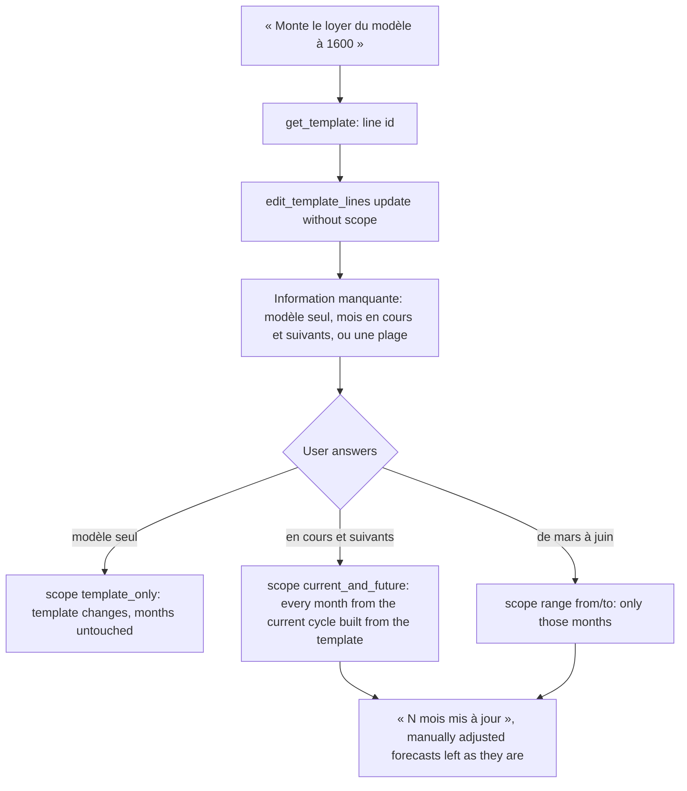
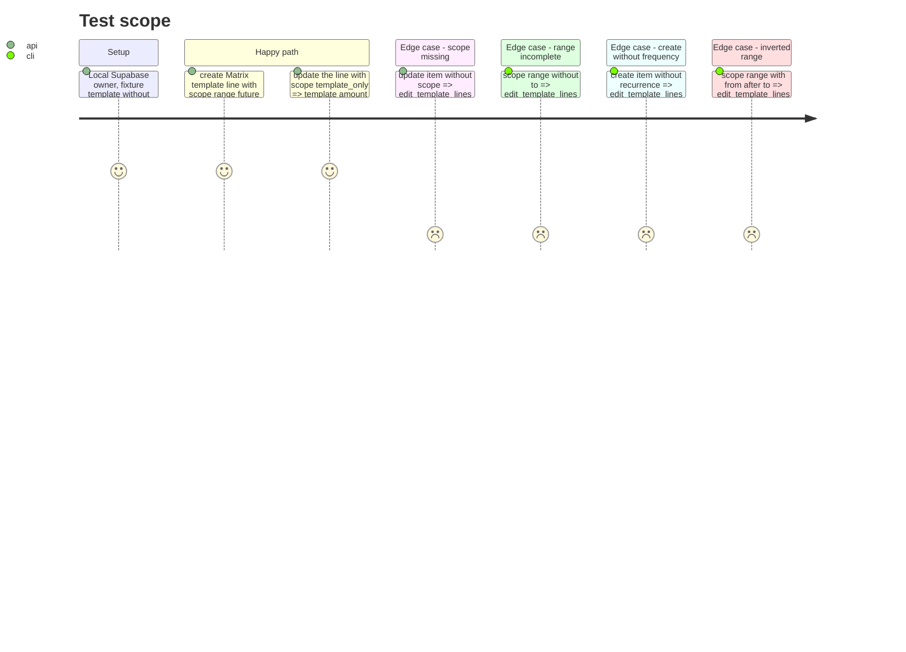

# Instruction: MCP tool `edit_template_lines` with an explicit scope

## Architecture projection

> Tree of the final files. ✅ create · ✏️ modify · ❌ delete

```txt
backend-nest/src/modules/mcp/
├── mcp.module.ts                                         ✏️ append EditTemplateLinesTool to TOOLS
└── infrastructure/
    ├── oauth/mcp-oauth.integration.spec.ts               ✏️ catalog N+6, lists, a template line created and propagated to one month
    └── tools/write/
        ├── edit-template-lines.tool.ts                   ✅
        └── edit-template-lines.tool.spec.ts              ✅
frontend/projects/webapp/public/i18n/{fr,en,de,it}.json   ✏️ settings.connections.tools.edit_template_lines
```

## User Journey



## Test Scope



## Tasks to do

### `1)` `edit_template_lines`

> CA6-CA9: add, change or remove template lines; propagation scope is always explicit; the answer says how many months changed.

1. `write/edit-template-lines.tool.ts`, `EditTemplateLinesTool`, injects `BUDGET_TEMPLATE_WRITE_PORT` and `ResolveCurrencyUseCase`.
2. Input schema (`period` = `z.object({ month: budgetSchema.shape.month, year: budgetSchema.shape.year })`, as `create-month-from-template.tool.ts` builds months):
   - `templateId: z.uuid()`;
   - `scope: z.enum(['template_only', 'current_and_future', 'range']).optional()`, described as « template_only = le modèle seul ; current_and_future = aussi le mois en cours et les suivants créés depuis ce modèle ; range = aussi les mois créés depuis ce modèle entre from et to. À demander à l’utilisateur, jamais à deviner » ;
   - `from: period.optional()`, `to: period.optional()` (range only);
   - `create`: array (max 50) of `{ name, amount, kind, recurrence?, currency?, tagIds? }` (`tagIds: z.array(z.uuid()).optional()`, ids from `list_tags`);
   - `update`: array (max 50) of `{ id, name?, amount?, kind?, recurrence?, currency?, tagIds? }`;
   - `delete`: array (max 50) of line ids.
   Max 50 per list keeps the total under the shared schema's 200-operation refine, which the use case parses.
3. Questions, in this order, each returning `askUser(...)` with no write:
   - all three lists empty → what to add, change or remove;
   - `scope` absent → « si la modification vaut pour le modèle seul (template_only), aussi pour le mois en cours et les suivants (current_and_future), ou pour une plage de mois (range avec from et to), puis rappelle edit_template_lines avec scope. » ;
   - `scope === 'range'` and `from` or `to` absent → the first and last month of the range;
   - a `create` item without `recurrence` → Mensuel or Ponctuel, same wording as `add_forecast`.
4. `from` after `to` → `BusinessException(ERROR_DEFINITIONS.VALIDATION_FAILED, { reason: 'range from is after to' })`.
5. Money: each item with an `amount` goes through `resolveCurrency.execute(amount, currency)`; spread the `AgentAmount` into the line (FX fields included). `create` items get `description: ''`.
6. Call `templates.editLines(templateId, { create, update, delete, propagateToBudgets: scope !== 'template_only' }, scope === 'range' ? { from, to } : undefined)`.
7. Text:
   - `Modèle mis à jour : {c} prévisions ajoutées, {u} modifiées, {d} supprimées.` then one `- [{id}] {name}` per created line (ids the agent can reuse);
   - `template_only` → `Les mois déjà créés ne changent pas.`;
   - otherwise → `{propagation.affectedBudgetsCount} mois mis à jour. Les prévisions ajustées à la main dans un mois restent telles quelles.` (the RPC skips `is_manually_adjusted` rows).
8. Metadata: `title = 'Modifier les prévisions d’un modèle'`, `description = 'Ajoute, modifie ou supprime des prévisions d’un modèle de mois. scope dit jusqu’où la modification s’applique : le modèle seul, le mois en cours et les suivants, ou une plage de mois, jamais avant le mois en cours. Les mois créés depuis ce modèle suivent, sauf les prévisions ajustées à la main dans un mois, qui restent telles quelles.'`, `mode = 'read_write'`, annotations `{ readOnlyHint: false, destructiveHint: true, idempotentHint: false, openWorldHint: false }` (a repeated `create` adds the line twice).

### `2)` Register and label

> CA15, CA16 (web part).

1. `mcp.module.ts`: append `EditTemplateLinesTool` to `TOOLS`.
2. `settings.connections.tools.edit_template_lines`: fr « Prévisions du modèle modifiées », en « Template planned items updated », de « Planung der Vorlage aktualisiert », it « Previsioni del modello aggiornate ».

### `3)` Integration spec (gated)

1. Catalog length and title counts → `N + 6`; `writes`, `destructive` += `edit_template_lines` (not idempotent).
2. In « executes all … tools », after the phase 2 template calls: `edit_template_lines` with `update` and no `scope` → `Information manquante`, template line count unchanged (admin query). Then `create` one line « Matrix template rent » (`amount: 400`, `kind: 'expense'`, `recurrence: 'fixed'`), `scope: 'range'`, `from = to = future` → text contains `1 mois mis à jour`; admin query: the future budget has a `budget_line` with that `template_line_id`. Keep the line id for phase 4. Then `update` its amount with `scope: 'template_only'` → the future forecast amount (read through `normal('budgets/<futureId>/details')`, decrypted) is still 400.
3. `used.size` → `N + 6`.

### `4)` Focused spec

1. `edit-template-lines.tool.spec.ts` (port and `ResolveCurrencyUseCase` mocked):
   - no scope → question, `editLines` not called;
   - range without `to` → question, not called;
   - create without recurrence → question, not called;
   - `template_only` → `propagateToBudgets: false`, no range, text says months unchanged;
   - `current_and_future` → `propagateToBudgets: true`, range `undefined`;
   - `range` → range forwarded as given;
   - `from` after `to` → rejects with `VALIDATION_FAILED`;
   - an amount in EUR is converted through `ResolveCurrencyUseCase` and its FX fields reach the line;
   - text reports `affectedBudgetsCount` and the created line ids.

### `5)` Validate

1. `cd backend-nest && bun test src/modules/mcp`
2. `cd backend-nest && bun run quality`
3. `cd frontend && pnpm exec ng test --include "**/catalog-parity.spec.ts"`
4. `cd frontend && pnpm exec prettier --check projects/webapp/public/i18n`
5. `pnpm test:lexicon`
6. `cd backend-nest && RUN_INTEGRATION_TESTS=true bun --env-file=.env.local test src/modules/mcp/infrastructure/oauth/mcp-oauth.integration.spec.ts`

## Test acceptance criteria

| Task | Acceptance criteria |
| ---- | ------------------- |
| 1 | Without a scope, or with an incomplete range or a create without frequency, the tool asks and writes nothing. With a scope, the template changes and only the months the scope covers follow; the answer gives the number of months updated and the ids of created lines. Manually adjusted forecasts are neither changed nor deleted. |
| 2 | The activity row shows « Prévisions du modèle modifiées » on the web in all four languages; `catalog-parity.spec.ts` passes. |
| 3 | The integration run proves a range propagation reaches exactly one month and a `template_only` edit reaches none. |
| 4 | The tool spec passes under `bun test src/modules/mcp`. |
