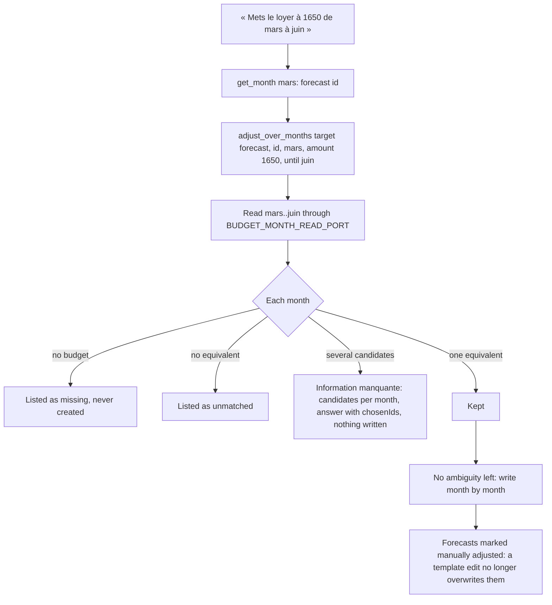
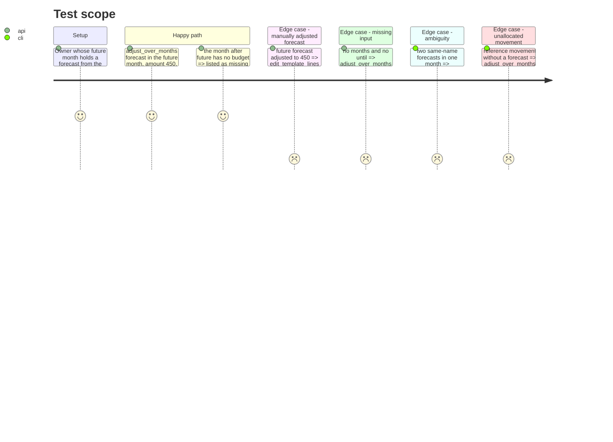

# Instruction: MCP tool `adjust_over_months`

## Architecture projection

> Tree of the final files. ✅ create · ✏️ modify · ❌ delete

```txt
backend-nest/src/modules/mcp/
├── mcp.module.ts                                         ✏️ providers += AdjustOverMonthsUseCase; append AdjustOverMonthsTool to TOOLS
├── application/
│   ├── adjust-over-months.use-case.ts                    ✅ match, then write, over ports only
│   └── adjust-over-months.use-case.spec.ts               ✅
└── infrastructure/
    ├── oauth/mcp-oauth.integration.spec.ts               ✏️ catalog N+7, lists, adjust then propagate
    └── tools/write/
        ├── adjust-over-months.tool.ts                    ✅ input checks, until → count, rendering
        └── adjust-over-months.tool.spec.ts               ✅
frontend/projects/webapp/public/i18n/{fr,en,de,it}.json   ✏️ settings.connections.tools.adjust_over_months
```

## User Journey



## Test Scope



## Tasks to do

### `1)` `AdjustOverMonthsUseCase` (mcp application layer)

> CA10-CA14: the same change on a forecast or an allocated movement across consecutive months, never guessing, never creating a month.

1. `mcp/application/adjust-over-months.use-case.ts`, one `execute(input)`; injects `BUDGET_MONTH_READ_PORT`, `BUDGET_LINE_WRITE_PORT`, `TRANSACTION_WRITE_PORT` (all three are domain ports already exported to `McpModule`) and `ResolveCurrencyUseCase`.
2. Input: `{ target: 'forecast' | 'movement'; id: string; from: BudgetPeriod; count: number; name?: string; amount?: number; currency?: SupportedCurrency; chosenIds?: readonly string[] }`.
3. Result (exported types in the same file):
   - `{ status: 'ambiguous'; months: { period: BudgetPeriod; candidates: { id: string; name: string; amount: number }[] }[] }`;
   - `{ status: 'done'; updated: BudgetPeriod[]; missingMonths: BudgetPeriod[]; unmatched: BudgetPeriod[]; failed: { period: BudgetPeriod; reason: string }[] }`.
4. Periods: `periodFromIndex(periodIndex(from) + i)` for `i < count` (`pulpe-shared`). Read all months with `Promise.all(periods.map((p) => monthRead.readMonth(p.month, p.year)))`.
5. Reference, in the first month:
   - forecast: `budgetLines.find(id)`; absent (or month `null`) → `BusinessException(BUDGET_LINE_NOT_FOUND, { id })`;
   - movement: `transactions.find(id)`; absent → `TRANSACTION_NOT_FOUND`; `budgetLineId` null → `VALIDATION_FAILED` with reason `movement is not allocated to a forecast`; its forecast is the reference forecast.
6. Equivalence in each later month:
   - equivalent forecasts: same `templateLineId` when the reference forecast has one; otherwise same `name.trim().toLowerCase()` and same `kind`;
   - forecast target: the candidates are those forecasts;
   - movement target: movements whose `budgetLineId` is one of those forecasts and whose normalized name equals the reference movement's.
   The first month uses the reference id itself.
7. Per month: `null` → `missingMonths`; no candidate → `unmatched`; one → kept; several → the one in `chosenIds` when exactly one is there, else an ambiguous entry. Any ambiguous entry → return `ambiguous` before any write or currency call.
8. Writes: `money = amount == null ? {} : await resolveCurrency.execute(amount, currency)` once; then, month by month in order:
   - forecast → `forecasts.update(id, { id, ...(name && { name }), ...money, isManuallyAdjusted: true })`;
   - movement → `movements.update(id, { ...(name && { name }), ...money })`.
   A `BusinessException` with status below 500 goes to `failed` with its message and the loop continues (re-running is safe: the change converges); anything else is rethrown. Cache invalidation and recalculation stay in the update use cases behind the ports.
9. `// ponytail:` comment on the loop: sequential, non-atomic, one recalculation per month; a batch RPC if 12 months ever proves slow.

### `2)` `adjust_over_months` tool

> The questions and the rendering; the use case stays free of `askUser` (infrastructure).

1. `write/adjust-over-months.tool.ts`, `AdjustOverMonthsTool`, injects `AdjustOverMonthsUseCase`.
2. Input (`period` built from `budgetSchema.shape.month` / `.year`, as in phase 3):
   - `target: z.enum(['forecast', 'movement'])` (« forecast = une prévision, movement = un mouvement rattaché à une prévision ») ;
   - `id: z.uuid()` (identifiant dans le mois de départ, lu avec get_month) ;
   - `month`, `year` (mois de départ, celui de id) ;
   - `name?`, `amount?` (`.positive()`), `currency?` (`supportedCurrencySchema`) ;
   - `months: z.number().int().min(1).max(12).optional()` (nombre de mois, mois de départ compris) ;
   - `until: period.optional()` (dernier mois, compris) ;
   - `chosenIds: z.array(z.uuid()).max(12).optional()` (réponse de l’utilisateur quand plusieurs éléments correspondent dans un mois).
3. Questions (no call to the use case):
   - neither `name` nor `amount` → what changes;
   - `months` and `until` both absent, or both present → « sur combien de mois, ou jusqu’à quel mois, puis rappelle adjust_over_months avec months ou until (pas les deux). ».
4. `count = until ? periodIndex(until) - periodIndex({ month, year }) + 1 : months`; outside `1..12` → `BusinessException(VALIDATION_FAILED, { reason: 'until must be within 12 months from the start month' })`.
5. Rendering:
   - `ambiguous` → `askUser('plusieurs éléments correspondent. m/yyyy : [id] name · round(amount) ; … Demande lesquels ajuster, puis rappelle adjust_over_months avec les mêmes arguments et chosenIds.')`;
   - `done` → `Ajusté sur {n} mois : m/yyyy, …` (or `Aucun mois ajusté.`), then when non-empty `Mois sans budget, non créés : …`, `Mois sans équivalent : …`, `Mois refusés : m/yyyy ({reason}), …`; for a forecast add `Ces prévisions sont désormais ajustées à la main : une modification du modèle ne les changera plus.`
6. Metadata: `title = 'Ajuster sur plusieurs mois'`, `description = 'Applique le même changement d’intitulé ou de montant à une prévision, ou à un mouvement rattaché à une prévision, sur plusieurs mois consécutifs (12 au plus) à partir du mois donné. Dans chaque mois, l’équivalent est la prévision issue de la même prévision du modèle, sinon celle de même intitulé et de même nature. Un mois sans budget n’est jamais créé : la réponse le liste. Les prévisions modifiées sont marquées ajustées à la main.'`, `mode = 'read_write'`, annotations `{ readOnlyHint: false, destructiveHint: true, idempotentHint: true, openWorldHint: false }`.

### `3)` Register and label

> CA15, CA16 (web part).

1. `mcp.module.ts`: `AdjustOverMonthsUseCase` in `providers` next to `ResolveCurrencyUseCase`; `AdjustOverMonthsTool` appended to `TOOLS`.
2. `settings.connections.tools.adjust_over_months`: fr « Ajusté sur plusieurs mois », en « Adjusted over several months », de « Über mehrere Monate angepasst », it « Modificato su più mesi ».

### `4)` Integration spec (gated)

1. Catalog length and title counts → `N + 7`; `writes`, `destructive`, idempotent list += `adjust_over_months`.
2. In « executes all … tools », after phase 3's template line: `adjust_over_months` without `months`/`until` → `Information manquante`. Find the future forecast with the phase 3 `template_line_id` in `normal('budgets/<futureId>/details')`; `adjust_over_months { target: 'forecast', id, ...future, amount: 450, months: 2 }` → text names `${future.month}/${future.year}` as adjusted and the next month as missing; the forecast reads 450 and admin `is_manually_adjusted` is `true`; no `monthly_budget` exists for the next month. Then `edit_template_lines` updates the template line to 500 with `scope: 'current_and_future'` → the future forecast still reads 450.
3. `used.size` → `N + 7`.

### `5)` Focused specs (bun, ports mocked with `satisfies`)

1. `adjust-over-months.use-case.spec.ts`:
   - forecast with `templateLineId`: matched in later months even when renamed there; each update carries `isManuallyAdjusted: true`; `ResolveCurrencyUseCase` called once;
   - forecast without `templateLineId`: matched on trimmed, case-insensitive name and same kind; same name with another kind is unmatched;
   - `readMonth` returns `null` → `missingMonths`, no create call exists on any port;
   - two candidates → `ambiguous`, zero update calls, currency never resolved; same input with `chosenIds` → `done`;
   - movement: same-name movement on the equivalent forecast is updated without `isManuallyAdjusted`; unallocated reference → `VALIDATION_FAILED`; unknown id → `BUDGET_LINE_NOT_FOUND` / `TRANSACTION_NOT_FOUND`;
   - a 400 `BusinessException` on month 2 → month 2 in `failed`, month 3 still written; a plain `Error` is rethrown.
2. `adjust-over-months.tool.spec.ts`:
   - no `name` and no `amount` → question; neither or both of `months`/`until` → question; use case not called;
   - `until` three months after the start → `count: 4`; `until` before the start or 13 months later → `VALIDATION_FAILED`;
   - `ambiguous` → `Information manquante`, each candidate id and `chosenIds` in the text;
   - `done` → adjusted, missing, unmatched and refused months rendered, plus the manual-adjustment sentence for a forecast only.

### `6)` Validate

1. `cd backend-nest && bun test src/modules/mcp`
2. `cd backend-nest && bun run quality` (`lint:arch` proves the use case reaches other modules only through `domain/ports`)
3. `cd frontend && pnpm exec ng test --include "**/catalog-parity.spec.ts"`
4. `cd frontend && pnpm exec prettier --check projects/webapp/public/i18n`
5. `pnpm test:lexicon`
6. `cd backend-nest && RUN_INTEGRATION_TESTS=true bun --env-file=.env.local test src/modules/mcp/infrastructure/oauth/mcp-oauth.integration.spec.ts`

## Test acceptance criteria

| Task | Acceptance criteria |
| ---- | ------------------- |
| 1 | Equivalents follow the template line, else name and nature; a month without budget is listed and never created; any ambiguity returns before a single write; forecasts written are marked manually adjusted; a refused month does not stop the others. |
| 2 | Missing change or missing span → a question and no write; `until` beyond 12 months → `isError`; ambiguity → a question listing the candidate ids per month, answered through `chosenIds`. |
| 3 | The activity row shows « Ajusté sur plusieurs mois » on the web in all four languages; `catalog-parity.spec.ts` passes. |
| 4 | The integration run proves the adjusted forecast survives a `current_and_future` template edit and that the missing month stays absent. |
| 5 | Both specs pass under `bun test src/modules/mcp`. |
