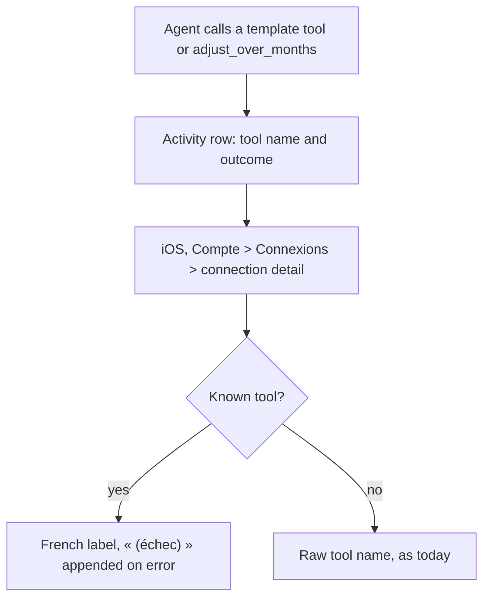
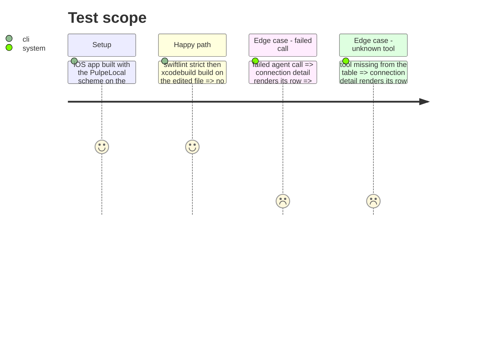

# Instruction: iOS activity labels for the six new write tools

## Architecture projection

> Tree of the final files. ✅ create · ✏️ modify · ❌ delete

```txt
ios/Pulpe/Features/Account/Connections/
└── ConnectionDetailView.swift      ✏️ label(for:) reads a static tool → label table instead of a switch
```

## User Journey



## Test Scope



## Tasks to do

### `1)` Label table

> CA16, iOS side. Same pattern as `add_movement`: French keys through `AppLocale.string`, no catalog entry (the Connections screen has none today). A switch with eleven cases would exceed SwiftLint's `cyclomatic_complexity` warning of 10, and lint runs `--strict`.

1. In `ConnectionDetailView`, add `private static let toolLabels: [String: String.LocalizationValue]` holding, in this order, `add_movement` « Mouvement ajouté », PUL-359's four entries (`create_tag`, `rename_tag`, `delete_tag`, `tag_items`, moved from the switch unchanged), then:
   - `create_template` « Modèle créé »
   - `update_template` « Modèle modifié »
   - `delete_template` « Modèle supprimé »
   - `duplicate_template` « Modèle dupliqué »
   - `edit_template_lines` « Prévisions du modèle modifiées »
   - `adjust_over_months` « Ajusté sur plusieurs mois »
2. `label(for:)`: `let name = toolLabels[entry.tool].map { AppLocale.string($0) } ?? entry.tool`; keep the existing `(échec)` line and the doc comment.

### `2)` Validate

1. `cd ios && swiftlint lint --strict Pulpe/Features/Account/Connections/ConnectionDetailView.swift`
2. `cd ios && xcodebuild build -scheme PulpeLocal -destination 'platform=iOS Simulator,name=Pulpe Tests' CODE_SIGNING_ALLOWED=NO`

## Test acceptance criteria

| Task | Acceptance criteria |
| ---- | ------------------- |
| 1 | The connection detail shows the French label for each of the six new tools, `add_movement` and PUL-359's tag tools; an error row appends « (échec) »; an unknown tool still shows its raw name. |
| 2 | `swiftlint --strict` reports no violation on the file and the PulpeLocal build succeeds. |
