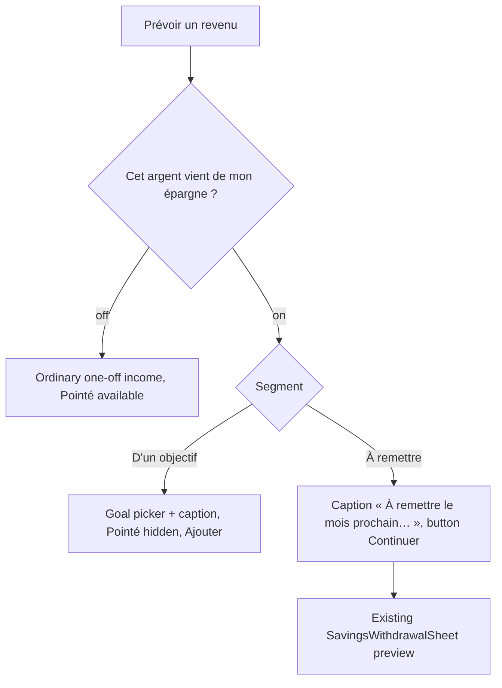
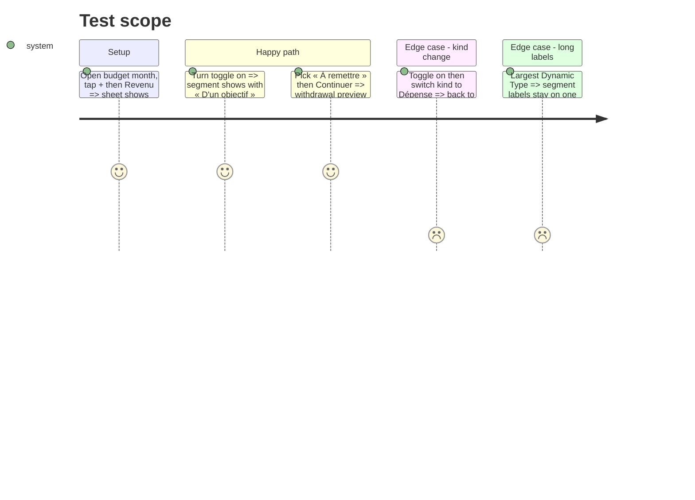

# Instruction: iOS prévision sheet, toggle + segment

## Architecture projection

> Tree of the final files. ✅ create · ✏️ modify · ❌ delete

```txt
ios/
├── Pulpe/
│   ├── Features/Budgets/BudgetDetails/
│   │   ├── AddBudgetLineSheet.swift                       ✏️ originPicker → savingsOriginSection
│   │   └── AddBudgetLineSheet+IncomeOrigin.swift          ✏️ toggle + SegmentedPicker; 2-case segment enum; labels
│   └── Resources/Localizable.xcstrings                    ✏️ add « Cet argent vient de mon épargne », « D'un objectif », « À remettre »; drop « Origine », « Origine du revenu », « Revenu habituel », « Pris sur mon épargne, à remettre le mois prochain »
└── PulpeTests/Features/Budgets/BudgetDetails/
    └── AddBudgetLineIncomeOriginTests.swift               ✏️ cover toggle ↔ origin mapping
```

## User Journey



## Test Scope



## Wireframe

```txt
┌──────────────────────────────────────────┐
│ (1) Kind toggle · amount · chips         │
├──────────────────────────────────────────┤
│ (2) Description                          │
├──────────────────────────────────────────┤
│ (3) Pointé                    [ toggle ] │
│ (4) Cet argent vient de mon   [ toggle ] │
│     épargne                              │
│ (5) [ D'un objectif | À remettre ]       │
│ (6) caption for the selected segment     │
│ (7) goal picker (objectif only)          │
├──────────────────────────────────────────┤
│ (8) Primary button                       │
└──────────────────────────────────────────┘
```

1. Unchanged header of the sheet.
2. Unchanged description row.
3. Pointé, hidden whenever (4) is on.
4. Savings toggle, income only, off by default.
5. Two-option segment, shown only when (4) is on.
6. Caption explaining the selected option.
7. Goal picker, only for « D'un objectif ».
8. « Ajouter », or « Continuer » for « À remettre ».

## Tasks to do

### `1)` Replace the menu with toggle + segment

> The prévision sheet asks the new question; the clipped menu is gone.

1. In `+IncomeOrigin.swift`, add a 2-case `SavingsOrigin` (`goal`, `repay`) with labels « D'un objectif » / « À remettre » and a mapping to/from `IncomeOrigin`.
2. Replace `originPicker` with a `Toggle("Cet argent vient de mon épargne")` bound to `incomeOrigin != .regular` (on → `.savingsGoal`, off → `.regular`), then `SegmentedPicker` bound to the `SavingsOrigin` view of `incomeOrigin`, plus the caption per option (« À remettre le mois prochain : je te le rappellerai. » reuses the existing string).
3. Delete `IncomeOrigin.label`.
4. Keep `isSavingsWithdrawal`, `isPlannedWithdrawal`, `forbidsChecked`, `resetIncompatibleOriginState` untouched.
5. Update the xcstrings keys (fr, en, de, it) listed in the projection.
6. Keep `AddBudgetLineSheet.swift` ≤ 350 LOC (`BudgetDetailsArchitectureTests`).

### `2)` Tests

> The mapping between the controls and the origin is pinned.

1. Add tests: toggle off ⇔ `.regular`; toggle on defaults to `.savingsGoal`; segment `repay` ⇔ `.repayNextMonth`.
2. Existing `AddBudgetLineIncomeOriginTests` stay green unchanged.

## Test acceptance criteria

| Task | Acceptance criteria |
| ---- | ------------------- |
| 1 | Creating a Revenu shows « Cet argent vient de mon épargne » off; « Origine » and « Revenu habituel » appear nowhere |
| 1 | Turning it on shows « D'un objectif » / « À remettre » on one line each, with « D'un objectif » selected and the goal picker visible |
| 1 | « À remettre » + Continuer opens the existing withdrawal preview with the amount and description prefilled |
| 1 | Pointé is hidden whenever the toggle is on |
| 2 | `xcodebuild test` on `PulpeTests/AddBudgetLineIncomeOriginTests` executes the new tests and passes |
