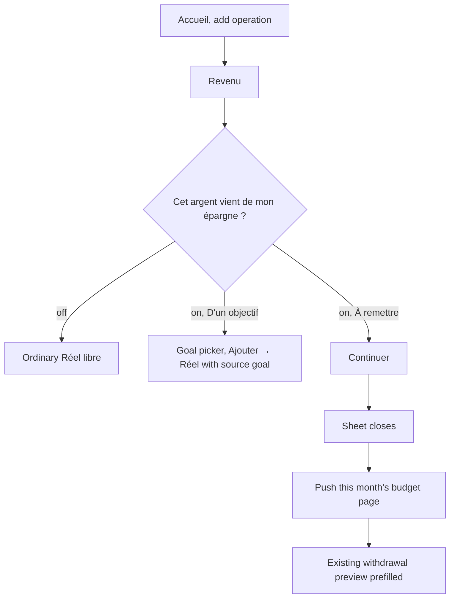

# Instruction: iOS mouvement sheet, toggle + segment + routing

## Architecture projection

> Tree of the final files. ✅ create · ✏️ modify · ❌ delete

```txt
ios/
├── Pulpe/
│   ├── Features/CurrentMonth/
│   │   ├── CurrentMonthView.swift                              ✏️ hold the pending « À remettre » intent, act on it in the add sheet's onDismiss
│   │   └── Components/
│   │       ├── AddTransactionSheet.swift                       ✏️ toggle + segment state; « Continuer » path emits the intent
│   │       └── AddTransactionSheet+SavingsOrigin.swift         ✅ the origin section, split out to stay under the 500-line SwiftLint warning
│   └── Resources/Localizable.xcstrings                         ✏️ drop « Ce revenu vient d'un objectif d'épargne »
└── PulpeTests/Features/CurrentMonth/
    └── AddTransactionSheetTests.swift                          ✏️ SavingsGoalOrigin with the segment
```

## User Journey



## Test Scope

```mermaid
---
title: Test scope
---
journey
  section Setup
    Current month budget loaded on Accueil => add operation available: 5: system
  section Happy path
    Revenu, toggle on, « À remettre », Continuer => budget page of the month opens with withdrawal preview prefilled: 5: system
    Confirm the preview => Revenu M appears on the budget page; Accueil shows the new balance on return: 5: system
  section Edge case - widget deep link
    Add from the widget, pick Revenu, toggle on => only « D'un objectif » path is offered, no « À remettre »: 1: system
  section Edge case - goal path unchanged
    Toggle on, « D'un objectif », pick goal, Ajouter => Réel created with source goal as today: 1: system
```

## Wireframe

```txt
┌──────────────────────────────────────────┐
│ (1) Kind toggle · amount · chips         │
├──────────────────────────────────────────┤
│ (2) Description · Tags                   │
├──────────────────────────────────────────┤
│ (3) Date · Pointé                        │
│ (4) Cet argent vient de mon   [ toggle ] │
│     épargne                              │
│ (5) [ D'un objectif | À remettre ]       │
│ (6) caption · goal picker (objectif)     │
├──────────────────────────────────────────┤
│ (7) Ajouter / Continuer                  │
└──────────────────────────────────────────┘
```

1. Unchanged header.
2. Unchanged description and tags.
3. Date unchanged; Pointé hidden when « À remettre » is selected.
4. Savings toggle, income only.
5. Segment, only when (4) is on and the presenter can route.
6. Caption and goal picker as today for « D'un objectif ».
7. « Continuer » for « À remettre ».

## Tasks to do

### `1)` Toggle + segment in the mouvement sheet

> Same question, same controls as the prévision sheet.

1. Rename the toggle copy to « Cet argent vient de mon épargne »; add the `SegmentedPicker` « D'un objectif » / « À remettre » below it.
2. Extend `SavingsGoalOrigin` with the selected segment: « À remettre » never blocks on the goal and sends no `sourceSavingsGoalId`.
3. Move the origin section to `AddTransactionSheet+SavingsOrigin.swift`.
4. Add an optional `onRequestSavingsWithdrawal: ((amount, name, currency) -> Void)?` init parameter; when nil (widget deep link), hide the segment and keep the goal-only behavior.

### `2)` Route « À remettre » to the budget page

> From the accueil, the existing withdrawal sheet opens with the typed values.

1. In `CurrentMonthView`, pass the closure; it stores the intent and dismisses the add sheet.
2. In the add sheet's `onDismiss`, push the month's `BudgetDestination` via the injected `BudgetDetailsRouter`, then present `.savingsWithdrawal(prefill)` with `budgetId`, `month`, `year` from `store.budget`, `missingAmount` from the month's remaining when negative, `startsAtPreview: true`.
3. Verify the sheet only presents once `BudgetDetailsView` is on screen (its `.sheet(item: $router.sheet)` is the host); if the router does not support push-then-present, add the smallest router entry that does.

### `3)` Tests

1. `AddTransactionSheetTests`: « À remettre » neither blocks nor sends a goal id; the goal path is unchanged.
2. `MainTabViewLayoutTests` stays green.

## Test acceptance criteria

| Task | Acceptance criteria |
| ---- | ------------------- |
| 1 | On the accueil, a Revenu shows « Cet argent vient de mon épargne » with the same segment as the prévision sheet |
| 1 | From the widget, the toggle shows no segment and behaves as the goal toggle does today |
| 2 | « À remettre » + Continuer opens this month's budget page with the withdrawal preview prefilled (amount, description) |
| 2 | Confirming creates Revenu M + Épargne M+1, and the accueil balance reflects it on return |
| 3 | `AddTransactionSheetTests` executes the new cases and passes |
