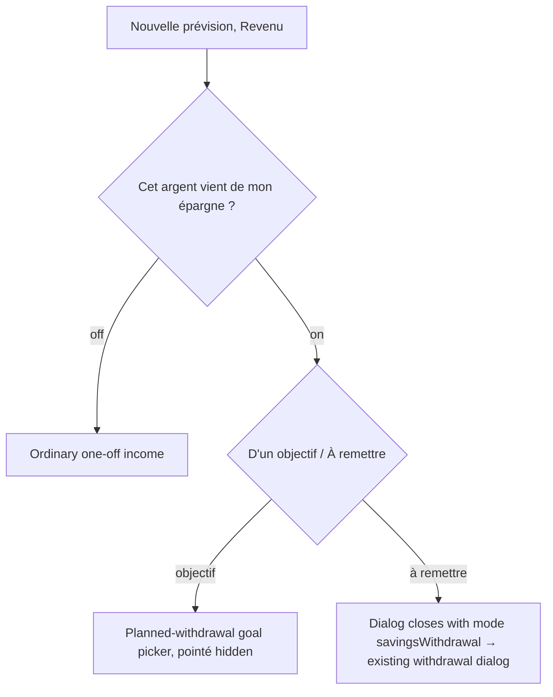
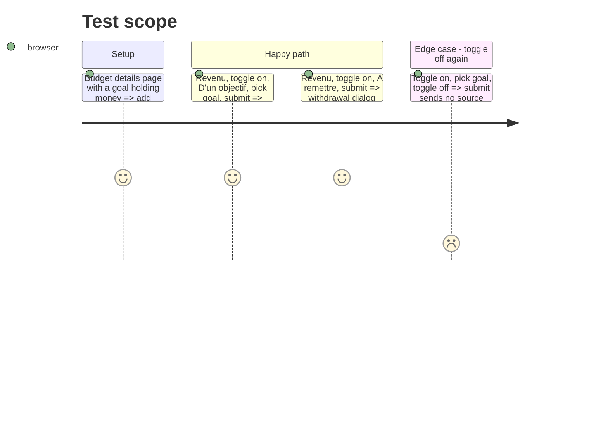

# Instruction: Webapp prévision dialog, toggle + segment

## Architecture projection

> Tree of the final files. ✅ create · ✏️ modify · ❌ delete

```txt
frontend/
├── projects/webapp/
│   ├── src/app/feature/budget/budget-details/budget-line/create/
│   │   ├── dialog.ts                 ✏️ mat-select → mat-slide-toggle + mat-button-toggle-group
│   │   └── dialog.spec.ts            ✏️ income origin describe drives the new controls
│   └── public/i18n/{fr,en,de,it}.json ✏️ budget.incomeOrigin: fromSavings, savingsGoal, repayNextMonth, hints; drop label, regular
└── e2e/pages/budget-details.page.ts  ✏️ openPlannedWithdrawalForm uses the toggle + segment testids
```

## User Journey



## Test Scope



## Wireframe

```txt
┌──────────────────────────────────────────┐
│ (1) Kind · amount · name                 │
├──────────────────────────────────────────┤
│ (2) Cet argent vient de mon épargne  [o] │
│ (3) [ D'un objectif | À remettre ]       │
│ (4) hint · goal picker (objectif only)   │
├──────────────────────────────────────────┤
│ (5) Pointé (hidden when (2) is on)       │
│ (6) Actions                              │
└──────────────────────────────────────────┘
```

1. Unchanged header fields.
2. Slide toggle, income only.
3. Button-toggle group, shown when (2) is on.
4. Hint per option; planned-withdrawal goal picker for « D'un objectif ».
5. Pointé, hidden in both savings modes.
6. Unchanged actions.

## Tasks to do

### `1)` Controls

> Same question as iOS, built from the dialog's existing Material pieces.

1. Replace the `mat-select` (`new-line-income-origin`) with a `mat-slide-toggle` (`new-line-from-savings-toggle`) and a `mat-button-toggle-group` (`new-line-savings-origin`, options `savingsGoal` / `repayNextMonth`), same markup as `spread-mode-toggle`.
2. Keep `#incomeOrigin` and `setIncomeOrigin`; the toggle calls `setIncomeOrigin(checked ? 'savingsGoal' : 'regular')`.
3. Hide pointé for `repayNextMonth` too (today only `savingsGoal`), matching iOS `forbidsChecked`.

### `2)` Copy

1. fr: `fromSavings` « Cet argent vient de mon épargne », `savingsGoal` « D'un objectif », `repayNextMonth` « À remettre », `repayNextMonthHint` « À remettre le mois prochain : je te le rappellerai. ». en, de, it equivalents; never « avance » nor « emprunt ».
2. Remove `budget.incomeOrigin.label` and `.regular` from the four catalogs.

### `3)` Tests

1. `dialog.spec.ts` « income origin (PUL-329 v2) »: same assertions, driven through the new controls; add « toggle off drops the goal ».
2. `budget-details.page.ts` `openPlannedWithdrawalForm()` clicks the toggle then the `savingsGoal` button.

## Test acceptance criteria

| Task | Acceptance criteria |
| ---- | ------------------- |
| 1 | A Revenu shows « Cet argent vient de mon épargne », off; « Revenu habituel » appears nowhere |
| 1 | « À remettre » + submit opens the existing withdrawal dialog prefilled |
| 1 | Pointé is hidden in both savings modes |
| 2 | `pnpm test:lexicon` and the i18n parity checks pass |
| 3 | The dialog spec and `savings-goal-withdrawals.spec.ts` « Announcing a withdrawal, then realizing it » pass |
