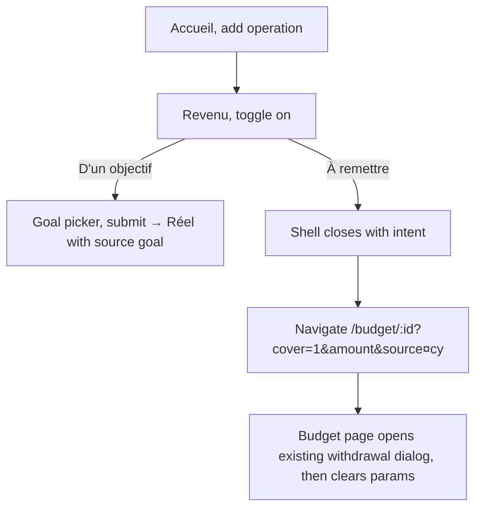
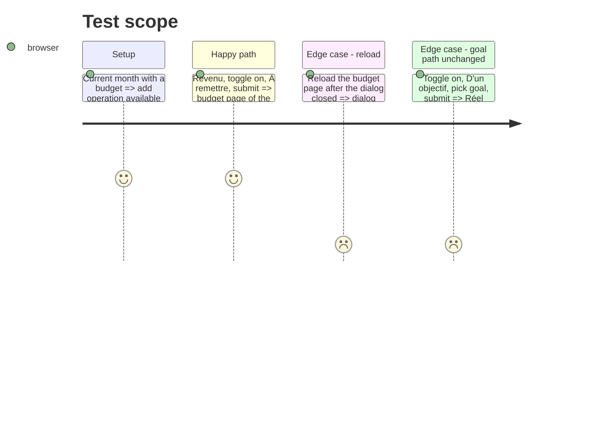

# Instruction: Webapp add-transaction form, toggle + routing

## Architecture projection

> Tree of the final files. ✅ create · ✏️ modify · ❌ delete

```txt
frontend/
├── projects/webapp/
│   ├── src/app/feature/
│   │   ├── current-month/
│   │   │   ├── components/add-transaction-form.ts           ✏️ segment under the toggle; « À remettre » emits a withdrawal intent
│   │   │   ├── components/add-transaction-form.spec.ts      ✏️ savings source describe
│   │   │   ├── components/add-transaction-shell-data.ts     ✏️ shell result can carry the withdrawal intent
│   │   │   ├── components/add-transaction-{dialog,bottom-sheet}.ts ✏️ close with the intent
│   │   │   └── current-month.ts                             ✏️ on intent, navigate to the budget page with query params
│   │   └── budget/budget-details/budget-details-page.ts      ✏️ read the query params once, open the withdrawal dialog, clear them
│   └── public/i18n/{fr,en,de,it}.json                        ✏️ reuse budget.incomeOrigin.*; drop currentMonth.addTransactionFromSavingsGoal
└── e2e/pages/current-month.page.ts                           ✏️ enableSavingsGoalSource picks the segment
```

## User Journey



## Test Scope



## Wireframe

```txt
┌──────────────────────────────────────────┐
│ (1) Kind · amount · name · date          │
├──────────────────────────────────────────┤
│ (2) Cet argent vient de mon épargne  [o] │
│ (3) [ D'un objectif | À remettre ]       │
│ (4) hint · goal picker (objectif only)   │
├──────────────────────────────────────────┤
│ (5) Ajouter / Continuer                  │
└──────────────────────────────────────────┘
```

1. Unchanged fields.
2. Existing toggle (`transaction-savings-source-toggle`) with the new label.
3. Button-toggle group (`transaction-savings-origin`).
4. Existing hint and goal picker for « D'un objectif ».
5. Submit label switches to « Continuer » for « À remettre ».

## Tasks to do

### `1)` Form

1. Add `MatButtonToggleModule` and the segment; default `savingsGoal` when the toggle turns on.
2. « À remettre »: `canSubmit` ignores the goal picker; submit emits a withdrawal intent `{ amount, source, inputCurrency }` instead of `created`.
3. Labels from `budget.incomeOrigin.*` (phase 3); delete `currentMonth.addTransactionFromSavingsGoal`.

### `2)` Routing

1. Shells close with `{ kind: 'savingsWithdrawal', prefill }`; `current-month.ts` navigates to the month's budget page with `cover=1` and the prefill as query params (amount and currency only, no label: the description goes through router state, not the URL).
2. `budget-details-page.ts` reads the intent once on load, calls the existing `#openSavingsWithdrawalFlow(prefill)`, then replaces the URL without the params.

### `3)` Tests

1. Form spec: « À remettre » emits the intent and never `created`; goal path unchanged.
2. Budget details page spec: the intent opens the dialog once.
3. e2e page object `enableSavingsGoalSource()` clicks the toggle then `savingsGoal`.

## Test acceptance criteria

| Task | Acceptance criteria |
| ---- | ------------------- |
| 1 | On the accueil a Revenu shows the same toggle + segment as the prévision dialog |
| 2 | « À remettre » + Continuer lands on the month's budget page with the withdrawal dialog prefilled |
| 2 | A reload of that page does not reopen the dialog |
| 3 | Form and page specs pass; `savings-goal-withdrawals.spec.ts` « Savings goal as the source of an income » passes |
