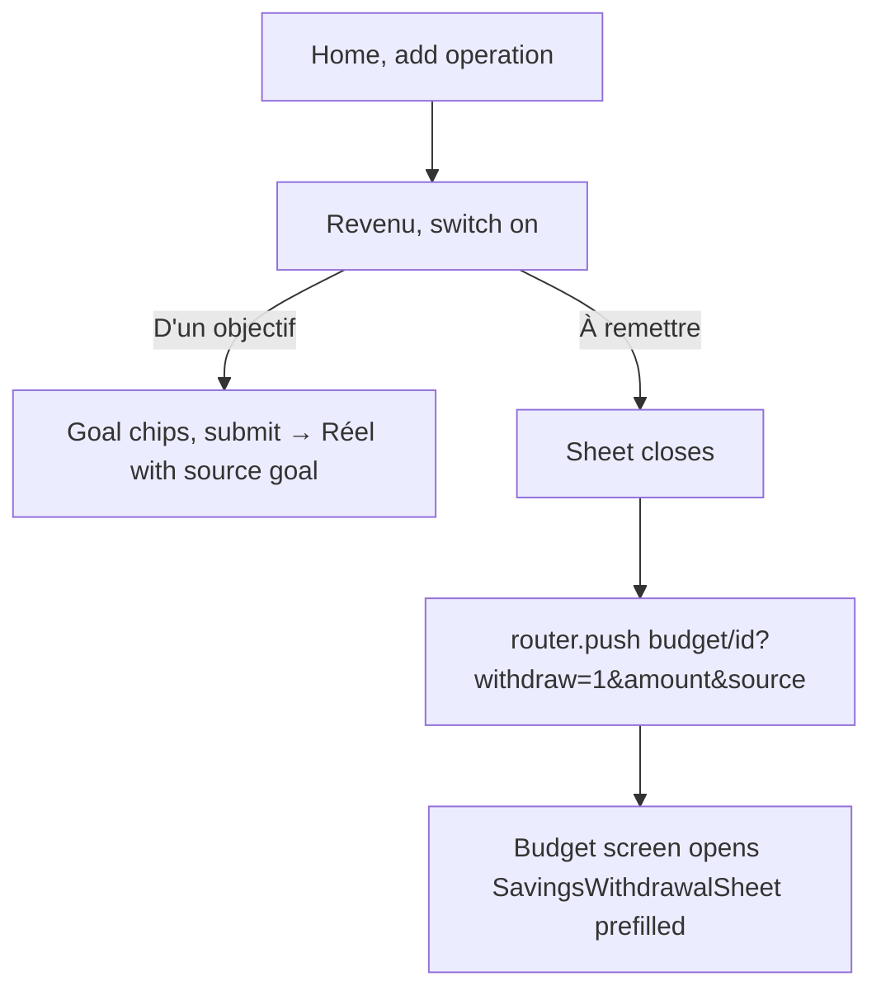
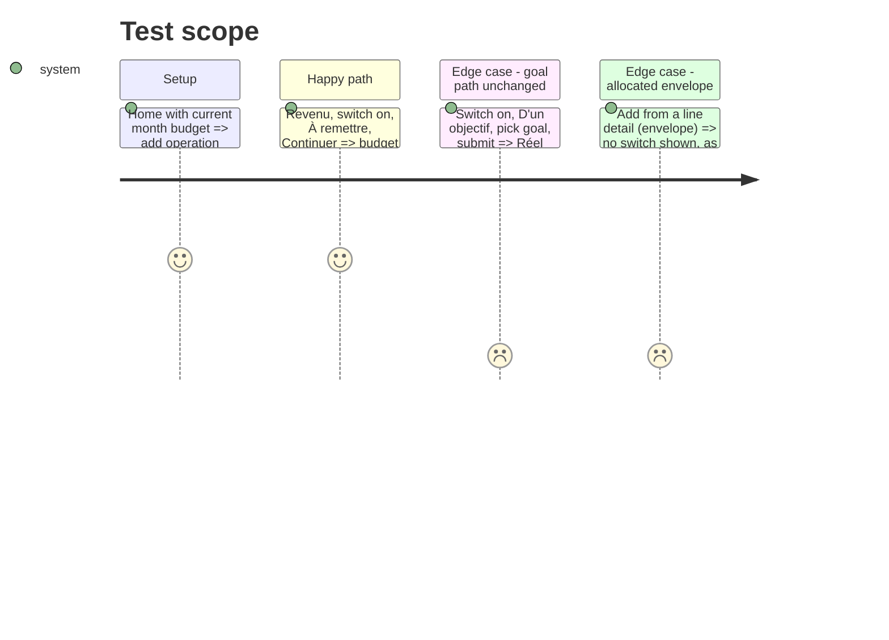

# Instruction: Android transaction sheet, toggle + routing

## Architecture projection

> Tree of the final files. ✅ create · ✏️ modify · ❌ delete

```txt
android/src/
├── features/transactions/components/
│   ├── transaction-sheet.tsx            ✏️ SegmentedButtons under the switch; « À remettre » calls onRequestWithdrawal
│   └── transaction-sheet.spec.tsx       ✏️ origin tests drive switch + segment
├── app/(main)/(tabs)/home.tsx           ✏️ pass onRequestWithdrawal → router.push budget/[id] with withdraw params
├── app/(main)/budget/[id].tsx           ✏️ read withdraw params once, call overlays.showWithdrawal(prefill)
├── features/budget-details/components/budget-detail-overlays.tsx ✏️ showWithdrawal accepts a prefill; pass onRequestWithdrawal to its own TransactionSheet
├── features/budget-details/savings-withdrawal/components/savings-withdrawal-sheet.tsx ✏️ accept an optional prefill (amount, source)
└── core/i18n/catalogs/{fr,en,de,it}.json ✏️ originTitle « Cet argent vient de mon épargne »; segment labels; repay hint
```

## User Journey



## Test Scope



## Tasks to do

### `1)` Sheet

1. Under the origin `Switch`, add `SegmentedButtons` (`goal` / `repay`), modelled on `spread-form-section.tsx:67-74`; default `goal`.
2. « À remettre »: `originProblemOf` returns no problem; submit calls `onRequestWithdrawal({ amount, source })` and closes; no `sourceSavingsGoalId` sent.
3. When `onRequestWithdrawal` is undefined, hide the segment (goal-only, as today).
4. Copy in the four catalogs; never « avance » nor « emprunt ».

### `2)` Routing

1. Home passes `onRequestWithdrawal` → `router.push` to `budget/[id]` with `withdraw=1`, `amount`, `source`.
2. `budget/[id].tsx` consumes the params once and calls `overlays.current?.showWithdrawal(prefill)`, then clears them with `router.setParams`.
3. On the budget screen itself, `BudgetDetailOverlays` passes `onRequestWithdrawal` straight to `showWithdrawal`.
4. `SavingsWithdrawalSheet` seeds amount and source from the prefill.

### `3)` Tests

1. `transaction-sheet.spec.tsx`: « À remettre » calls `onRequestWithdrawal` and never submits; existing origin tests updated for the new labels.
2. `budget-detail-overlays.spec.tsx`: `showWithdrawal(prefill)` forwards the prefill.

## Test acceptance criteria

| Task | Acceptance criteria |
| ---- | ------------------- |
| 1 | A new Revenu on Home shows « Cet argent vient de mon épargne » and, when on, « D'un objectif » / « À remettre » |
| 2 | « À remettre » lands on the month's budget screen with the withdrawal sheet prefilled |
| 2 | Leaving and re-entering the budget screen does not reopen the sheet |
| 3 | `cd android && pnpm test` passes the updated specs |
