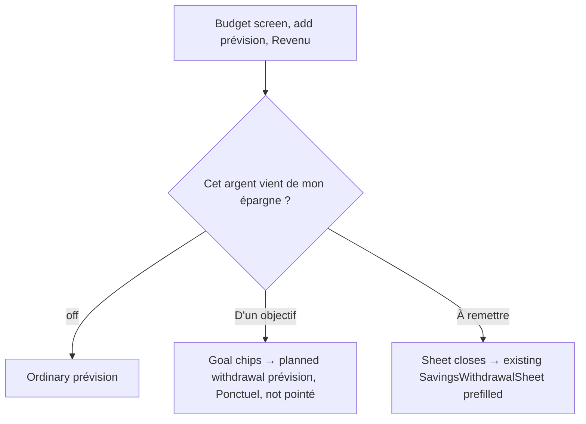
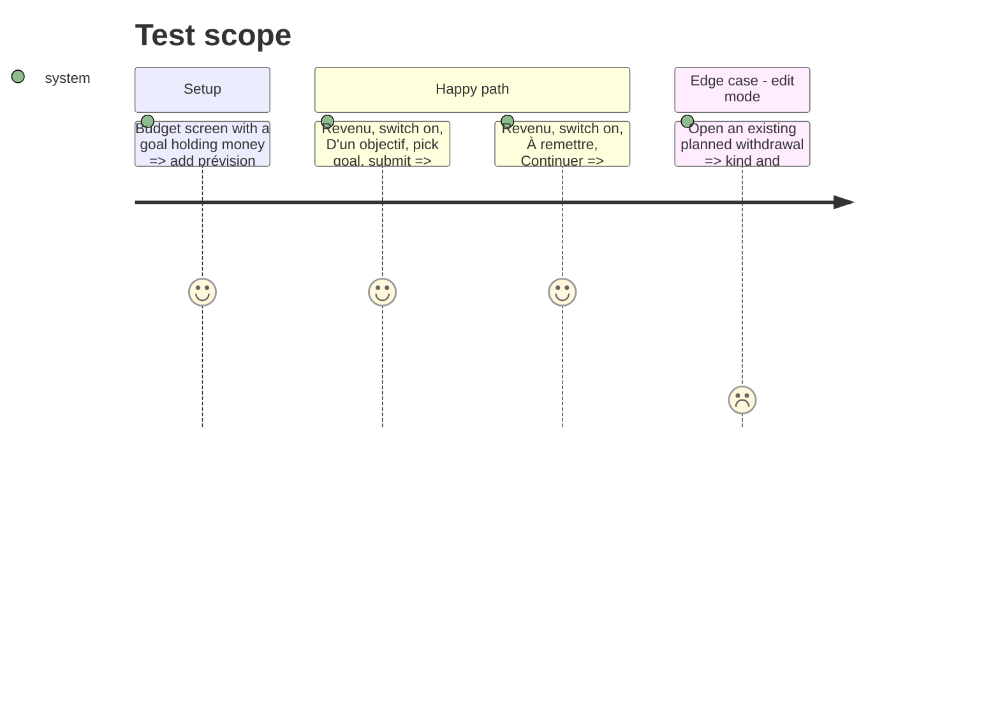

# Instruction: Android prévision sheet gains the income origin

## Architecture projection

> Tree of the final files. ✅ create · ✏️ modify · ❌ delete

```txt
android/src/
├── features/budget-details/
│   ├── budget-line-draft.ts                       ✏️ sourceSavingsGoalId in draft + payload (income, create only)
│   ├── components/budget-line-sheet.tsx           ✏️ switch + segment for a new income; goal chips; pointé gating; « À remettre » → onRequestWithdrawal
│   ├── components/budget-line-sheet.spec.tsx      ✏️ origin cases
│   └── components/budget-detail-overlays.tsx      ✏️ pass onRequestWithdrawal → showWithdrawal(prefill)
├── features/savings-goals/goals-queries.ts        ✏️ only if planned-withdrawal options differ from withdrawal options
└── core/i18n/catalogs/{fr,en,de,it}.json          ✏️ reuse phase 5 keys
```

## User Journey



## Test Scope



## Tasks to do

### `1)` Draft and payload

1. Add `sourceSavingsGoalId` to the draft; send it only for a new income in « D'un objectif »; force recurrence `one_off` and no pointé, matching iOS `+Submit.swift`.
2. Confirm with `shared/schemas.ts` that the budget-line create schema already accepts `sourceSavingsGoalId` (it does for iOS and web; no backend change expected).

### `2)` Sheet

1. Same switch + `SegmentedButtons` as phase 5, shown for a new income only.
2. « D'un objectif »: goal chips in planned-withdrawal mode (check the web `mode="plannedWithdrawal"` rule against `/savings-goals/withdrawal-options` before reusing the hook).
3. « À remettre »: submit calls `onRequestWithdrawal`, as in phase 5.
4. Keep `disabled: isPlannedWithdrawal` exactly twice (`phase7-actions-i18n.spec.ts`).

### `3)` Tests

1. `budget-line-sheet.spec.tsx`: goal path sends the source and `one_off`; « À remettre » routes; edit mode unchanged.

## Test acceptance criteria

| Task | Acceptance criteria |
| ---- | ------------------- |
| 1 | A planned withdrawal created on Android shows on iOS/web as a planned withdrawal of that goal |
| 2 | The prévision and transaction sheets on Android ask the same question with the same labels |
| 3 | `cd android && pnpm test` passes, including `phase7-actions-i18n.spec.ts` |
